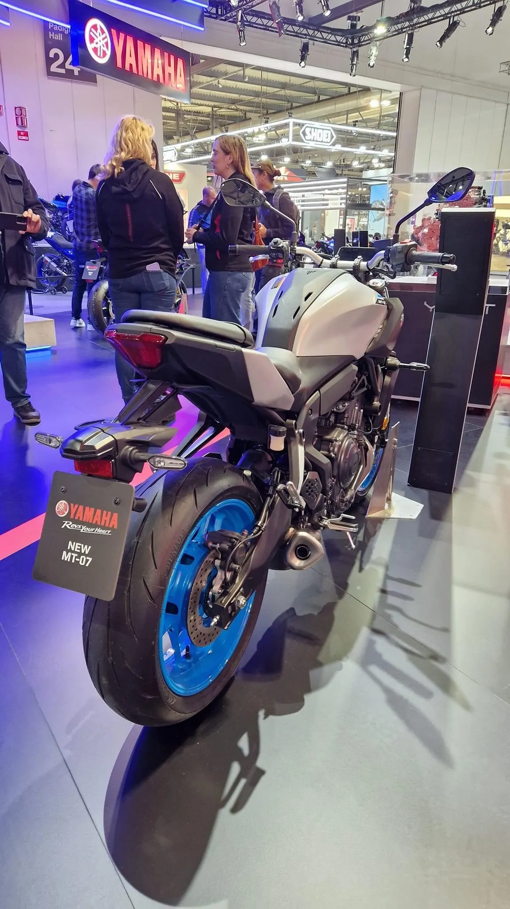
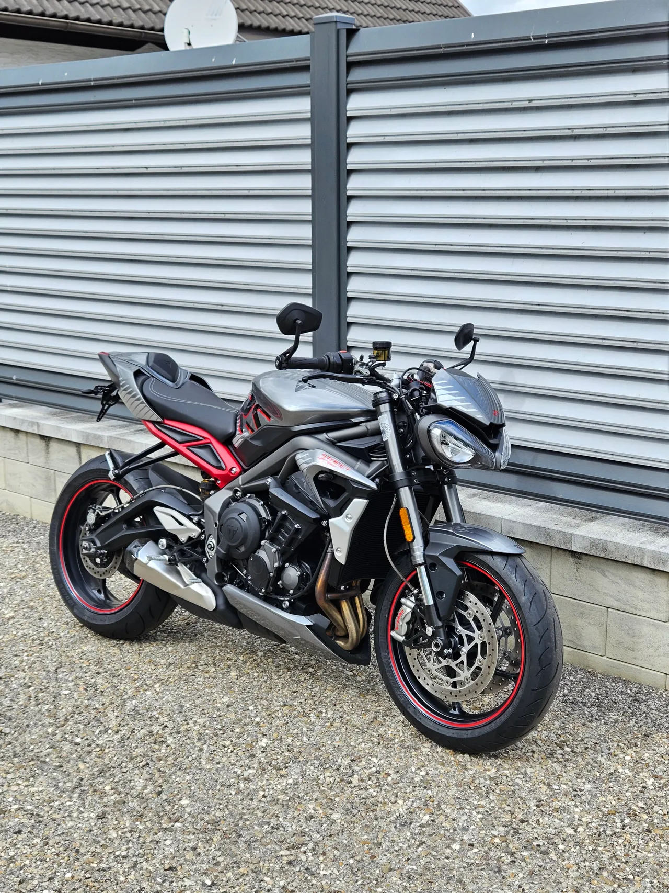
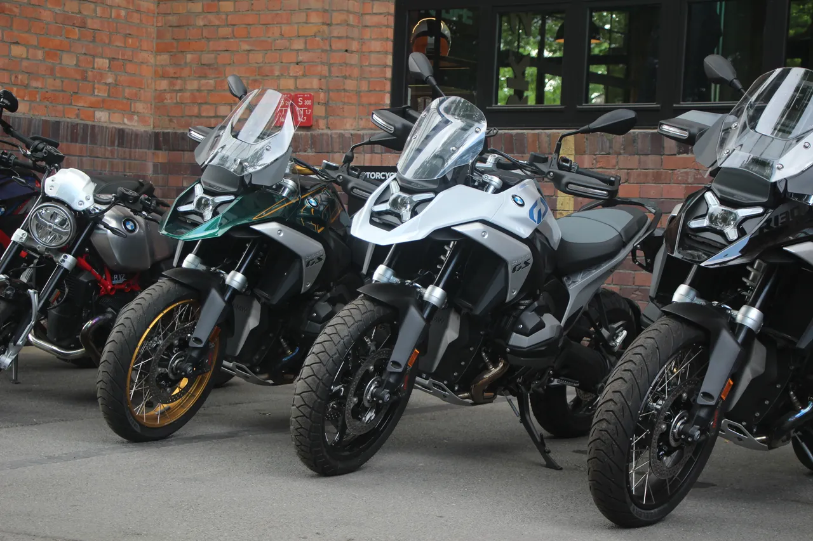
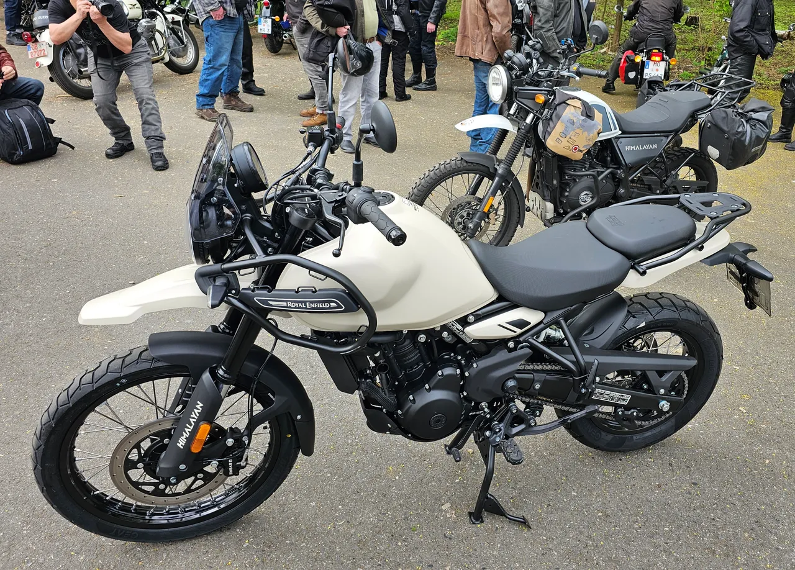
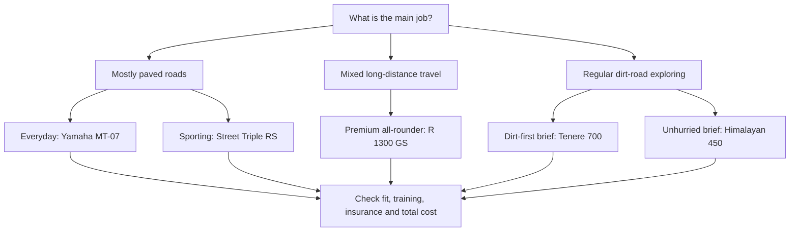

The best motorcycle of 2026 is not necessarily the fastest one. It is the one you still
want to take out on an ordinary Tuesday, after the insurance quote arrives and the
novelty of the spec sheet wears off.

My shortlist starts there: **five bikes worth considering in 2026, each for a different
kind of rider.** The Yamaha MT-07 is the everyday pick; the Triumph Street Triple 765 RS
is the sporting one. The BMW R 1300 GS suits a bigger all-round brief, while the Yamaha
Tenere 700 and Royal Enfield Himalayan 450 approach adventure riding from different
directions.

**Research log, 16 October 2026:** this is an editorial buying guide based on the
manufacturer information linked below, not a hands-on group test, an industry award
or a claim to have ridden these motorcycles. "Of 2026" means a shortlist for shopping
this year, not that every bike was newly launched this year. Model years, equipment
and availability vary by country. Some live manufacturer pages already show the next
model year; confirm the exact specification on the bike you are buying.

The downloaded photographs are openly licensed illustrations. They are **not proof
of a 2026 model's appearance or equipment**; their captions identify earlier bikes
where known. Full attribution and licence links are at the end.

## In this log

- [The shortlist at a glance](#the-shortlist-at-a-glance)
- [How I chose the five](#how-i-chose-the-five)
- [Yamaha MT-07: the everyday pick](#yamaha-mt-07-the-everyday-pick)
- [Triumph Street Triple 765 RS: the sporting pick](#triumph-street-triple-765-rs-the-sporting-pick)
- [BMW R 1300 GS: the big all-rounder](#bmw-r-1300-gs-the-big-all-rounder)
- [Yamaha Tenere 700: the dirt-first adventure pick](#yamaha-tenere-700-the-dirt-first-adventure-pick)
- [Royal Enfield Himalayan 450: the unhurried adventure pick](#royal-enfield-himalayan-450-the-unhurried-adventure-pick)
- [Which one belongs in your garage?](#which-one-belongs-in-your-garage)
- [The before-you-buy checklist](#the-before-you-buy-checklist)
- [Frequently asked questions](#frequently-asked-questions)
- [Sources and photo credits](#sources-and-photo-credits)

## The shortlist at a glance

These are category picks, not a ranking from first to fifth. The engine sizes help
identify the bikes; they are not a score for how much fun each will be.

| Motorcycle | Engine layout and capacity | My pick for | The trade-off to investigate |
| --- | --- | --- | --- |
| Yamaha MT-07 | 689 cc parallel twin | Everyday road riding | Wind exposure and carrying luggage |
| Triumph Street Triple 765 RS | 765 cc inline triple | Sporty road riding and occasional track days | Comfort on your actual roads |
| BMW R 1300 GS | 1,300 cc flat twin | A premium, do-many-things travel bike | Size, options and total ownership cost |
| Yamaha Tenere 700 | 689 cc parallel twin | Adventure riding with a real dirt-road brief | Seat height and loaded low-speed handling |
| Royal Enfield Himalayan 450 | 452 cc single | Unhurried exploring | Loaded motorway performance and local support |

Engine details come from the manufacturer pages and specification sheet in
[Sources and photo credits](#sources-and-photo-credits). I have deliberately left out
cross-market prices and a horsepower leaderboard: taxes, trim levels and measurement
conventions make those comparisons less useful than they initially look.

## How I chose the five

A useful shortlist needs a reason to include each motorcycle, and a reason to walk
away from it. My criteria are:

1. **A clear job.** Commuting, sporty rides and remote travel are different problems.
2. **A credible compromise.** Every bike gives something up: comfort, cost, weight,
   weather protection or performance.
3. **Ownership beyond the launch video.** Dealer access, servicing, tyres, insurance
   and security belong in the decision.
4. **Fit before figures.** Reach to the ground, knee bend and confidence moving the
   bike around matter more than an impressive specification.

This is a deliberately narrow, road-and-adventure-leaning list. It is not a complete
survey of cruisers, electric motorcycles, scooters or dedicated race bikes. Nor is
it a first-bike recommendation list: a motorcycle can be excellent and still be the
wrong place to start.

## Yamaha MT-07: the everyday pick

The MT-07 earns its place by keeping the brief simple: a road-focused naked bike
with an upright riding position and a 689 cc CP2 twin. Yamaha's 2026 US page lists
41 mm inverted forks, radially mounted front brake calipers and SpinForged wheels.
Those are useful chassis details, rather than just a bigger number on the engine.

For everyday riding, the attraction is the middle ground. You get a bike built
around ordinary roads rather than a touring package you may never use or a
race-replica posture you may not enjoy in traffic. Of these five, it is my first
test-ride booking for someone whose riding is mostly solo, mostly paved and often
shorter than a full day.

**Why it makes the list:** a focused road-bike proposition without making every
journey an expedition.

**Why you might choose something else:** a naked bike leaves you exposed to wind.
If your real life includes long motorway stretches, a passenger and luggage, look
closely at whether adding accessories solves the problem or merely disguises the
need for a different motorcycle.

**On the test ride:** check throttle response at town speeds, wrist and knee
comfort, and how the bike feels on an uneven road. Confirm the transmission and
electronics fitted to the exact regional version; do not assume every MT-07
advertisement describes the same equipment.

## Triumph Street Triple 765 RS: the sporting pick

The Street Triple is the shortlist's answer to a very specific question: what if
the point of the ride is the ride itself? The 765 cc triple and the RS's
performance-focused chassis specification make it the sporting candidate here,
without requiring a fully faired superbike.

The important distinction is **sporty rather than automatically sensible**. Better
brakes and suspension are attractive, but they do not make riding position,
road surface or running costs disappear. I would put this ahead of the MT-07 on a
shopping list only if the sporting brief genuinely takes priority.

**Why it makes the list:** it gives the shortlist a dedicated performance-roadster
option, with scope for properly organised track days.

**Why you might choose something else:** the RS premium only makes sense if its
equipment matters to you. Compare the Street Triple R as well. A more expensive
version is not necessarily a better purchase for commuting on broken tarmac.

**On the test ride:** pay attention to suspension compliance, the reach to the bars
and heat in slow traffic. Get an insurance quote before treating the purchase
price as the whole budget. Any exploration of performance limits belongs on a
closed course with suitable instruction, not on public roads.

## BMW R 1300 GS: the big all-rounder

The GS is my premium do-many-things pick, not the automatic winner. BMW's technical
page specifies a 1,300 cc boxer twin, shaft drive, EVO Telelever front suspension
and EVO Paralever at the rear. The broader pitch is a motorcycle that can cover
daily roads and longer travel without changing its identity.

That flexibility is the appeal. If the garage has room for one bike and the
calendar includes commuting, weekends away and luggage-laden trips, the GS is a
reasonable place to begin the premium end of the search.

But buying versatility is different from needing it. A large travel bike still
has to fit through your gate, reverse out of your parking space and feel manageable
when the surface is awkward.

**Why it makes the list:** a broad travel brief backed by a distinctive chassis and
shaft-drive layout.

**Why you might choose something else:** options can substantially change both the
price and what the motorcycle does. BMW describes features such as adaptive
vehicle height control as optional; do not confuse a fully equipped demo with
the base bike on a quotation.

**On the test ride:** try slow turns, stopping on a slight slope and moving the bike
with the engine off. If you travel with a passenger, arrange a suitable test
together. Ask for an itemised, ride-away quote including luggage, suspension
options and anything you assumed was standard.

## Yamaha Tenere 700: the dirt-first adventure pick

The Tenere shares a 689 cc CP2 engine family with the MT-07, but it answers a
different question. Yamaha's 2026 page puts its adventure purpose up front,
including selectable ABS modes and long-travel suspension.

This is the bike I would investigate when unsurfaced roads are part of the plan,
not just something that appears in the promotional photography. That does not
mean it is a lightweight enduro or that a purchase replaces off-road training.
It means the compromises have been made with a different route in mind.

**Why it makes the list:** a clear adventure brief that separates it from a
road-first naked bike or a large, comfort-oriented travel purchase.

**Why you might choose something else:** a tall adventure bike can be demanding
when loaded, especially on uneven ground. If almost all your mileage is paved,
you may prefer a lower road bike with appropriate luggage.

**On the test ride:** check the standing position, reach to the controls and
confidence at walking pace. Confirm exactly how the ABS modes work on the bike
you are considering, and use road-appropriate settings on public roads. Budget
for training and suitable protective equipment before decorative accessories.

## Royal Enfield Himalayan 450: the unhurried adventure pick

The Himalayan is here because an adventure motorcycle does not have to chase
the largest engine. Royal Enfield's technical sheet specifies a 452 cc
liquid-cooled single, while its model page describes an adjustable two-piece
seat and an optional lower seat.

My reason to shortlist it is the unhurried brief: exploring back roads and
making the journey the point, rather than trying to reproduce the performance
of a much larger motorcycle. That is a buying philosophy, not a claim that a
smaller bike is always easier to handle.

**Why it makes the list:** it offers a different scale of adventure purchase from
the GS, and a useful counterweight to shopping by displacement alone.

**Why you might choose something else:** regular fast motorway journeys with a
passenger and luggage deserve a realistic assessment of performance and
comfort. Compare the complete local price, service access and warranty support
before calling any motorcycle a bargain.

**On the test ride:** check the seat in both relevant positions, low-speed
balance and vibration at your normal cruising speed. Ask which wheel and tyre
configuration your chosen version uses; do not infer tubeless capability from
the appearance of a spoked wheel.

## Which one belongs in your garage?

Start with the riding you actually do, rather than the trip you might take once.
This diagram is a route into the shortlist, not an automated verdict.

In words: start with the **MT-07** for everyday road riding or the **Street Triple
RS** when sporting use takes priority. Investigate the **GS** for a premium
mixed-travel brief. Compare the **Tenere** and **Himalayan** when exploring away
from the main road is central to the plan. Then let fit, local support and the
budget overrule the diagram.

## The before-you-buy checklist

- **Licence and experience:** check local licence restrictions and the precise
  version's eligibility. Do not assume an unrestricted motorcycle can simply
  be made compliant.
- **Physical fit:** sit on it in riding kit. Check control reach, knee bend,
  stopping confidence and manoeuvring with the engine off.
- **Actual route:** include town traffic, your normal cruising speed and a
  representative rough road in a safe, dealer-approved test.
- **Total cost:** add insurance, security, servicing, tyres, riding equipment,
  luggage and any finance charges to the ride-away price.
- **Local support:** ask about service appointments, parts availability and the
  warranty's terms, not just its headline duration.
- **Exact specification:** get the model year, trim, fitted options, wheel type
  and included accessories in writing.
- **Used alternatives:** compare an inspected, well-maintained used motorcycle
  before assuming that a new model is the best value.

## Frequently asked questions

### Which is the best all-round motorcycle here?

For a mostly paved, mostly solo routine, my starting point is the MT-07. For a
much broader travel brief and a larger budget, it is the GS. Those are different
definitions of "all-round"; neither answer replaces a test ride.

### Are any of these automatically a good first bike?

No. This list is organised by purpose, not beginner suitability. Training,
licensing, physical fit and experience come first. If you are new to riding,
compare lighter, lower-powered options with a qualified instructor rather than
treating this shortlist as a progression ladder.

### Why are there no exact prices or claimed top speeds?

Prices change with country, taxes, trim, dealer fees and promotions. Top speed
does little to explain whether a bike is pleasant on your commute. Obtain local
quotes for identically equipped motorcycles; spend more attention on comfort,
braking confidence, support and ownership costs.

### Should I wait for the next model year?

Only if a confirmed change matters to your use. Check official local information
and delivery dates rather than buying or delaying because of rumours. A
well-priced current bike with the right equipment may be the better answer.

## The takeaway

If I were building a test-ride calendar, the MT-07 would establish the everyday
baseline and the Street Triple RS would test how much I value the sporting
side. The GS, Tenere and Himalayan would then force an honest answer about what
"adventure" means in my actual riding plans.

That is the useful part of a best-of list: not declaring a universal champion,
but making the next decision clearer. **Choose the job, check the fit, price the
whole ownership experience, then choose the bike.**

## Sources and photo credits

### Manufacturer information

Checked for this log on **16 October 2026**. These are live pages, not archived
2026 specifications; regional details and the displayed model year can change.
Factual specifications above are manufacturer claims, while the category picks
and buying advice are editorial judgements.

1. [Yamaha MT-07, Yamaha Motor USA](https://www.yamahamotorsports.com/models/mt-07):
   2026 model description, 689 cc CP2 engine, forks, front brakes and wheels.
2. [Triumph Street Triple 765 range](https://www.triumphmotorcycles.co.uk/motorcycles/roadsters/street-triple-765)
   and [specifications](https://www.triumphmotorcycles.co.uk/motorcycles/roadsters/street-triple-765/specification):
   engine and R/RS positioning. Select the RS when comparing equipment.
3. [BMW R 1300 GS](https://www.bmwmotorcycles.com/en/models/adventure/r1300gs.html)
   and [technical data](https://www.bmwmotorcycles.com/en/models/adventure/r1300gs/technicaldata.html):
   engine, chassis, shaft drive and optional equipment. The US site may display
   a later model year; verify a 2026 bike against its own build specification.
4. [Yamaha Tenere 700, Yamaha Motor USA](https://www.yamahamotorsports.com/models/tenere-700):
   2026 model description, engine, suspension and selectable ABS.
5. [Royal Enfield Himalayan](https://www.royalenfield.com/uk/en/motorcycles/new-himalayan/)
   and [2026 technical specifications, PDF](https://www.royalenfield.com/content/dam/open-pdf/royal-enfield-himalayan-450-technical-specifications-english-2026.pdf):
   engine, seat and model configuration information.

### Photographs and reuse

All five photographs were downloaded from Wikimedia Commons, resized to at most
1,280 pixels wide and converted to WebP without intentional cropping. The
photographs retain their respective licences; they are not relicensed under
the site's code licence. No photographer or manufacturer endorsement is implied.

- **Yamaha MT-07:** AVMOTO,
  [Yamaha MT-07 2025](https://commons.wikimedia.org/wiki/File:Yamaha_MT-07_2025.jpg),
  [CC BY-SA 4.0](https://creativecommons.org/licenses/by-sa/4.0/).
  Local adaptation: `yamaha-mt-07.webp`.
- **Triumph Street Triple:** Darktiger0512,
  [Triumph Street Triple 765 RS (2022)](https://commons.wikimedia.org/wiki/File:Triumph_Street_Triple_765_RS_(2022).jpg),
  [CC BY 4.0](https://creativecommons.org/licenses/by/4.0/).
  Local adaptation: `triumph-street-triple.webp`.
- **BMW R 1300 GS:** Wikisympathisant,
  [3 BMW R1300GS 2024-06-07](https://commons.wikimedia.org/wiki/File:3_BMW_R1300GS_2024-06-07.jpg),
  [CC BY-SA 4.0](https://creativecommons.org/licenses/by-sa/4.0/).
  Local adaptation: `bmw-r-1300-gs.webp`.
- **Yamaha Tenere 700:** AVMOTO,
  [Yamaha Tenere 700 2025](https://commons.wikimedia.org/wiki/File:Yamaha_T%C3%A9n%C3%A9r%C3%A9_700_2025.jpg),
  [CC BY-SA 4.0](https://creativecommons.org/licenses/by-sa/4.0/).
  Local adaptation: `yamaha-tenere-700.webp`.
- **Royal Enfield Himalayan:** Rouv1505,
  [Royal-Enfield-Himalayan-450](https://commons.wikimedia.org/wiki/File:Royal-Enfield-Himalayan-450.jpg),
  [CC BY-SA 4.0](https://creativecommons.org/licenses/by-sa/4.0/).
  Local adaptation: `royal-enfield-himalayan.webp`.
