Five thousand pounds is a strange budget for a motorcycle. It won't buy much that is new,
and it is too much to spend on a 125 or an A2 starter bike. Spent on a used bike, though,
it buys a lot of motorcycle: a litre superbike, a big-boxer BMW tourer, a triple-engined
Triumph, or the bike that every magazine called the best of its class a few years ago.

So this log has one rule: **every bike has to be the best thing £5,000 can buy for its
job, and nothing under 650 cc made the list.** Most of the thirty-six are 700 cc and
bigger. Twelve categories, three bikes in each, all of them on sale on AutoTrader in
real numbers with a total price of £5,000 or less.

**Research log, 16 October 2026:** I have not ridden or inspected these bikes. The
picks are my editorial judgement, built on three things:

- **Prices** come from a national search of motorcycle listings on
  [AutoTrader UK](https://www.autotrader.co.uk/bikes) on 16 October 2026, filtered to a
  total price of £5,000 or less. For each model I give the number of listings, the
  **typical asking price** (the middle half of those listings, from the 25th to the
  75th percentile), the median, the range of years most listings fall in (10th to 90th
  percentile), and the median year and mileage. These are asking prices, not sold
  prices, and because the search stops at £5,000 they describe what *your* money buys,
  not what the model is worth in general. Listings change daily.
- **Reviews** are quoted as one line each from
  [MCN](https://www.motorcyclenews.com/bike-reviews/) (with its overall rating out of
  five) and Bennetts [BikeSocial](https://www.bennetts.co.uk/bikesocial/reviews/bikes),
  usually from their used-buying guides. Quotes are verbatim; each links to the page it
  came from, and the full list is at the end. Where a review covers a different model
  year from the bikes you'll find under £5,000, I say so.
- **Photos** are from [Wikimedia Commons](https://commons.wikimedia.org/), used under
  their Creative Commons licences and credited in every caption. Some show a later or
  earlier year of the same model; the caption says which.

You need a full category A licence for every bike here. Insurance on the superbikes and
hyperbikes can cost more each year than the bike loses in value, so get a quote before
you get attached.

## In this log

- [The £5,000 line-up at a glance](#the-5000-line-up-at-a-glance)
- [What £5,000 really buys in 2026](#what-5000-really-buys-in-2026)
- [Middleweight naked bikes](#middleweight-naked-bikes)
- [Big naked bikes](#big-naked-bikes)
- [Superbikes](#superbikes)
- [Middleweight sports bikes](#middleweight-sports-bikes)
- [Sports tourers](#sports-tourers)
- [Touring bikes](#touring-bikes)
- [Big adventure bikes](#big-adventure-bikes)
- [Middleweight adventure bikes](#middleweight-adventure-bikes)
- [Modern classics](#modern-classics)
- [Cruisers](#cruisers)
- [Practical all-rounders](#practical-all-rounders)
- [Hyperbikes and musclebikes](#hyperbikes-and-musclebikes)
- [If it were my £5,000](#if-it-were-my-5000)
- [Frequently asked questions](#frequently-asked-questions)
- [Sources and photo credits](#sources-and-photo-credits)

## The £5,000 line-up at a glance

Typical asking price is the middle half of AutoTrader listings at £5,000 or less on
16 October 2026. Ratings are MCN's overall review score for the generation linked in
each section.

| Category | Bike | Listings | Typical asking | Median year, miles | MCN |
| --- | --- | ---: | --- | --- | :---: |
| Middleweight naked | Yamaha MT-07 | 36 | £4,195–£4,989 | 2018, 14,100 | 5/5 |
| | Triumph Street Triple 675 | 64 | £3,600–£4,695 | 2013, 15,000 | 4/5 |
| | KTM 790 Duke | 31 | £4,195–£4,994 | 2020, 9,600 | 4/5 |
| Big naked | Yamaha MT-09 | 13 | £4,000–£4,999 | 2014, 18,500 | 4/5 |
| | BMW F 900 R | 6 | £4,495–£4,995 | 2020, 10,700 | 4/5 |
| | Triumph Speed Triple 1050 | 33 | £4,089–£4,988 | 2011, 17,400 | 5/5 |
| Superbike | Honda CBR1000RR Fireblade | 31 | £4,388–£4,989 | 2008, 23,600 | 4/5 |
| | Suzuki GSX-R1000 | 26 | £3,988–£4,899 | 2005, 25,100 | 5/5 |
| | Yamaha YZF-R1 | 37 | £3,800–£4,889 | 2002, 21,600 | 5/5 |
| Middleweight sports | Triumph Daytona 675 | 11 | £4,450–£4,999 | 2010, 22,500 | 5/5 |
| | Honda CBR600RR | 22 | £3,750–£4,795 | 2007, 23,800 | 4/5 |
| | Suzuki GSX-R750 | 25 | £3,795–£4,990 | 2008, 27,000 | 4/5 |
| Sports tourer | Kawasaki Z1000SX | 34 | £3,999–£4,995 | 2013, 23,400 | 4/5 |
| | Yamaha MT-09 Tracer / Tracer 900 | 20 | £4,489–£4,995 | 2015, 24,900 | 5/5 |
| | Triumph Sprint GT 1050 | 25 | £3,495–£3,999 | 2013, 16,700 | 4/5 |
| Touring | BMW R 1200 RT | 36 | £3,095–£3,995 | 2009, 36,000 | 5/5 |
| | Yamaha FJR1300 | 29 | £2,989–£4,495 | 2006, 34,200 | 5/5 |
| | Triumph Trophy 1200 | 16 | £3,995–£4,500 | 2014, 35,100 | 4/5 |
| Big adventure | BMW R 1200 GS | 30 | £3,495–£4,450 | 2007, 35,500 | 5/5 |
| | Triumph Tiger Explorer 1200 | 20 | £4,186–£4,950 | 2013, 31,100 | 5/5 |
| | Suzuki V-Strom 1000 | 31 | £2,995–£4,499 | 2014, 23,600 | 4/5 |
| Middleweight adventure | Triumph Tiger 800 | 72 | £3,849–£4,690 | 2014, 23,700 | 4/5 |
| | BMW F 800 GS | 10 | £4,295–£4,900 | 2014, 24,200 | 4/5 |
| | Suzuki V-Strom 650 | 49 | £3,295–£4,395 | 2017, 18,000 | 5/5 |
| Modern classic | Triumph Bonneville T100 | 31 | £4,250–£4,689 | 2012, 12,600 | 4/5 |
| | Ducati Scrambler 800 | 47 | £4,200–£4,795 | 2016, 7,100 | 4/5 |
| | Yamaha XSR700 | 29 | £4,200–£4,995 | 2019, 10,200 | 5/5 |
| Cruiser | Harley-Davidson Sportster 883 | 51 | £4,290–£4,900 | 2008, 13,000 | 4/5 |
| | Triumph Speedmaster 865 | 12 | £4,490–£4,695 | 2013, 13,100 | 4/5 |
| | Kawasaki Vulcan 900 | 12 | £4,195–£4,990 | 2012, 12,500 | 4/5 |
| Practical all-rounder | Honda NC750X | 47 | £3,995–£4,800 | 2019, 15,000 | 4/5 |
| | Kawasaki Versys 650 | 50 | £2,990–£4,295 | 2016, 14,400 | 4/5 |
| | Yamaha Tracer 700 | 20 | £4,190–£4,690 | 2018, 14,600 | 4/5 |
| Hyperbike and musclebike | Suzuki GSX1300R Hayabusa | 16 | £3,990–£4,499 | 2005, 28,000 | 4/5 |
| | Kawasaki ZZR1400 | 14 | £3,150–£4,690 | 2007, 30,800 | 5/5 |
| | Suzuki GSF1250 Bandit | 27 | £2,899–£3,895 | 2009, 21,500 | 4/5 |

## What £5,000 really buys in 2026

Three patterns stood out once the numbers were in.

1. **Middleweight twins hold their value; big fours and boxers don't.** A £5,000 MT-07 or
   XSR700 is typically a 2018–2019 bike with under 15,000 miles. The same money buys a
   2005 GSX-R1000, a 2007 R 1200 GS or a 2006 FJR1300 with 25,000 to 35,000 miles.
   Neither is wrong; you are choosing between a newer bike and a bigger one.
2. **High miles on a big tourer are not the warning sign they are on a sports bike.** An
   R 1200 RT or FJR1300 with 35,000 miles is barely run in if it has been serviced.
   A superbike with 25,000 miles may have done track days. Judge history, not mileage.
3. **The superbikes are old.** Under £5,000, most Fireblades, GSX-R1000s and R1s were
   built between 2002 and 2011, before traction control and, on most of them, ABS were
   fitted. They are still devastatingly fast. They are not forgiving.

## Middleweight naked bikes

The sweet spot of used biking: light, quick, cheap to run and fun at road speeds. All
three of these would be on my shortlist for one bike that does everything.

### Yamaha MT-07

. Photo: PackMecEng, CC BY-SA 4.0, via Wikimedia Commons.")

**What £5,000 buys:** 36 listings, typically **£4,195–£4,989** (median £4,499). Mostly
2014–2023 bikes; the median is a 2018 bike with about 14,100 miles.

> "Hallelujah. The Yamaha MT-07 is proof you don't need big power, expensive suspension
> or fussy electronics to have fun." [MCN, 2014–2017 MT-07 review](https://www.motorcyclenews.com/bike-reviews/yamaha/mt-07/2014/), rated 5/5

> "The MT-07 is a brilliant bike but one that does feel a touch dated now in its early
> incarnations." [BikeSocial, MT-07 (2014) used review](https://www.bennetts.co.uk/bikesocial/reviews/bikes/yamaha/mt-07-2014-used-review)

The 689 cc parallel twin is the most-loved engine in modern middleweight biking: torquey,
frugal and almost unbreakable. The suspension on early bikes is soft and basic, and
BikeSocial is right that the brakes and forks look budget next to newer rivals, but a
sorted shock transforms it.

**Check:** drop damage on bars and levers, chain and sprocket wear, and whether the
suspension has been upgraded.

**Who it's for:** anyone who wants the newest, lowest-mileage bike £5,000 can buy and
values fun over spec sheets.

### Triumph Street Triple 675

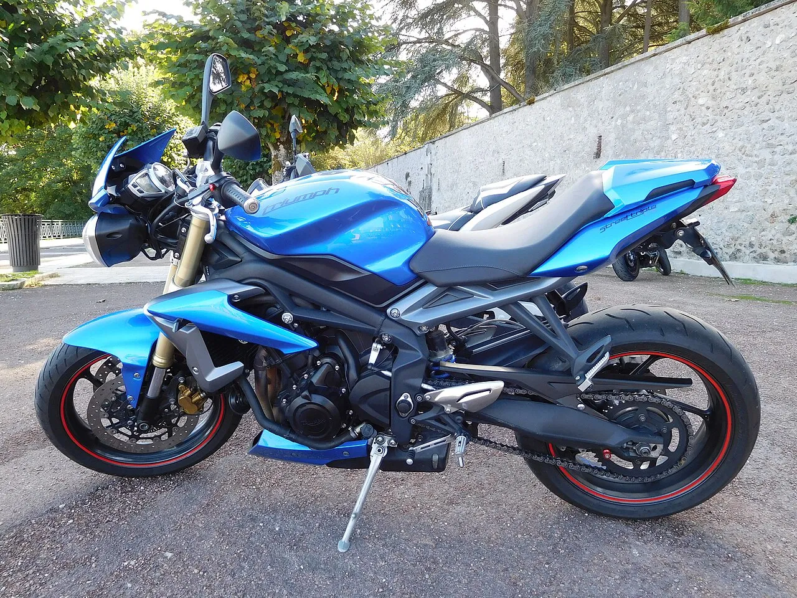

**What £5,000 buys:** 64 listings, the most of any naked bike here, typically
**£3,600–£4,695** (median £3,999). Mostly 2010–2016 bikes; the median is a 2013 bike
with about 15,000 miles.

> "We love Street Triples. We always have." [MCN, Street Triple 675 (2013) review](https://www.motorcyclenews.com/bike-reviews/triumph/street-triple-675/2013/), rated 4/5

> "The older 675 Street Triple models remain simply outstanding bikes to ride and great
> used buys." [BikeSocial, Street Triple (2013–2016) used review](https://www.bennetts.co.uk/bikesocial/reviews/bikes/triumph/street-triple-2013-used-review), rated 5/5

The Daytona 675 engine in a naked bike, and the best-value bike in this group. £4,000
gets a 2013-on model with the lighter frame and under-seat exhaust moved to the side;
stretch for an R version and you also get fully adjustable suspension. Economy is not
its strength, at around 40 mpg.

**Check:** regulator/rectifier and charging, throttle-body balance on hesitant bikes,
and that recalls have been done.

**Who it's for:** riders who want a three-cylinder sound and sharp handling for under
£4,000, leaving money for kit.

### KTM 790 Duke

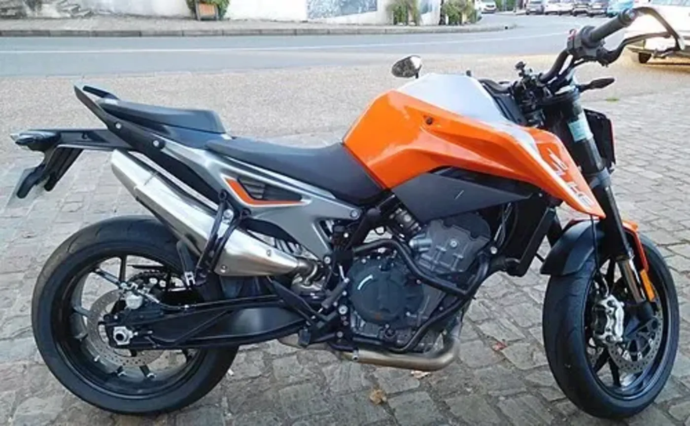

**What £5,000 buys:** 31 listings, typically **£4,195–£4,994** (median £4,495). Mostly
2018–2023 bikes; the median is a 2020 bike with about 9,600 miles, jointly the newest in
this log with the BMW F 900 R.

> "Its LC8c engine is a peach, the chassis predictably balanced and it's all topped off
> with superbike-spec electronics." Michael Neeves, [MCN, 790 Duke (2018) review](https://www.motorcyclenews.com/bike-reviews/ktm/790-duke/2018/), rated 4/5

> "The KTM has more hooligan tendencies and by comparison to the Triumph, feels like a
> teenager full of raging hormones." [BikeSocial, KTM 790 Duke vs Triumph Street Triple R](https://www.bennetts.co.uk/bikesocial/reviews/bikes/group-tests/ktm-790-duke-vs-triumph-street-triple-r-review)

The surprise of my price research. New in 2018 this was a bike of around £8,500; now
£5,000 buys lean-sensitive traction control, cornering ABS and a quickshifter as standard,
which few other bikes here offer at this price. MCN's downsides are a snatchy throttle in
town and zero wind protection.

**Check:** full service history from a KTM dealer, including the valve check, and
recall work. MCN also reports owners' allegations of costly LC8c engine repairs, so
ask questions and keep the history file.

**Who it's for:** the rider who wants modern electronics and a fresh bike, and likes a
bit of hooligan in their naked.

## Big naked bikes

More engine, still no fairing. These three are fast enough to get you into trouble and
comfortable enough for a day out.

### Yamaha MT-09

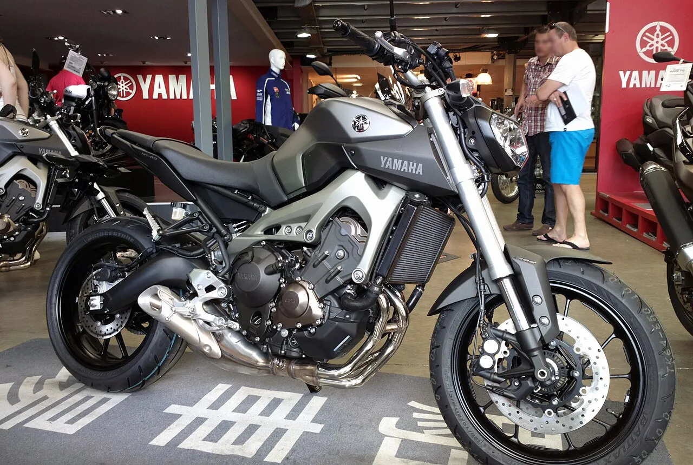

**What £5,000 buys:** 13 listings, typically **£4,000–£4,999** (median £4,695). Mostly
2013–2017 bikes; the median is a 2014 bike with about 18,500 miles.

> "There's not a lot wrong with the MT-09 in standard trim so this bike was always onto
> a bit of a winner." Phil West, [MCN, MT-09 (2014) review](https://www.motorcyclenews.com/bike-reviews/yamaha/mt-09/2014/), rated 4/5

> "Buy a used one at a decent price, upgrade the shock for a quality aftermarket item
> and get the forks re-valved and you will absolutely fall in love with Yamaha's simply
> brilliant naked." [BikeSocial, MT-09 (2013) used review](https://www.bennetts.co.uk/bikesocial/reviews/bikes/yamaha/mt-09-review-2013-used-price-spec)

The 847 cc crossplane triple is one of the great modern engines. Both reviews agree on
its one weakness, cheap suspension, and the snatchy fuelling of the earliest bikes in
"A" mode is well known. Budget a few hundred pounds for a shock and you have a bike that
embarrasses superbikes on a B-road.

**Check:** a suspension upgrade (a plus), how it was used, and fuelling at small
throttle openings.

**Who it's for:** the experienced rider who wants maximum fun per pound and doesn't
mind doing some fettling.

### BMW F 900 R

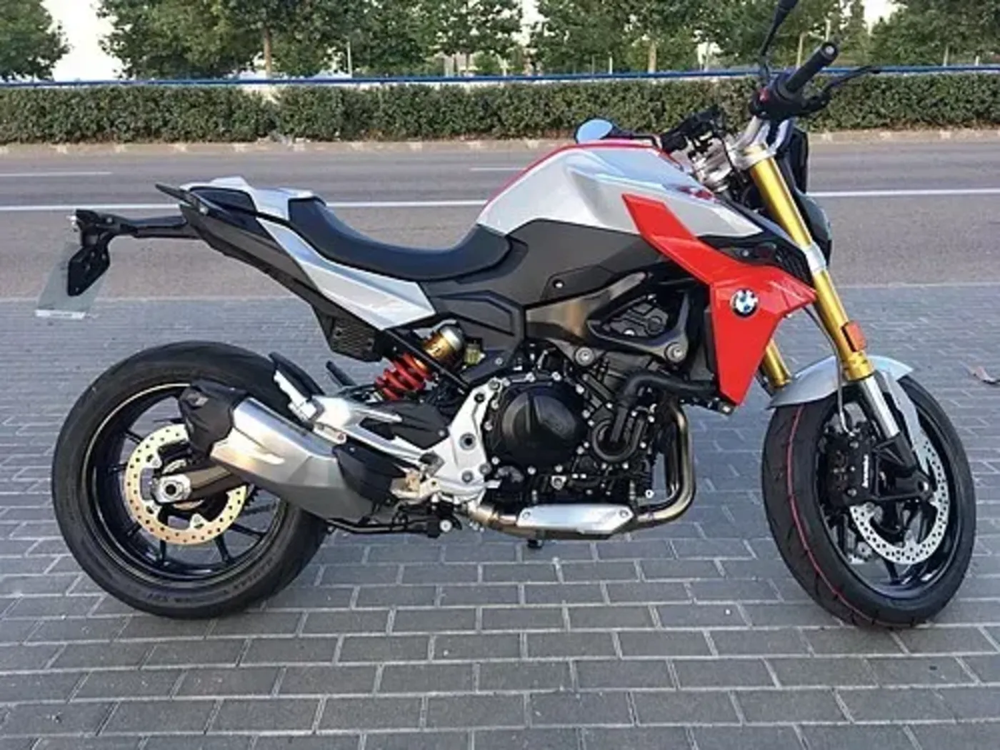

**What £5,000 buys:** only **6 listings**, at **£4,495–£4,995** (median £4,797), all
2020–2021 bikes with about 10,700 miles. This is the edge of the budget; be patient.

> "Anybody considering a middle-weight roadster should look closely at the new BMW."
> [BikeSocial, BMW F900R (2020) review](https://www.bennetts.co.uk/bikesocial/reviews/bikes/bmw/bmw-f900r-2020-review-spec-price)

> "That's no criticism of the R, it's just a reflection of how brilliant the XR is."
> Phil West, [MCN, F900R (2020) review](https://www.motorcyclenews.com/bike-reviews/bmw/f900r/2020/), rated 4/5

The rational choice: a 895 cc parallel twin with riding modes, traction control and
ABS as standard, and BMW's equipment packs on many used bikes. Neither review calls it
thrilling, and MCN thinks its F 900 XR sibling is the better bike, but at this price a
four- or five-year-old BMW with low miles is very hard to beat.

**Check:** which BMW packs are fitted (they change the value a lot), service history and
the dash and electronics.

**Who it's for:** riders who want a modern, well-equipped, low-mileage bike and would
rather have refinement than drama.

### Triumph Speed Triple 1050

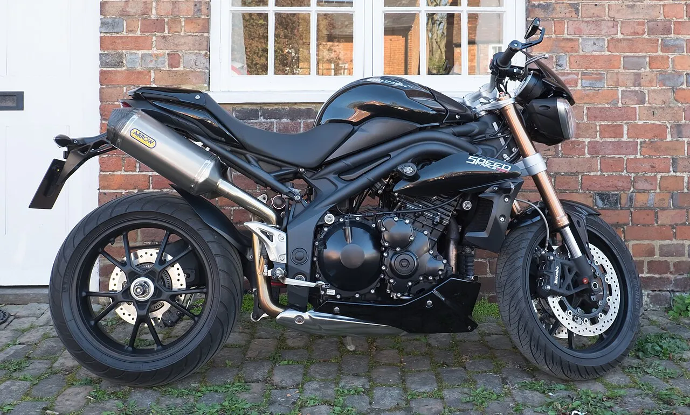

**What £5,000 buys:** 33 listings, typically **£4,089–£4,988** (median £4,495). Mostly
2008–2014 bikes; the median is a 2011 bike with about 17,400 miles.

> "For 2011 the Speed Triple got an all-new chassis package, frame and swingarm to turn
> MCN's favourite big-bore naked bike into a thoroughly modern big-bore naked bike."
> [MCN, Speed Triple 1050 (2011) review](https://www.motorcyclenews.com/bike-reviews/triumph/speed-triple-1050/2011/), rated 5/5

> "If you buy a good one (it's not hard), you will fall in love with this British icon
> and may well find yourself a Speed Triple fan for life." [BikeSocial, Speed Triple 1050 (2005) used review](https://www.bennetts.co.uk/bikesocial/reviews/bikes/triumph/speed-triple-1050-2005-used-review)

A big, torquey 1050 cc triple and a lot of character for the money. £5,000 sits right
on the change between the round-headlight 2005–2010 bikes and the 2011-on generation
with the new frame and "bug-eye" lights; both reviews rate both. BikeSocial's one
reservation is the gearbox.

**Check:** gear selection, charging system and the history of any modified exhaust or
map.

**Who it's for:** riders who want big-bike torque and a famous name, and plan to keep it.

## Superbikes

The most performance per pound in motorcycling. These are 160 bhp-plus, 1,000 cc
machines for the price of a used 125 a few years old. The catch is age: most are
from 2002–2011, with few rider aids and plenty of previous owners.

### Honda CBR1000RR Fireblade

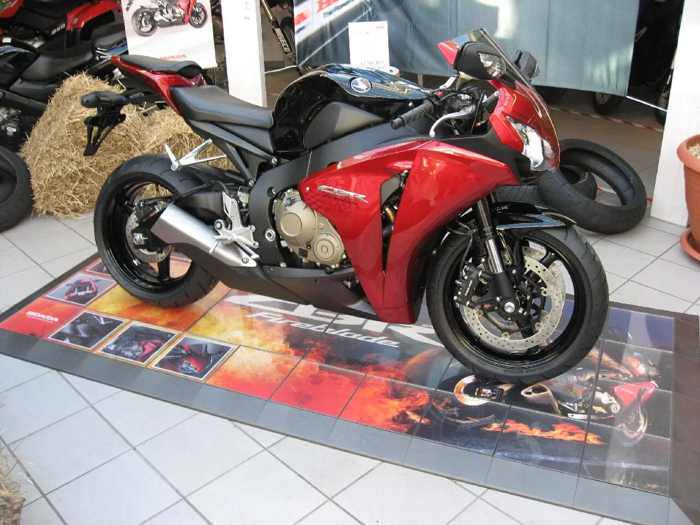

**What £5,000 buys:** 31 listings, typically **£4,388–£4,989** (median £4,650). Mostly
2005–2011 bikes; the median is a 2008 bike with about 23,600 miles.

> "Since 1992 the name FireBlade has conjured visions of a hard-charging superbike with
> attitude." [MCN, CBR1000RR Fireblade (2008) review](https://www.motorcyclenews.com/bike-reviews/honda/cbr1000rr-fireblade/2008/), rated 4/5

> "This generation of Fireblade is hard to argue against." [BikeSocial, CBR1000RR Fireblade (2008) used review](https://www.bennetts.co.uk/bikesocial/reviews/bikes/honda/cbr1000rr-fireblade-2008-used-review)

My pick of the superbikes. The 2008 redesign is lighter, more compact and still looks
modern, and the median £5,000 bike is exactly that generation. BikeSocial sums it up as
reliable, classy and easier to live with than its rivals, although with "over 160bhp
at the rear wheel (and no traction control)".

**Check:** crash or track damage (look at the frame, bar ends and footpegs), whether the
rare combined ABS version is fitted, and tyre and chain condition.

**Who it's for:** an experienced rider who wants a superbike for the road, not the track.

### Suzuki GSX-R1000

 with an aftermarket Yoshimura exhaust. Photo: Steven Bohn, CC BY-SA 3.0, via Wikimedia Commons.")

**What £5,000 buys:** 26 listings, typically **£3,988–£4,899** (median £4,525). Mostly
2001–2008 bikes; the median is a 2005 bike with about 25,100 miles.

> "The first Suzuki GSX-R1000 set new superbike standards in 2001, the second one did it
> again in 2003 and this, the third full Suzuki GSX-R1000 update, went straight back to
> the top of the superbike tree in 2005." [MCN, GSX-R1000 (2005) review](https://www.motorcyclenews.com/bike-reviews/suzuki/gsx-r1000/2005/), rated 5/5

> "The GSX-R1000 K7/8 is a very underrated machine." [BikeSocial, GSX-R1000 (2007) used review](https://www.bennetts.co.uk/bikesocial/reviews/bikes/suzuki/gsxr1000-2007-review-used)

The K5 and K6 (2005–2006) are the legends: light, brutally strong and the bikes MCN
rated best of their era. BikeSocial makes the case for the heavier-looking K7/K8, which
those in the know rate highly once the bulky standard exhausts are replaced.

**Check:** crash damage, the charging system (stator and regulator), and a long list of
aftermarket parts that might hide a hard life.

**Who it's for:** riders who want old-school, raw superbike performance at the lowest
price.

### Yamaha YZF-R1

**What £5,000 buys:** 37 listings, typically **£3,800–£4,889** (median £4,494). Mostly
1998–2007 bikes; the median is a 2002 bike with about 21,600 miles.

> "It's hard to fault the clinical, precise and devastatingly fast 2004 Yamaha R1."
> [MCN, R1 (2004) review](https://www.motorcyclenews.com/bike-reviews/yamaha/r1/2004/), rated 5/5

> "This generation of R1 may not be the most thrilling to ride, but it is a beautifully
> built machine that has a feeling of refinement that its rivals fail to match."
> [BikeSocial, YZF-R1 (2004) review](https://www.bennetts.co.uk/bikesocial/reviews/bikes/yamaha/yzf-r1-2004-review)

The widest choice of the three, from the iconic early carburettor bikes to the
2004–2006 underseat-exhaust model both reviewers praise. For road use, a 2004-on
bike is the one to hunt for; the median listing is older, so be selective.

**Check:** the age of the bike more than the miles: perished rubber, corrosion, and
documented servicing.

**Who it's for:** riders who want a superbike that is beautifully made, and maybe a
future classic.

## Middleweight sports bikes

Supersport 600s and their friends: lighter and more agile than a superbike, often more
fun on the road, and cheaper to insure.

### Triumph Daytona 675

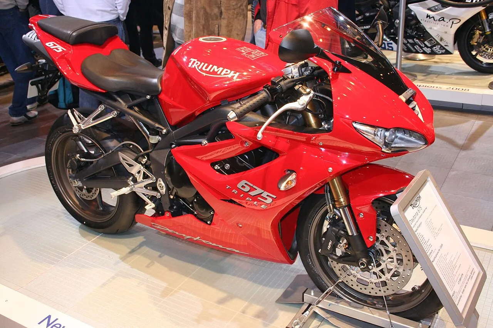

**What £5,000 buys:** 11 listings, typically **£4,450–£4,999** (median £4,750). Mostly
2006–2013 bikes; the median is a 2010 bike with about 22,500 miles.

> "Silky, compact handling, allied to kick-ass engine power and a howling exhaust note,
> make the Triumph Daytona 675 a real winner on the road, or track." [MCN, Daytona 675 (2006) review](https://www.motorcyclenews.com/bike-reviews/triumph/daytona-675/2006/), rated 5/5

> "If you want a lightweight supersport bike for mainly road use, the Daytona 675 is the
> one to buy." [BikeSocial, Daytona 675 (2006–2012) used review](https://www.bennetts.co.uk/bikesocial/reviews/bikes/triumph/triumph-daytona-675-2006-2012-review-used-price-spec)

MCN rates it 5/5 and BikeSocial calls it the one to buy. The triple has a midrange that the
four-cylinder 600s can't match, which matters on the road. There are only 11 under
£5,000, so it holds its value well.

**Check:** the regulator/rectifier, recall work, and signs of track use.

**Who it's for:** the rider who wants a sports bike for the road rather than for lap
times.

### Honda CBR600RR

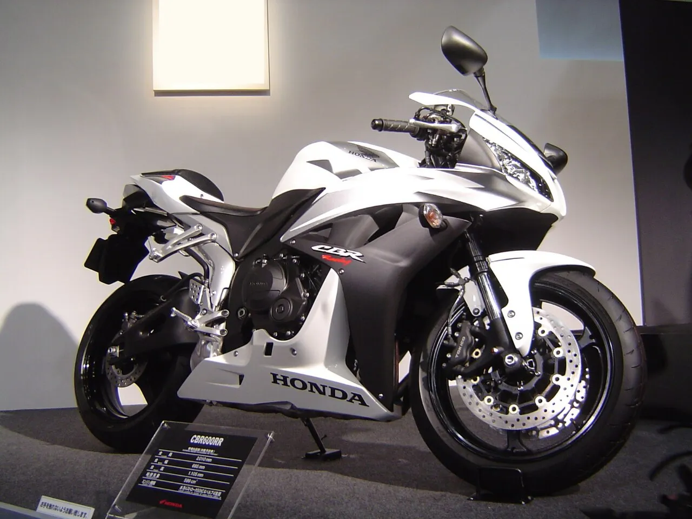

**What £5,000 buys:** 22 listings, typically **£3,750–£4,795** (median £4,345). Mostly
2004–2013 bikes; the median is a 2007 bike with about 23,800 miles.

> "Honda have hit back hard with the track focused CBR600RR." [MCN, CBR600RR (2007) review](https://www.motorcyclenews.com/bike-reviews/honda/cbr600rr/2007/), rated 4/5

> "If you are after a supersport bike, it is a great option that isn't as frantic to
> ride as some rivals yet still gives you the buzz you need when the right corners
> arrive." [BikeSocial, CBR600RR (2007) used review](https://www.bennetts.co.uk/bikesocial/reviews/bikes/honda/cbr600rr-2007-review-used), rated 4/5

The Honda of supersports: well made, reliable and a little more forgiving than its
rivals. The 2007–2012 generation is the one to look for; some have Honda's combined ABS,
rare on a 600.

**Check:** track use and crash damage, and the condition of fasteners and bodywork.

**Who it's for:** a rider stepping up to a sports bike who wants one that won't bite.

### Suzuki GSX-R750

**What £5,000 buys:** 25 listings, typically **£3,795–£4,990** (median £4,500). Mostly
1997–2011 bikes; the median is a 2008 bike with about 27,000 miles.

> "Pound-for-pound we reckon it's one of the best sportsbikes you can buy." [MCN, GSX-R750 (2011) review](https://www.motorcyclenews.com/bike-reviews/suzuki/gsx-r750/2011/), rated 5/5

> "Put simply, it was the only real 750 and if you wanted a supersport bike that was a
> bit less rev-happy, the GSX-R750 was ideal." [BikeSocial, GSX-R750 K6/K7 buyer's guide](https://www.bennetts.co.uk/bikesocial/reviews/bikes/suzuki/suzuki-gsx-r750-k6-k7-2006-2007-buyers-guide)

The middle way: a 600-sized chassis with extra midrange and close to 150 bhp. MCN rates
the 2006 K6 4/5 and the 2011 model 5/5. Under £5,000 you are mostly looking at
2006–2010 bikes, with the occasional 2011.

**Check:** the stator and regulator, crash damage and BikeSocial's warning about
"poorly fitted aftermarket extras".

**Who it's for:** the rider who finds a 600 too peaky and a 1000 too much.

## Sports tourers

Fast, comfortable and able to carry luggage. Probably the most underrated used category,
and full of bargains.

### Kawasaki Z1000SX

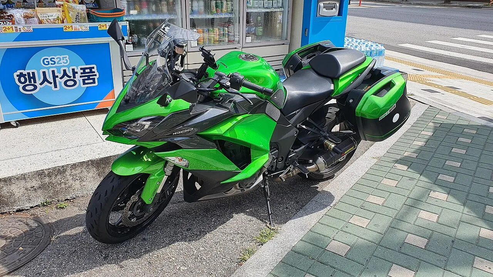

**What £5,000 buys:** 34 listings, typically **£3,999–£4,995** (median £4,470). Mostly
2011–2015 bikes; the median is a 2013 bike with about 23,400 miles.

> "Loosely based on Kawasaki's excellent Z1000, the SX fits snugly in to the gap between
> said naked bike and the track orientated ZX-10R, making it a grown-up bike for the
> real world." [MCN, Z1000SX (2010) review](https://www.motorcyclenews.com/bike-reviews/kawasaki/z1000sx/2010/), rated 4/5

> "If you are after a sporty tourer, the SX remains a great buy, however in a modern
> context its lack of electronic assists is a bit disappointing." [BikeSocial, Z1000SX buyer's guide](https://www.bennetts.co.uk/bikesocial/reviews/bikes/kawasaki/kawasaki-z1000sx-2011-current-buyers-guide)

A 1,043 cc inline four that is smooth and strong everywhere, with a sports-bike
chassis and a proper fairing. Most have ABS and simple traction control; the 2014
update added a better screen and fairing.

**Check:** whether the official luggage and mounts come with it, and evidence of
regular servicing.

**Who it's for:** riders who want one bike for commuting, touring and fast weekends.

### Yamaha MT-09 Tracer / Tracer 900

. Photo: Danielvd, CC BY-SA 4.0, via Wikimedia Commons.")

**What £5,000 buys:** 20 listings, typically **£4,489–£4,995** (median £4,772), almost
all 2015–2017 MT-09 Tracers with about 24,900 miles.

> "This is a seriously good bike at a seriously great price." Phil West, [MCN, MT-09
> Tracer (2015) review](https://www.motorcyclenews.com/bike-reviews/yamaha/mt-09-tracer/2015/), rated 5/5

> "The Tracer 900 makes for a really good sports tourer that can be had for a bargain
> price, however it does have its drawbacks." [BikeSocial, Tracer 900 (2015) used review](https://www.bennetts.co.uk/bikesocial/reviews/bikes/yamaha/tracer-900-2015-review-used)

The MT-09's brilliant triple with a fairing, a taller screen and a comfortable seat.
BikeSocial's drawbacks are the bouncy suspension and missing cruise control; both are
fair, and neither stops this being the most fun tourer here.

**Check:** the suspension, luggage, and early-bike throttle response.

**Who it's for:** riders who want to tour but still want a hooligan engine.

### Triumph Sprint GT 1050

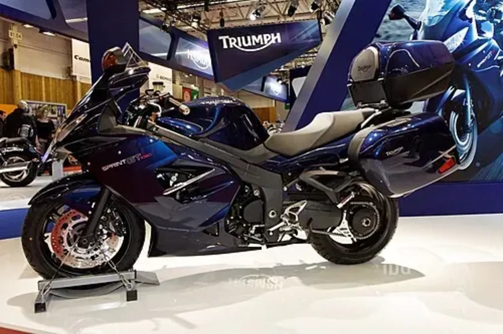

**What £5,000 buys:** 25 listings, typically **£3,495–£3,999** (median £3,650). Mostly
2010–2015 bikes; the median is a 2013 bike with about 16,700 miles. The cheapest sports
tourer here by around £800.

> "Take Triumph's superb Sprint ST (Sport Touring) and make it more adept at touring
> and also pillion friendly and what do you end up with? A Triumph Sprint GT (Grand
> Touring), that's what." [MCN, Sprint GT (2010) review](https://www.motorcyclenews.com/bike-reviews/triumph/sprint-gt-1050/2010/), rated 4/5

> "If you are after a solid do-it-all that is also a very handy tourer, it is hard to
> fault the Sprint GT." [BikeSocial, Sprint GT (2011–2016) used review](https://www.bennetts.co.uk/bikesocial/reviews/bikes/triumph/sprint-gt-2011-used-review)

The value champion of this log. A 1050 cc triple, ABS and panniers as standard, a
longer swingarm for stability with a pillion, and low miles for its age. It is less
agile than the Sprint ST, but much more comfortable.

**Check:** the regulator/rectifier, the pannier locks and mounts, and the brakes.

**Who it's for:** the two-up tourer on a budget, with £1,000 left over for a trip.

## Touring bikes

Big, heavy, shaft-driven and built to do 300 miles before lunch. These lose value fastest,
which makes them the biggest bargains if you want to see Europe.

### BMW R 1200 RT

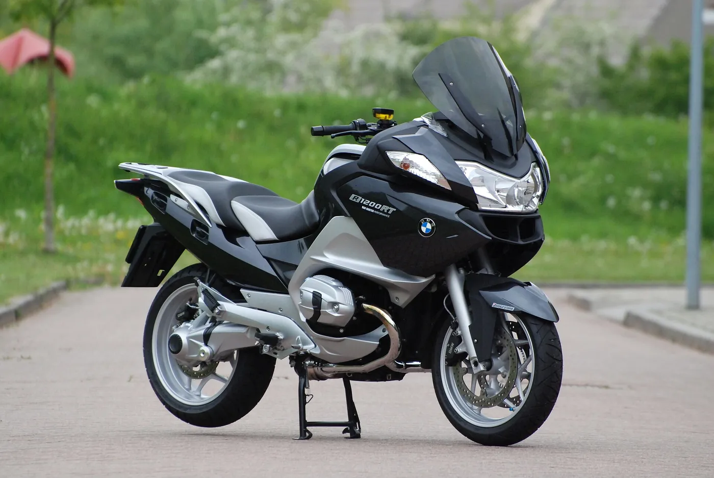

**What £5,000 buys:** 36 listings, typically **£3,095–£3,995** (median £3,495). Mostly
2006–2012 bikes; the median is a 2009 bike with about 36,000 miles.

> "Not just a great tourer, a great motorcycle, period." [MCN, R1200RT (2005) review](https://www.motorcyclenews.com/bike-reviews/bmw/r1200rt/2005/), rated 5/5

> "The BMW R1200RT is a fabulous full-dress tourer that is also surprisingly sprightly
> in bends." [BikeSocial, R 1200 RT (2006–2013) used review](https://www.bennetts.co.uk/bikesocial/reviews/bikes/bmw/r1200rt-2006-used-review)

The touring benchmark of its generation for £3,500. Electric screen, heated grips,
cruise control and panniers are common on used bikes. The boxer twin is low-revving and
long-lived; 36,000 miles is mid-life.

**Check:** the brakes on 2005–2007 bikes (the servo-assisted ABS unit is expensive to
fix), the final drive for play or leaks, and a full service history.

**Who it's for:** two-up touring riders who want luxury for less than the price of a
used scooter.

### Yamaha FJR1300

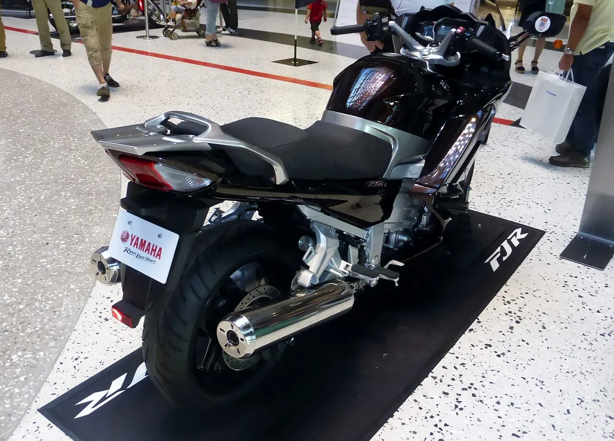

**What £5,000 buys:** 29 listings, typically **£2,989–£4,495** (median £3,889). Mostly
2002–2010 bikes; the median is a 2006 bike with about 34,200 miles.

> "Although not as glamorous or gadget-laden a some rivals, the FJR has always impressed
> for its effective, no messing, durable and dependable approach." [MCN, FJR1300 (2001) review](https://www.motorcyclenews.com/bike-reviews/yamaha/fjr1300/2001/), rated 5/5

> "The FJR1300 is a touring institution." [BikeSocial, FJR1300 (2013) used review](https://www.bennetts.co.uk/bikesocial/reviews/bikes/yamaha/fjr1300-2013-used-review)

A 1,298 cc four, shaft drive and Japanese durability. It is a sportier, harder-edged
tourer than the BMW, and there is even an AS version with an automatic clutch. The
cheapest bikes are under £3,000.

**Check:** shaft-drive condition, the electric screen, and how hot the cockpit gets on
earlier bikes.

**Who it's for:** riders who want huge mileage with as few worries as possible.

### Triumph Trophy 1200

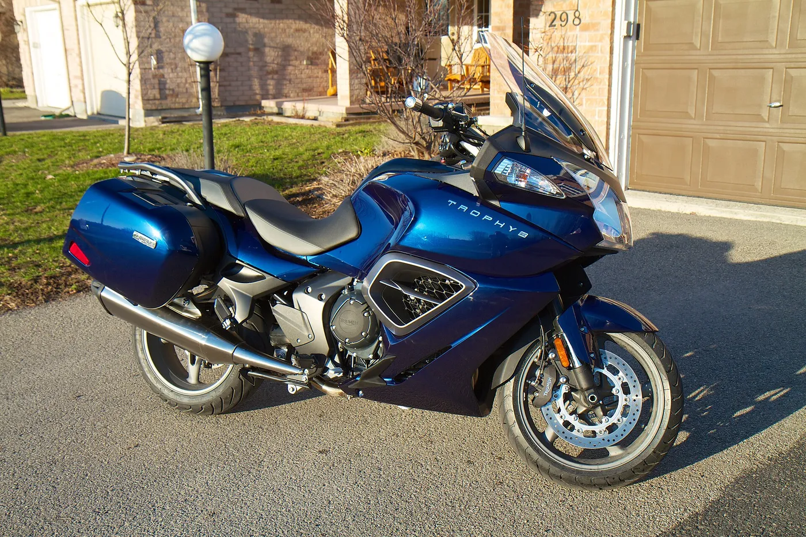

**What £5,000 buys:** 16 listings, typically **£3,995–£4,500** (median £4,445). Mostly
2012–2016 bikes; the median is a 2014 bike with about 35,100 miles.

> "The Trophy went off sale in 2017, but thanks to relatively low sales volumes it's a
> very good used buy." [MCN, Trophy 1200 (2012) review](https://www.motorcyclenews.com/bike-reviews/triumph/trophy-1200/2012/), rated 4/5

> "A great British product that will do very well over here, there, and everywhere."
> [BikeSocial, Triumph Trophy (2012) review](https://www.bennetts.co.uk/bikesocial/reviews/bikes/triumph/triumph-trophy)

The newest tourer here. A 1,215 cc triple, shaft drive, cruise control, electric screen
and (on the SE) electronically adjustable suspension, for the price of a 2009 RT. MCN
called it the best tourer overall when new.

**Check:** that all the electronics work, especially the suspension and audio on the
SE, and that recall work has been done.

**Who it's for:** riders who want a modern tourer and like the idea of something
rarer than a BMW.

## Big adventure bikes

The UK's favourite type of big bike, which is why there are so many on the used market.
At £5,000 the choice is between an early BMW, a Triumph that beat it in tests, and a
Suzuki that undercuts them both.

### BMW R 1200 GS

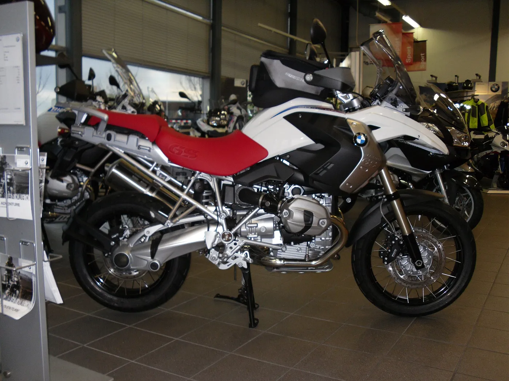

**What £5,000 buys:** 30 listings, typically **£3,495–£4,450** (median £3,997). Mostly
2004–2009 bikes; the median is a 2007 bike with about 35,500 miles.

> "The BMW R1200GS breezed into the motorcycle world in 2004 and changed it forever."
> [MCN, R1200GS (2004) review](https://www.motorcyclenews.com/bike-reviews/bmw/r1200gs/2004/), rated 5/5

> "If you're looking to experience the thrills of the adventure bike world for the
> first time, you could do a lot worse than start with a BMW R1200 GS." [BikeSocial, R1200GS (2004–2019) buying guide](https://www.bennetts.co.uk/bikesocial/reviews/bikes/bmw/r1200gs-2004-review-used)

The bike that made adventure bikes mainstream. Under £5,000 you get the first,
air/oil-cooled generation; the 2008 update added a little more power. It is
comfortable, stable and simple to work on.

**Check:** the final drive (play in the rear wheel or oil leaks), servo-assisted ABS on
2004–2007 bikes, and a full history.

**Who it's for:** a first adventure bike that will go round the world if you want it to.

### Triumph Tiger Explorer 1200

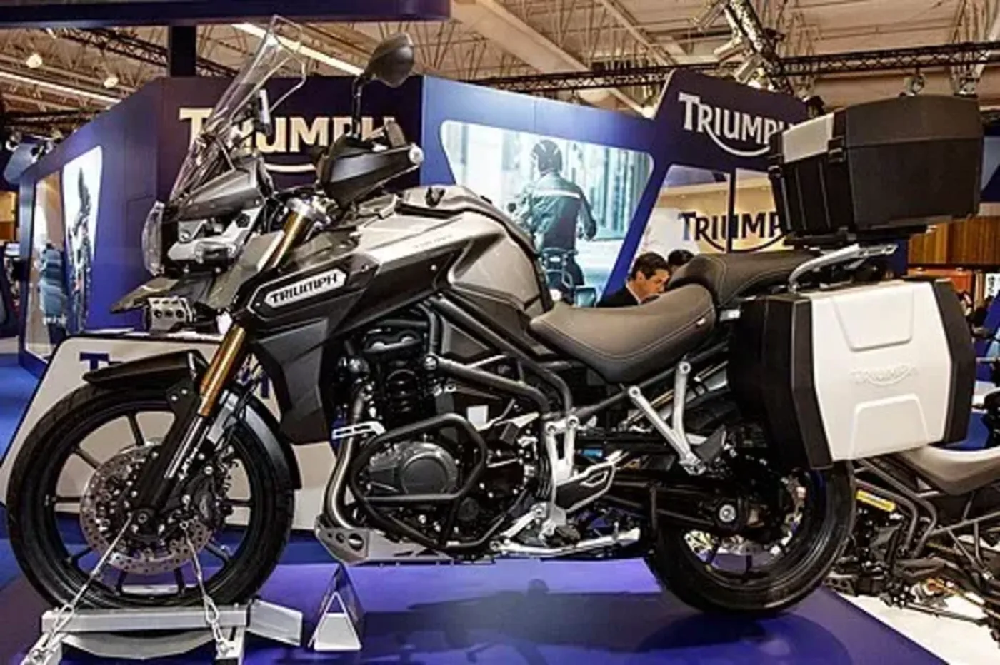

**What £5,000 buys:** 20 listings, typically **£4,186–£4,950** (median £4,497). Mostly
2012–2015 bikes; the median is a 2013 bike with about 31,100 miles.

> "Triumph has built a bike with more power, better handling, more agility and arguably
> better styling than R1200GS." [MCN, Tiger Explorer 1200 (2012) review](https://www.motorcyclenews.com/bike-reviews/triumph/tiger-1200-explorer/2012/), rated 5/5

> "Early Explorer models don't hold their value as well as the equivalent vintage
> R1200GS and you can pick up a 2012 model for in the region of £5500, which is a lot of
> bike for your money." [BikeSocial, Tiger Explorer (2012–2015) buyer's guide](https://www.bennetts.co.uk/bikesocial/reviews/bikes/triumph/triumph-tiger-explorer-2012-2015-buyers-guide)

The bargain of this category. For £4,500 you get a GS rival that is around six years
newer than the median £5,000 GS, with 135 bhp, shaft drive, cruise control and
traction control. Prices have fallen since BikeSocial's guide.

**Check:** that all recalls have been done, final-drive condition and the electrics.

**Who it's for:** riders who want big adventure-bike comfort and pillion space, with
newer tech than a GS.

### Suzuki V-Strom 1000

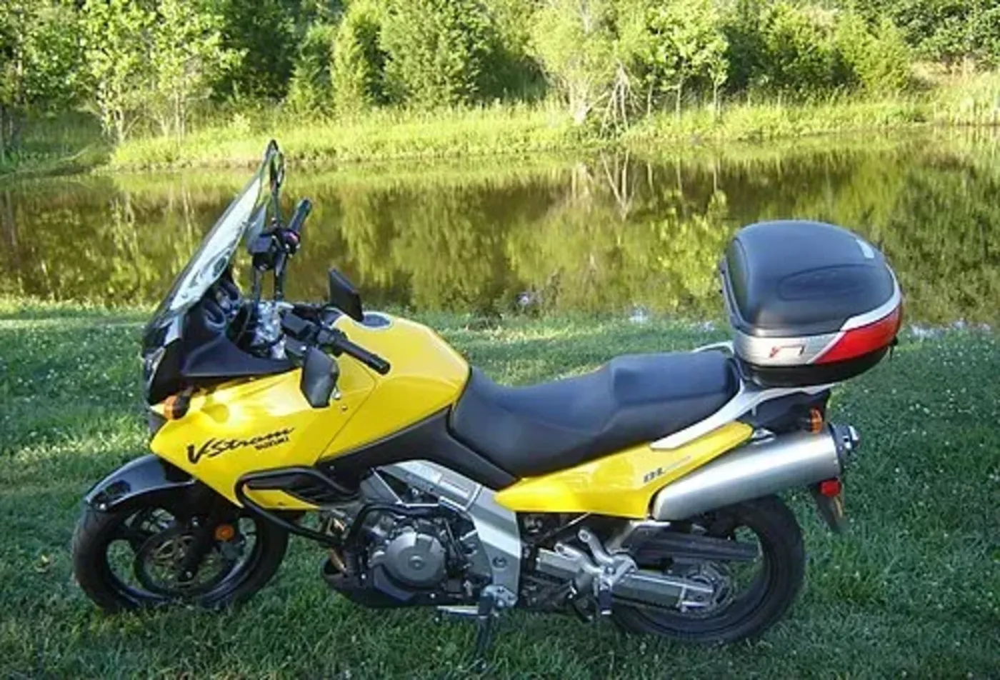

**What £5,000 buys:** 31 listings, typically **£2,995–£4,499** (median £3,899). Mostly
2004–2018 bikes; the median is a 2014 bike with about 23,600 miles.

> "The Suzuki DL1000 V-Strom is a far better bike than its subdued manner and slightly
> anonymous styling suggests." [MCN, DL1000 V-Strom (2002) review](https://www.motorcyclenews.com/bike-reviews/suzuki/dl1000-v-strom/2002/), rated 4/5

> "It's not the sexiest of adventure bikes but it is a really solid performer that just
> gets on with the job in hand." [BikeSocial, V-Strom 1000 (2014–2019) used review](https://www.bennetts.co.uk/bikesocial/reviews/bikes/suzuki/v-strom-1000-2014-used)

Two bikes in one search. The cheap ones are the original 2002–2009 DL1000; the bikes
around £4,500 are the 2014-on model with ABS and traction control, which MCN's 2014
review also rates 4/5. Chain drive keeps running costs down.

**Check:** which generation you are looking at, chain and sprockets, and corrosion on
older bikes.

**Who it's for:** the practical rider who would rather spend the difference on fuel and
ferries.

## Middleweight adventure bikes

Lighter, cheaper to run and easier to handle on a gravel track. All three are excellent
used buys.

### Triumph Tiger 800

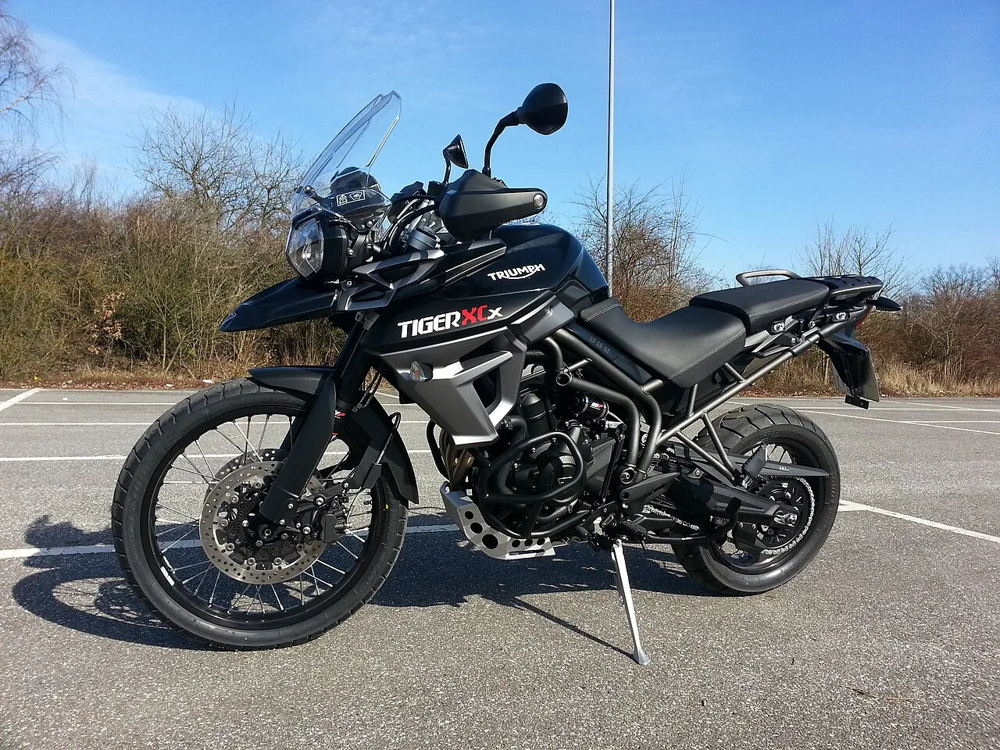

**What £5,000 buys:** 72 listings, the most of any bike in this log, typically
**£3,849–£4,690** (median £4,294). Mostly 2011–2017 bikes; the median is a 2014 bike
with about 23,700 miles.

> "For riders looking for a genuine do-it-all machine, the Tiger 800 is one of the
> soundest used bikes on the market." [MCN, Tiger 800 (2010) review](https://www.motorcyclenews.com/bike-reviews/triumph/tiger-800/2010/), rated 4/5

> "If you want a lighter adventure bike with a bit of character, the XRx is the pick of
> the bunch." [BikeSocial, Tiger 800 XRx (2015) used review](https://www.bennetts.co.uk/bikesocial/reviews/bikes/triumph/tiger-800-xrx-2015-review-used-price-spec)

The pick for most people. A smooth, characterful triple and the widest choice in this
log, from road-focused XR models to off-road XC versions with spoked wheels. The 2015
update added ride-by-wire, traction control and riding modes.

**Check:** recall work, the regulator/rectifier, and spoked wheels on XC models.

**Who it's for:** anyone who wants one sensible, fun bike for everything.

### BMW F 800 GS

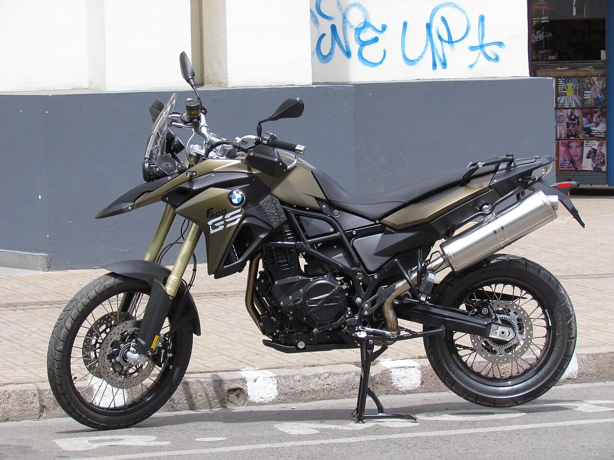

**What £5,000 buys:** 10 listings, typically **£4,295–£4,900** (median £4,640). Mostly
2011–2017 bikes; the median is a 2014 bike with about 24,200 miles.

> "The BMW F800GS is virtually unique: a 750/800 class adventure bike, that to most
> degrees offers the best of both worlds." Michael Guy, [MCN, F800GS (2008) review](https://www.motorcyclenews.com/bike-reviews/bmw/f800gs/2008/), rated 4/5

The most off-road capable bike here, with a 21-inch front wheel and long suspension
travel. It is tall and the parallel twin is less charming than the Triumph's triple, but
on gravel nothing else in this log comes close.

**Check:** the water pump seal (a known weakness: look for coolant weeping), the fuel
gauge sender, and off-road damage.

**Who it's for:** riders who mean the "adventure" part.

### Suzuki V-Strom 650

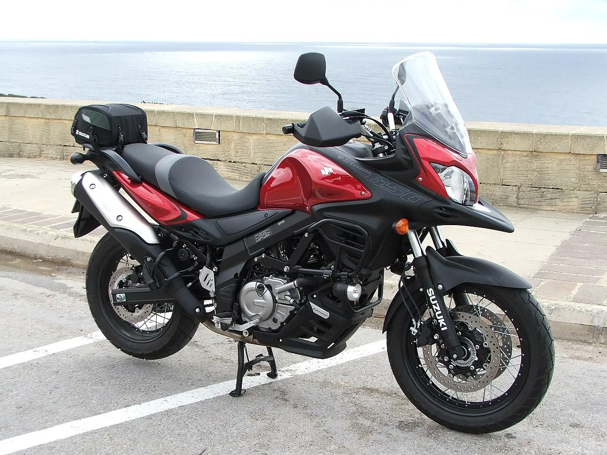

**What £5,000 buys:** 49 listings, typically **£3,295–£4,395** (median £3,890). Mostly
2010–2022 bikes; the median is a 2017 bike with about 18,000 miles.

> "It all adds up to an immensely, almost peerlessly versatile package that is simply
> brilliant value for money, especially in the used market." [MCN, DL650 V-Strom (2011) review](https://www.motorcyclenews.com/bike-reviews/suzuki/dl650-v-strom/2011/), rated 5/5

> "Suzuki's V-Strom may be slightly humble and lack glamour compared to the mega-buck
> Multistradas and GSs of this world – but it's an important bike." [BikeSocial, V-Strom 650 (2017) review](https://www.bennetts.co.uk/bikesocial/reviews/bikes/suzuki/reviewed-2017-suzuki-v-strom-650)

The cheapest bike here per year of age. The SV650-derived V-twin is famously durable,
and £4,000 buys a 2017-on model with traction control. It is not exciting, but it
does everything well.

**Check:** chain and sprockets, corrosion on winter bikes, and luggage mounts.

**Who it's for:** riders who want a newer bike, low costs and nothing to worry about.

## Modern classics

Retro style with modern reliability. These hold their value well, so £5,000 buys a
young, low-mileage bike.

### Triumph Bonneville T100

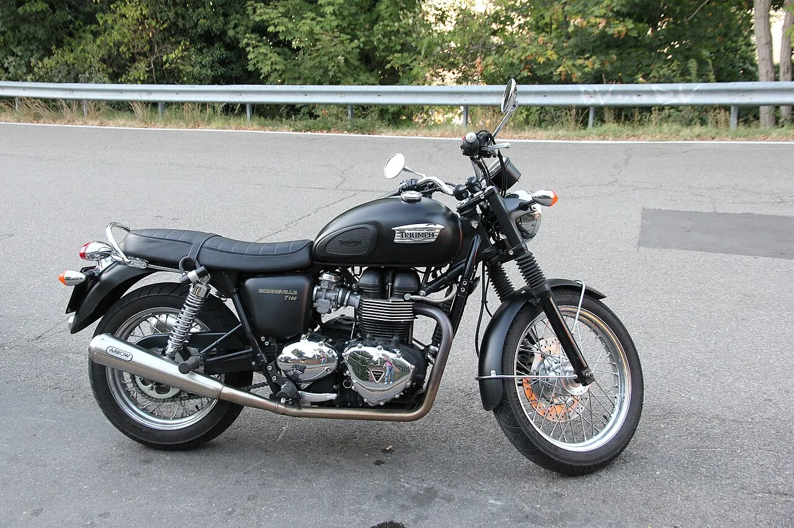

**What £5,000 buys:** 31 listings, typically **£4,250–£4,689** (median £4,295). Mostly
2008–2014 bikes; the median is a 2012 bike with about 12,600 miles.

> "With a heritage to rival the Harley and excellent build quality, the Triumph
> Bonneville is unquestionably the better performing motorcycle." [MCN, Bonneville 900 (2000–2016) review](https://www.motorcyclenews.com/bike-reviews/triumph/bonneville-900/2000/), rated 4/5

> "The reinvented Bonneville hits the mark in so many ways." [BikeSocial, Bonneville (2001) used review](https://www.bennetts.co.uk/bikesocial/reviews/bikes/triumph/bonneville-2001-used-review)

The original modern classic. These are the 865 cc air-cooled bikes, fuel-injected from
2008, not the later water-cooled 900. They are simple, handsome and easy to maintain at
home, and owners tend to look after them.

**Check:** corrosion on chrome and spokes, and any non-standard exhausts.

**Who it's for:** riders who want a classic look without classic reliability.

### Ducati Scrambler 800

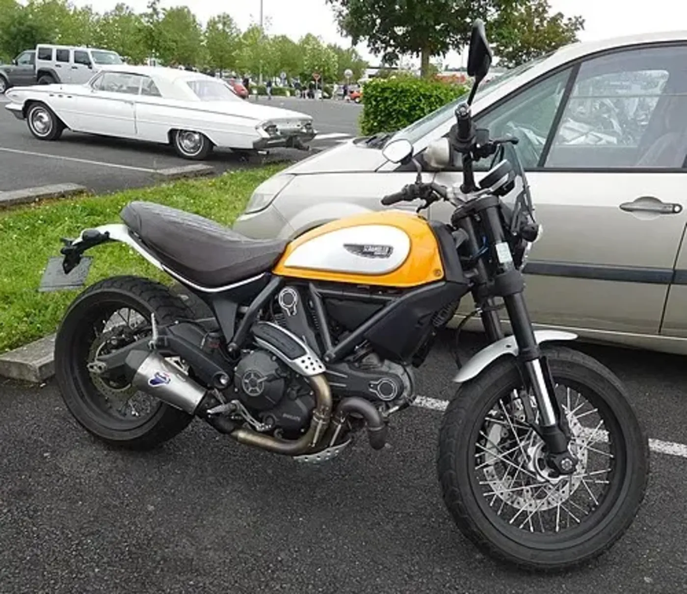

**What £5,000 buys:** 47 listings, typically **£4,200–£4,795** (median £4,499). Mostly
2015–2018 bikes; the median is a 2016 bike with just 7,100 miles, the lowest mileage in
this log.

> "You don't have to be a fashionable hipster to enjoy the Scrambler, its qualities
> shine through without the clever marketing." Adam Child, [MCN, Scrambler 800 (2015) review](https://www.motorcyclenews.com/bike-reviews/ducati/scrambler-800/2015/), rated 4/5

> "With the Scrambler Ducati succeeded in creating a fun, good-looking retro that
> appeal to all riders." [BikeSocial, Scrambler 800 (2015–) buying guide](https://www.bennetts.co.uk/bikesocial/reviews/bikes/ducati/scrambler-803-2015-used)

A Ducati for MT-07 money. The air-cooled 803 cc V-twin is easy-going and the bike is
light and small. It is not fast, and both reviewers say experienced riders may want more,
but low miles and Ducati style are hard to argue with.

**Check:** proof the timing belts have been changed on schedule (by age as well as
miles), and the service history.

**Who it's for:** riders who want a stylish, fun bike that will mostly be ridden on
sunny weekends.

### Yamaha XSR700

, via Wikimedia Commons.")

**What £5,000 buys:** 29 listings, typically **£4,200–£4,995** (median £4,499). Mostly
2017–2022 bikes; the median is a 2019 bike with about 10,200 miles.

> "The neo-retro XSR looks refined, it's classy and handles the road well – the cherry
> on top is it does it all for an extremely attractive price tag. Brilliant." Andy
> Davidson, [MCN, XSR700 (2015–2021) review](https://www.motorcyclenews.com/bike-reviews/yamaha/xsr700/2015/), rated 5/5

> "The XSR is also a great starting point for home customisers." [BikeSocial, XSR700 (2016–) buyer's guide](https://www.bennetts.co.uk/bikesocial/reviews/bikes/yamaha/xsr700-2016-review-used-price-spec)

An MT-07 in retro clothes, with the same engine and the same fun. BikeSocial notes it
didn't get the MT-07's 2017 suspension upgrade, but it is the newest modern classic you
can buy for £5,000.

**Check:** the same as the MT-07: drops, chain, and suspension.

**Who it's for:** riders who love the MT-07's engine but want something better looking.

## Cruisers

Low seats, big torque and relaxed riding. No sports bikes in disguise here, but all three
are surprisingly easy to live with.

### Harley-Davidson Sportster 883

. Photo: Ocdp, CC BY-SA 3.0, via Wikimedia Commons.")

**What £5,000 buys:** 51 listings, typically **£4,290–£4,900** (median £4,499). Mostly
2002–2013 bikes; the median is a 2008 bike with about 13,000 miles.

> "Sorry haters, but the Harley-Davidson Iron 883 is good for an entry level cruiser
> motorbike." Jordan Gibbons, [MCN, Sportster Iron 883 (2015) review](https://www.motorcyclenews.com/bike-reviews/harley-davidson/sportster-883/2015/), rated 4/5

> "You just have to love the Iron 883 as it is a proper Harley both in terms of its soul
> and its visual appeal." [BikeSocial, Iron 883 (2010–) buying guide](https://www.bennetts.co.uk/bikesocial/reviews/bikes/harley-davidson/harley-davidson-iron-883-2010-current-review-buying-guide)

The easiest way into Harley ownership. It vibrates, clunks and won't win a spec-sheet
battle, as both reviews say, but it holds its value and there are endless ways to
personalise it. Look for 2004-on, rubber-mounted engines.

**Check:** the drive belt, any aftermarket exhaust or tuning, and whether the riding
position suits you.

**Who it's for:** the rider who wants an authentic Harley and has accepted the
compromises.

### Triumph Speedmaster 865

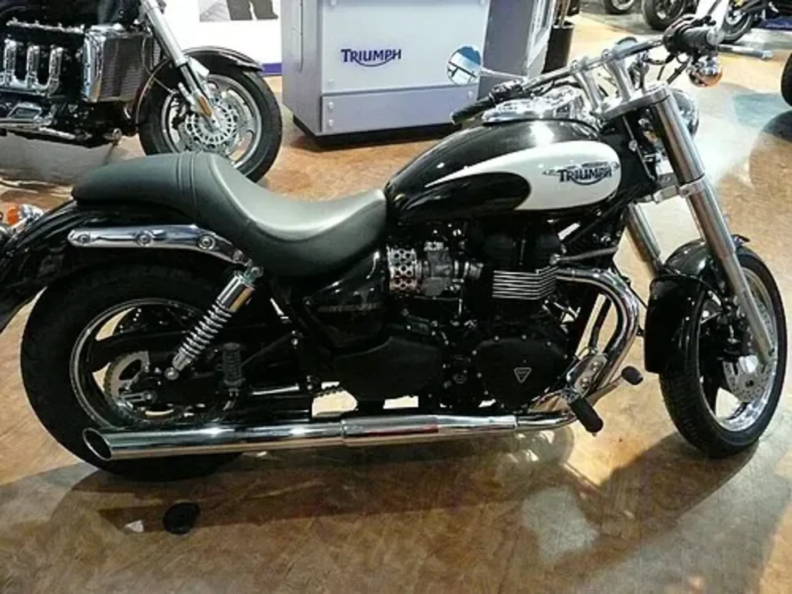

**What £5,000 buys:** 12 listings, typically **£4,490–£4,695** (median £4,544). Mostly
2010–2014 bikes; the median is a 2013 bike with about 13,100 miles.

> "Considering the price you get a lot of bike for your money." [MCN, Speedmaster (2011) review](https://www.motorcyclenews.com/bike-reviews/triumph/speedmaster/2011/), rated 4/5

The Bonneville's 865 cc twin in a cruiser, with a low seat, forward controls and
pulled-back bars. It is lighter and better handling than most cruisers, and smoother
than the Harley. I couldn't find a BikeSocial review of this generation, so there is
only one quote here.

**Check:** the same as the Bonneville: corrosion and modifications.

**Who it's for:** the rider who wants a cruiser look with Bonneville manners.

### Kawasaki Vulcan 900

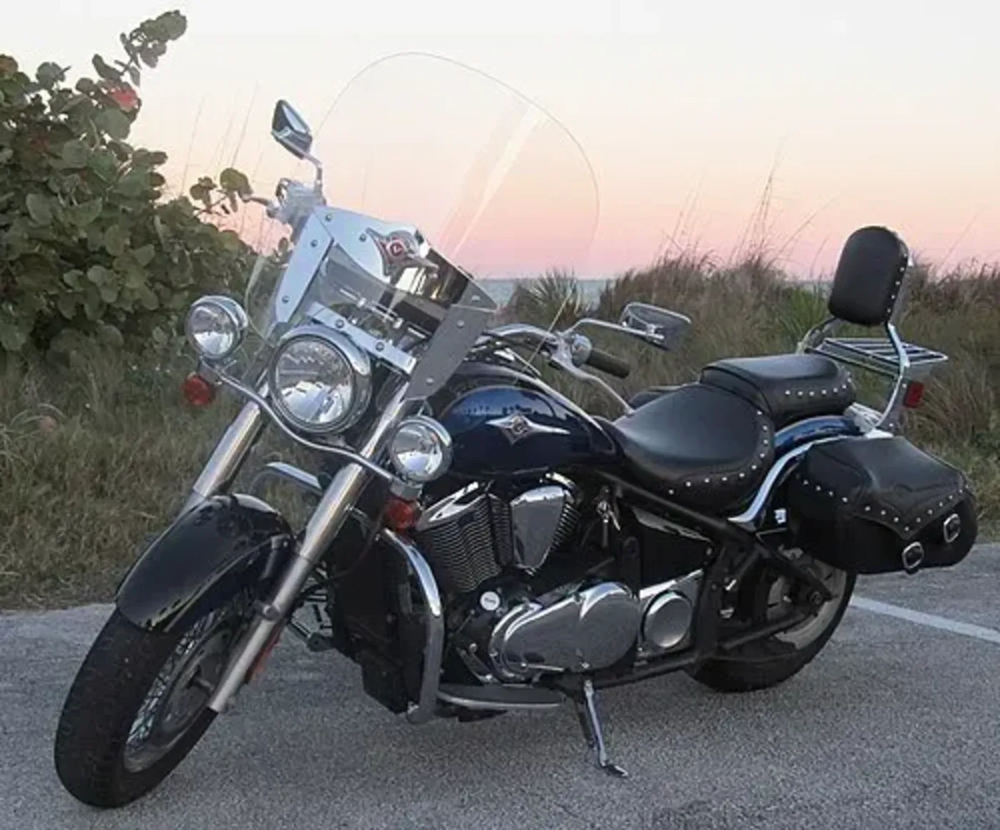

**What £5,000 buys:** 12 listings, typically **£4,195–£4,990** (median £4,597). Mostly
2008–2016 bikes; the median is a 2012 bike with about 12,500 miles.

> "Over recent years Kawasaki has created an impressive portfolio of cruisers and
> Kawasaki VN900 Custom is one of its best yet." [MCN, VN900 Custom (2007) review](https://www.motorcyclenews.com/bike-reviews/kawasaki/vn900-custom/2007/), rated 4/5

A 903 cc water-cooled V-twin, belt drive and Japanese reliability. It looks the part
and costs little to run. BikeSocial doesn't have a review of this model, so again
there is one quote here.

**Check:** the belt, corrosion, and whether it is the Classic or the Custom (with the
21-inch front wheel).

**Who it's for:** riders who want a big-looking cruiser and want to do nothing but ride
it.

## Practical all-rounders

Not glamorous, but these are the bikes that commute all week and tour at the weekend,
for very little money.

### Honda NC750X

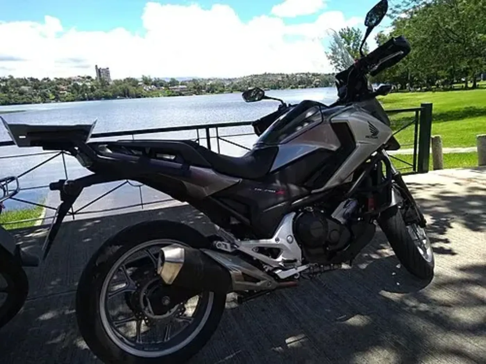

**What £5,000 buys:** 47 listings, typically **£3,995–£4,800** (median £4,295). Mostly
2016–2021 bikes; the median is a 2019 bike with about 15,000 miles.

> "The adaptable Honda NC750X adventure bike embraces a pleasing, old-school, do-it-all
> status." [MCN, NC750X (2014) review](https://www.motorcyclenews.com/bike-reviews/honda/nc750x/2014/), rated 4/5

> "The 2016 NC750X contains some really effective upgrades." [BikeSocial, NC750X (2016–) buying guide](https://www.bennetts.co.uk/bikesocial/reviews/bikes/honda/honda-nc750x-2016-review-used-price-spec)

The most sensible bike here. A low-revving 745 cc twin that returns 70 mpg or more, a
lockable helmet compartment where the tank would be, and Honda's DCT automatic gearbox on
many used bikes. It won't thrill you, but it will save you money every day.

**Check:** DCT or manual (both are good), and luggage.

**Who it's for:** the daily commuter who also wants to tour.

### Kawasaki Versys 650

, via Wikimedia Commons.")

**What £5,000 buys:** 50 listings, typically **£2,990–£4,295** (median £3,545). Mostly
2010–2020 bikes; the median is a 2016 bike with about 14,400 miles.

> "Kawasaki's third-generation Versys 650 has grown into a serious small-capacity
> sports tourer - brilliant at munching big miles for little money." Michael Neeves,
> [MCN, Versys 650 (2015) review](https://www.motorcyclenews.com/bike-reviews/kawasaki/versys-650/2015/), rated 4/5

> "It's a proper do-it-all bike, just as happy commuting all week as it is carving a few
> backroads or heading off for a weekend fully loaded." [BikeSocial, Versys 650 (2007–) buying guide](https://www.bennetts.co.uk/bikesocial/reviews/bikes/kawasaki/kawasaki-versys-650-2007-review-used-price-spec)

One of the cheapest bikes in this log, with a median of £3,545. The 649 cc twin has been
raced and proven tough. Avoid the vibey 2007–2009 bikes; the 2015-on version is the one
MCN rated as a serious sports tourer.

**Check:** the generation, chain and corrosion.

**Who it's for:** riders on a tighter budget who want a capable, comfortable all-rounder.

### Yamaha Tracer 700

**What £5,000 buys:** 20 listings, typically **£4,190–£4,690** (median £4,489). Mostly
2017–2020 bikes; the median is a 2018 bike with about 14,600 miles.

> "The Tracer 700 ticks all the touring boxes." Emma Franklin, [MCN, Tracer 700 (2016) review](https://www.motorcyclenews.com/bike-reviews/yamaha/tracer-700/2016/), rated 4/5

> "The Tracer 700 is a brilliant do-it-all machine that can commute, tour and just be
> enjoyed whatever the weather." [BikeSocial, Tracer 700 (2016–2019) buyer's guide](https://www.bennetts.co.uk/bikesocial/reviews/bikes/yamaha/tracer-700-2016-review-used-price-spec)

An MT-07 with a fairing, a bigger tank and a comfier seat. It is lighter and livelier
than the Honda or the Kawasaki, and both reviews love its engine. The suspension is a
touch soft for fast riding.

**Check:** the same as the MT-07, plus the luggage.

**Who it's for:** the rider who wants practicality but still enjoys a twisty road.

## Hyperbikes and musclebikes

Big engines, huge speed and long legs. Probably the most motorcycle per pound you can
buy, though insurance and tyres won't be cheap.

### Suzuki GSX1300R Hayabusa

, via Wikimedia Commons.")

**What £5,000 buys:** 16 listings, typically **£3,990–£4,499** (median £4,147). Mostly
2001–2008 bikes; the median is a 2005 bike with about 28,000 miles.

> "The original Suzuki GSX1300R Hayabusa is still one seriously quick motorcycle,
> possessed of enormous acceleration and breathtaking top speed." [MCN, GSX1300R Hayabusa (1999) review](https://www.motorcyclenews.com/bike-reviews/suzuki/gsx1300r-hayabusa/1999/), rated 4/5

> "If you enjoy B-road riding then it isn't for you, however if you ride smooth A-roads
> and want effortless acceleration, mind-bending..." [BikeSocial, Hayabusa (1999–2007) review](https://www.bennetts.co.uk/bikesocial/reviews/bikes/suzuki/suzuki-gsx1300r-hayabusa-1999-2007-review-used-price-spec)

The original 190 mph icon, now cheaper than most middleweights. It is long, heavy and
a superb high-speed tourer. BikeSocial is honest: it is not a B-road bike.

**Check:** modifications (lots of 'Busas have been tuned, lowered or stretched),
crash damage and tyres.

**Who it's for:** riders who want a legend and mostly ride on fast A-roads.

### Kawasaki ZZR1400

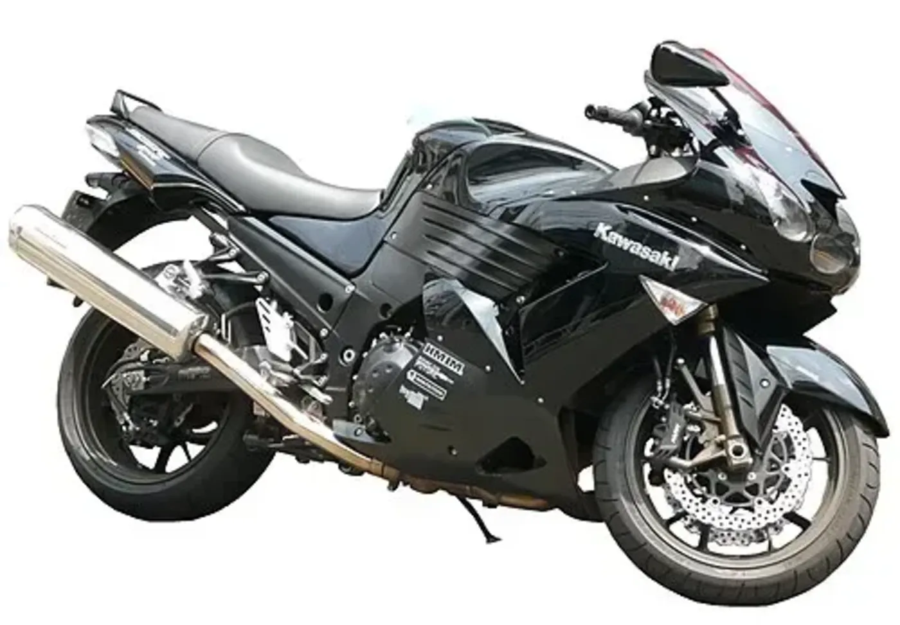

**What £5,000 buys:** 14 listings, typically **£3,150–£4,690** (median £3,894). Mostly
2007–2012 bikes; the median is a 2007 bike with about 30,800 miles.

> "Capable of commuting, two up sporty touring, track days, drag racing, posing – almost
> anything is possible on the big Kawasaki ZZR1400 - just don't try taking it dirt
> riding." [MCN, ZZR1400 (2006) review](https://www.motorcyclenews.com/bike-reviews/kawasaki/zzr1400/2006/), rated 5/5

> "It is a very special bike indeed." [BikeSocial, ZZR1400 (2006–2019) buying guide](https://www.bennetts.co.uk/bikesocial/reviews/bikes/kawasaki/kawasaki-zzr1400-2006-review-used-guide)

When new, the most powerful production bike you could buy, and it is still a
devastating motorway machine. It is more modern and sharper handling than the
Hayabusa, for less money.

**Check:** history and modifications, tyres, and whether it has the optional ABS.

**Who it's for:** riders who want the most power for the least money and can afford
the insurance.

### Suzuki GSF1250 Bandit

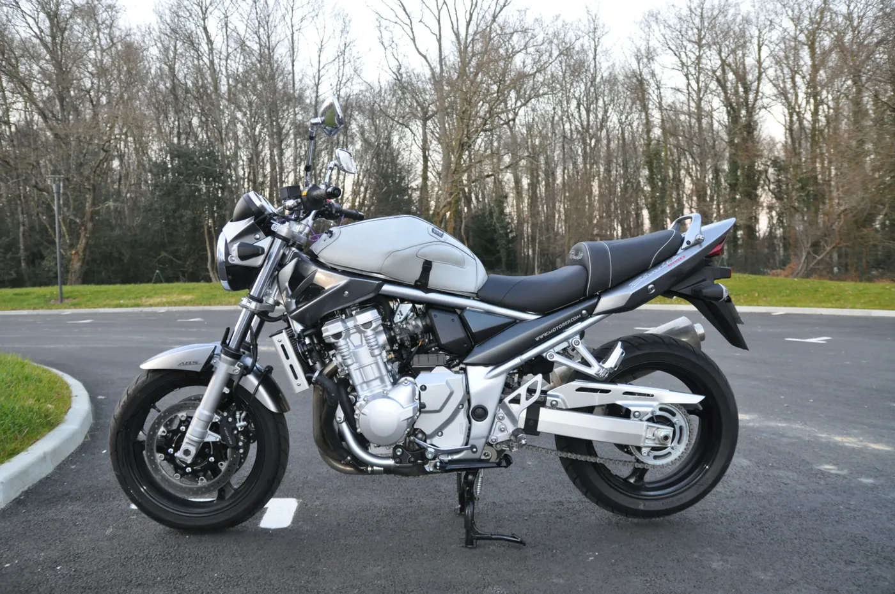

**What £5,000 buys:** 27 listings, typically **£2,899–£3,895** (median £3,499). Mostly
2007–2015 bikes; the median is a 2009 bike with about 21,500 miles.

> "The GSF1250 Bandit's frame and suspension have also been upgraded to give a
> sumptuous, well-mannered mileage machine that can also run in the twisties." [MCN, GSF1250 Bandit (2007) review](https://www.motorcyclenews.com/bike-reviews/suzuki/gsf1250-bandit/2007/), rated 4/5

> "If you are the kind of rider who enjoys a bike with a lot of torque and also has a
> keen eye for a bargain, the Bandit 1250 is a great value machine and an excellent
> motorway commuter." [BikeSocial, GSF1250 Bandit buyer's guide](https://www.bennetts.co.uk/bikesocial/reviews/bikes/suzuki/suzuki-gsf1250-bandit-2007-2012-and-2015-2016-buyers-guide)

A huge-torque 1,255 cc four with a comfortable riding position. It is a no-frills
workhorse, which is exactly why it is so cheap. Many are the half-faired S version,
often with ABS.

**Check:** corrosion (many are winter commuters), the chain, and the brakes.

**Who it's for:** riders who want big-bike grunt for the price of a used 125.

## If it were my £5,000

Ranked purely by how much bike each pound buys, my shortlist would be:

1. **KTM 790 Duke**, for a 2020 bike with cornering ABS, lean-sensitive traction control and a quickshifter.
2. **Triumph Tiger Explorer 1200**, for a GS-beater for £4,500.
3. **Triumph Sprint GT 1050**, for a 1050 cc triple tourer with panniers for £3,650.
4. **Honda Fireblade (2008–2011)**, for the best road superbike at this price.
5. **Triumph Street Triple 675**, for the best fun-per-pound.

For one bike that does it all, I'd buy a Tiger 800 or a Tracer 900 and spend what's
left on tyres, luggage and a trip.

## Frequently asked questions

### Why are there no 125s or A2 bikes?

Because £5,000 is a lot of money for one, and the point of this log was the best bike the
budget buys. If you are on an A2 licence, the MT-07, XSR700 and Tracer 700 can be
restricted to 35 kW by a dealer, and some sellers already list A2-restricted bikes.

### Is a 20-year-old superbike a sensible buy?

It can be, if you're experienced and it has been looked after. Most have no traction
control and many have no ABS. Budget for tyres, a service and, possibly, a chain and
sprockets straight away, and get an insurance quote first.

### Are AutoTrader asking prices what bikes sell for?

No. Asking prices are a starting point; private sales usually leave room to negotiate,
and dealer prices often include a warranty. Use the ranges in this log to judge whether
a bike is priced in line with the market.

### What checks matter most on any used bike?

Run an HPI-style history check, look up the MOT history on
[GOV.UK](https://www.gov.uk/check-mot-history) to verify mileage, ask for the service
history, check that the VIN and engine numbers match the V5C, and test-ride it from cold.
If you are not confident, pay for an inspection.

## Sources and photo credits

### Prices

[AutoTrader UK bike search](https://www.autotrader.co.uk/bikes), national search by make
and model, filtered to a total price of £5,000 or less, checked on **16 October 2026**.
Statistics were calculated from the listings returned; obvious errors (prices under £300
and bikes listed before 1980) were excluded. Listings change daily, so the numbers will
not match a search done later.

### Reviews

Quotes are verbatim from the pages below, each checked on 16 October 2026. Ratings are
MCN's overall review rating for that page. Copyright stays with the publishers;
quotes are short extracts for review and comparison.

**Middleweight naked bikes**

1. [Yamaha MT-07 (2014) review](https://www.motorcyclenews.com/bike-reviews/yamaha/mt-07/2014/), MCN.
2. [Yamaha MT-07 (2014) used review](https://www.bennetts.co.uk/bikesocial/reviews/bikes/yamaha/mt-07-2014-used-review), BikeSocial.
3. [Triumph Street Triple 675 (2013) review](https://www.motorcyclenews.com/bike-reviews/triumph/street-triple-675/2013/), MCN.
4. [Triumph Street Triple (2013–2016) used review](https://www.bennetts.co.uk/bikesocial/reviews/bikes/triumph/street-triple-2013-used-review), BikeSocial.
5. [KTM 790 Duke (2018) review](https://www.motorcyclenews.com/bike-reviews/ktm/790-duke/2018/), Michael Neeves, MCN.
6. [KTM 790 Duke vs Triumph Street Triple R](https://www.bennetts.co.uk/bikesocial/reviews/bikes/group-tests/ktm-790-duke-vs-triumph-street-triple-r-review), BikeSocial.

**Big naked bikes**

7. [Yamaha MT-09 (2014) review](https://www.motorcyclenews.com/bike-reviews/yamaha/mt-09/2014/), Phil West, MCN.
8. [Yamaha MT-09 (2013) used review](https://www.bennetts.co.uk/bikesocial/reviews/bikes/yamaha/mt-09-review-2013-used-price-spec), BikeSocial.
9. [BMW F900R (2020) review](https://www.motorcyclenews.com/bike-reviews/bmw/f900r/2020/), Phil West, MCN.
10. [BMW F900R (2020) review](https://www.bennetts.co.uk/bikesocial/reviews/bikes/bmw/bmw-f900r-2020-review-spec-price), BikeSocial.
11. [Triumph Speed Triple 1050 (2011) review](https://www.motorcyclenews.com/bike-reviews/triumph/speed-triple-1050/2011/), MCN.
12. [Triumph Speed Triple 1050 (2005) used review](https://www.bennetts.co.uk/bikesocial/reviews/bikes/triumph/speed-triple-1050-2005-used-review), BikeSocial.

**Superbikes**

13. [Honda CBR1000RR Fireblade (2008) review](https://www.motorcyclenews.com/bike-reviews/honda/cbr1000rr-fireblade/2008/), MCN.
14. [Honda CBR1000RR Fireblade (2008) used review](https://www.bennetts.co.uk/bikesocial/reviews/bikes/honda/cbr1000rr-fireblade-2008-used-review), BikeSocial.
15. [Suzuki GSX-R1000 (2005) review](https://www.motorcyclenews.com/bike-reviews/suzuki/gsx-r1000/2005/), MCN.
16. [Suzuki GSX-R1000 (2007) used review](https://www.bennetts.co.uk/bikesocial/reviews/bikes/suzuki/gsxr1000-2007-review-used), BikeSocial.
17. [Yamaha R1 (2004) review](https://www.motorcyclenews.com/bike-reviews/yamaha/r1/2004/), MCN.
18. [Yamaha YZF-R1 (2004) review](https://www.bennetts.co.uk/bikesocial/reviews/bikes/yamaha/yzf-r1-2004-review), BikeSocial.

**Middleweight sports bikes**

19. [Triumph Daytona 675 (2006) review](https://www.motorcyclenews.com/bike-reviews/triumph/daytona-675/2006/), MCN.
20. [Triumph Daytona 675 (2006–2012) used review](https://www.bennetts.co.uk/bikesocial/reviews/bikes/triumph/triumph-daytona-675-2006-2012-review-used-price-spec), BikeSocial.
21. [Honda CBR600RR (2007) review](https://www.motorcyclenews.com/bike-reviews/honda/cbr600rr/2007/), MCN.
22. [Honda CBR600RR (2007) used review](https://www.bennetts.co.uk/bikesocial/reviews/bikes/honda/cbr600rr-2007-review-used), BikeSocial.
23. [Suzuki GSX-R750 (2011) review](https://www.motorcyclenews.com/bike-reviews/suzuki/gsx-r750/2011/), Michael Neeves, MCN.
24. [Suzuki GSX-R750 K6/K7 buyer's guide](https://www.bennetts.co.uk/bikesocial/reviews/bikes/suzuki/suzuki-gsx-r750-k6-k7-2006-2007-buyers-guide), BikeSocial.

**Sports tourers**

25. [Kawasaki Z1000SX (2010) review](https://www.motorcyclenews.com/bike-reviews/kawasaki/z1000sx/2010/), MCN.
26. [Kawasaki Z1000SX buyer's guide](https://www.bennetts.co.uk/bikesocial/reviews/bikes/kawasaki/kawasaki-z1000sx-2011-current-buyers-guide), BikeSocial.
27. [Yamaha MT-09 Tracer (2015) review](https://www.motorcyclenews.com/bike-reviews/yamaha/mt-09-tracer/2015/), Phil West, MCN.
28. [Yamaha Tracer 900 (2015) used review](https://www.bennetts.co.uk/bikesocial/reviews/bikes/yamaha/tracer-900-2015-review-used), BikeSocial.
29. [Triumph Sprint GT (2010) review](https://www.motorcyclenews.com/bike-reviews/triumph/sprint-gt-1050/2010/), MCN.
30. [Triumph Sprint GT (2011–2016) used review](https://www.bennetts.co.uk/bikesocial/reviews/bikes/triumph/sprint-gt-2011-used-review), BikeSocial.

**Touring bikes**

31. [BMW R1200RT (2005) review](https://www.motorcyclenews.com/bike-reviews/bmw/r1200rt/2005/), MCN.
32. [BMW R 1200 RT (2006–2013) used review](https://www.bennetts.co.uk/bikesocial/reviews/bikes/bmw/r1200rt-2006-used-review), BikeSocial.
33. [Yamaha FJR1300 (2001) review](https://www.motorcyclenews.com/bike-reviews/yamaha/fjr1300/2001/), MCN.
34. [Yamaha FJR1300 (2013) used review](https://www.bennetts.co.uk/bikesocial/reviews/bikes/yamaha/fjr1300-2013-used-review), BikeSocial.
35. [Triumph Trophy 1200 (2012) review](https://www.motorcyclenews.com/bike-reviews/triumph/trophy-1200/2012/), MCN.
36. [Triumph Trophy (2012) review](https://www.bennetts.co.uk/bikesocial/reviews/bikes/triumph/triumph-trophy), BikeSocial.

**Big adventure bikes**

37. [BMW R1200GS (2004) review](https://www.motorcyclenews.com/bike-reviews/bmw/r1200gs/2004/), MCN.
38. [BMW R1200GS (2004–2019) buying guide](https://www.bennetts.co.uk/bikesocial/reviews/bikes/bmw/r1200gs-2004-review-used), BikeSocial.
39. [Triumph Tiger Explorer 1200 (2012) review](https://www.motorcyclenews.com/bike-reviews/triumph/tiger-1200-explorer/2012/), MCN.
40. [Triumph Tiger Explorer (2012–2015) buyer's guide](https://www.bennetts.co.uk/bikesocial/reviews/bikes/triumph/triumph-tiger-explorer-2012-2015-buyers-guide), BikeSocial.
41. [Suzuki DL1000 V-Strom (2002) review](https://www.motorcyclenews.com/bike-reviews/suzuki/dl1000-v-strom/2002/)
    and [V-Strom 1000 (2014) review](https://www.motorcyclenews.com/bike-reviews/suzuki/dl1000-v-strom/2014/), MCN.
42. [Suzuki V-Strom 1000 (2014–2019) used review](https://www.bennetts.co.uk/bikesocial/reviews/bikes/suzuki/v-strom-1000-2014-used), BikeSocial.

**Middleweight adventure bikes**

43. [Triumph Tiger 800 (2010) review](https://www.motorcyclenews.com/bike-reviews/triumph/tiger-800/2010/), MCN.
44. [Triumph Tiger 800 XRx (2015) used review](https://www.bennetts.co.uk/bikesocial/reviews/bikes/triumph/tiger-800-xrx-2015-review-used-price-spec), BikeSocial.
45. [BMW F800GS (2008) review](https://www.motorcyclenews.com/bike-reviews/bmw/f800gs/2008/), Michael Guy, MCN.
46. [Suzuki DL650 V-Strom (2011) review](https://www.motorcyclenews.com/bike-reviews/suzuki/dl650-v-strom/2011/), MCN.
47. [Suzuki V-Strom 650 (2017) review](https://www.bennetts.co.uk/bikesocial/reviews/bikes/suzuki/reviewed-2017-suzuki-v-strom-650), BikeSocial.

**Modern classics**

48. [Triumph Bonneville 900 (2000–2016) review](https://www.motorcyclenews.com/bike-reviews/triumph/bonneville-900/2000/), MCN.
49. [Triumph Bonneville (2001) used review](https://www.bennetts.co.uk/bikesocial/reviews/bikes/triumph/bonneville-2001-used-review), BikeSocial.
50. [Ducati Scrambler 800 (2015) review](https://www.motorcyclenews.com/bike-reviews/ducati/scrambler-800/2015/), Adam Child, MCN.
51. [Ducati Scrambler 800 (2015–) buying guide](https://www.bennetts.co.uk/bikesocial/reviews/bikes/ducati/scrambler-803-2015-used), BikeSocial.
52. [Yamaha XSR700 (2015–2021) review](https://www.motorcyclenews.com/bike-reviews/yamaha/xsr700/2015/), Andy Davidson, MCN.
53. [Yamaha XSR700 (2016–) buyer's guide](https://www.bennetts.co.uk/bikesocial/reviews/bikes/yamaha/xsr700-2016-review-used-price-spec), BikeSocial.

**Cruisers**

54. [Harley-Davidson Sportster Iron 883 (2015) review](https://www.motorcyclenews.com/bike-reviews/harley-davidson/sportster-883/2015/), Jordan Gibbons, MCN.
55. [Harley-Davidson Iron 883 (2010–) buying guide](https://www.bennetts.co.uk/bikesocial/reviews/bikes/harley-davidson/harley-davidson-iron-883-2010-current-review-buying-guide), BikeSocial.
56. [Triumph Speedmaster (2011) review](https://www.motorcyclenews.com/bike-reviews/triumph/speedmaster/2011/), MCN.
57. [Kawasaki VN900 Custom (2007) review](https://www.motorcyclenews.com/bike-reviews/kawasaki/vn900-custom/2007/), MCN.

**Practical all-rounders**

58. [Honda NC750X (2014) review](https://www.motorcyclenews.com/bike-reviews/honda/nc750x/2014/), MCN.
59. [Honda NC750X (2016–) buying guide](https://www.bennetts.co.uk/bikesocial/reviews/bikes/honda/honda-nc750x-2016-review-used-price-spec), BikeSocial.
60. [Kawasaki Versys 650 (2015) review](https://www.motorcyclenews.com/bike-reviews/kawasaki/versys-650/2015/), Michael Neeves, MCN.
61. [Kawasaki Versys 650 (2007–) buying guide](https://www.bennetts.co.uk/bikesocial/reviews/bikes/kawasaki/kawasaki-versys-650-2007-review-used-price-spec), BikeSocial.
62. [Yamaha Tracer 700 (2016) review](https://www.motorcyclenews.com/bike-reviews/yamaha/tracer-700/2016/), Emma Franklin, MCN.
63. [Yamaha Tracer 700 (2016–2019) buyer's guide](https://www.bennetts.co.uk/bikesocial/reviews/bikes/yamaha/tracer-700-2016-review-used-price-spec), BikeSocial.

**Hyperbikes and musclebikes**

64. [Suzuki GSX1300R Hayabusa (1999) review](https://www.motorcyclenews.com/bike-reviews/suzuki/gsx1300r-hayabusa/1999/), MCN.
65. [Suzuki GSX1300R Hayabusa (1999–2007) review](https://www.bennetts.co.uk/bikesocial/reviews/bikes/suzuki/suzuki-gsx1300r-hayabusa-1999-2007-review-used-price-spec), BikeSocial.
66. [Kawasaki ZZR1400 (2006) review](https://www.motorcyclenews.com/bike-reviews/kawasaki/zzr1400/2006/), MCN.
67. [Kawasaki ZZR1400 (2006–2019) buying guide](https://www.bennetts.co.uk/bikesocial/reviews/bikes/kawasaki/kawasaki-zzr1400-2006-review-used-guide), BikeSocial.
68. [Suzuki GSF1250 Bandit (2007) review](https://www.motorcyclenews.com/bike-reviews/suzuki/gsf1250-bandit/2007/), MCN.
69. [Suzuki GSF1250 Bandit buyer's guide](https://www.bennetts.co.uk/bikesocial/reviews/bikes/suzuki/suzuki-gsf1250-bandit-2007-2012-and-2015-2016-buyers-guide), BikeSocial.

### Photographs

All 36 photographs are from Wikimedia Commons and are used under the licence shown.
Each was resized to at most 1,400 pixels wide, had its metadata stripped and was
converted to WebP. They are not covered by this
site's code licence, and no photographer or manufacturer endorsement is implied.

1. Yamaha MT-07 (2021 model shown): [2021_Black_Yamaha_MT-07.jpg](https://commons.wikimedia.org/wiki/File:2021_Black_Yamaha_MT-07.jpg) by PackMecEng, [CC BY-SA 4.0](https://creativecommons.org/licenses/by-sa/4.0).
2. Triumph Street Triple 675, 2013–2016 generation: [Triumph_Street_Triple_675,_blue.jpg](https://commons.wikimedia.org/wiki/File:Triumph_Street_Triple_675,_blue.jpg) by Cjp24, [CC BY-SA 4.0](https://creativecommons.org/licenses/by-sa/4.0).
3. KTM 790 Duke, 2018 model: [KTM_790_Duke_(1).jpg](https://commons.wikimedia.org/wiki/File:KTM_790_Duke_(1).jpg) by Cjp24, [CC BY-SA 4.0](https://creativecommons.org/licenses/by-sa/4.0).
4. Yamaha MT-09, 2014 model: [Yamaha_MT-09_2014.jpg](https://commons.wikimedia.org/wiki/File:Yamaha_MT-09_2014.jpg) by TheMalsa, [CC BY-SA 3.0](https://creativecommons.org/licenses/by-sa/3.0).
5. BMW F 900 R, 2020 model: [BMW_F900R_(12)_JDL.jpg](https://commons.wikimedia.org/wiki/File:BMW_F900R_(12)_JDL.jpg) by Wiki LIC, [CC BY-SA 4.0](https://creativecommons.org/licenses/by-sa/4.0).
6. Triumph Speed Triple 1050, 2011 model: [Triumph_Speed_Triple_1050_2011.jpg](https://commons.wikimedia.org/wiki/File:Triumph_Speed_Triple_1050_2011.jpg) by DeFacto, [CC BY-SA 4.0](https://creativecommons.org/licenses/by-sa/4.0).
7. Honda CBR1000RR Fireblade, 2008 model: [CBR1000R_Fireblade_08.jpg](https://commons.wikimedia.org/wiki/File:CBR1000R_Fireblade_08.jpg) by Darth NormaN, [CC BY 3.0](https://creativecommons.org/licenses/by/3.0).
8. Suzuki GSX-R1000 K6 (2006) with an aftermarket Yoshimura exhaust: [Suzuki_GSX-R1000_'06_with_Full_Yoshimura_Exhaust.jpg](https://commons.wikimedia.org/wiki/File:Suzuki_GSX-R1000_'06_with_Full_Yoshimura_Exhaust.jpg) by Steven Bohn, [CC BY-SA 3.0](https://creativecommons.org/licenses/by-sa/3.0).
9. Yamaha YZF-R1, 2006 model: [Yamaha_YZF-R1_2006.jpg](https://commons.wikimedia.org/wiki/File:Yamaha_YZF-R1_2006.jpg) by StealthFX, public domain.
10. Triumph Daytona 675, 2009 model: [Triumph_Daytona_675_2009.jpg](https://commons.wikimedia.org/wiki/File:Triumph_Daytona_675_2009.jpg) by Oz from Near Bristol, UK, [CC BY 2.0](https://creativecommons.org/licenses/by/2.0).
11. Honda CBR600RR, 2007 model: [HONDA_CBR600RR_2007TMCS.jpg](https://commons.wikimedia.org/wiki/File:HONDA_CBR600RR_2007TMCS.jpg) by PekePON, [CC BY-SA 3.0](https://creativecommons.org/licenses/by-sa/3.0).
12. Suzuki GSX-R750, 2011 model: [2011_Suzuki_GSX-R750.jpg](https://commons.wikimedia.org/wiki/File:2011_Suzuki_GSX-R750.jpg) by Muaddib.1402, [CC BY-SA 3.0](https://creativecommons.org/licenses/by-sa/3.0).
13. Kawasaki Z1000SX: [Green_Kawasaki_Z1000SX_in_Seoul.jpg](https://commons.wikimedia.org/wiki/File:Green_Kawasaki_Z1000SX_in_Seoul.jpg) by Ox1997cow, [CC BY-SA 3.0](https://creativecommons.org/licenses/by-sa/3.0).
14. Yamaha MT-09 Tracer (sold as the FJ-09 in the US): [Yamaha_MT-09_Tracer_(FJ-09).jpg](https://commons.wikimedia.org/wiki/File:Yamaha_MT-09_Tracer_(FJ-09).jpg) by Danielvd, [CC BY-SA 4.0](https://creativecommons.org/licenses/by-sa/4.0).
15. Triumph Sprint GT at the 2011 Paris motorcycle show: [Paris_-_Salon_de_la_moto_2011_-_Triumph_-_Sprint_GT_-_003.jpg](https://commons.wikimedia.org/wiki/File:Paris_-_Salon_de_la_moto_2011_-_Triumph_-_Sprint_GT_-_003.jpg) by Thesupermat, [CC BY-SA 3.0](https://creativecommons.org/licenses/by-sa/3.0).
16. BMW R 1200 RT, 2010 model: [BMW 2010 R1200RT Special.jpg](https://commons.wikimedia.org/wiki/File:BMW_2010_R1200RT_Special.jpg) by Hans45, [CC BY-SA 3.0](https://creativecommons.org/licenses/by-sa/3.0).
17. Yamaha FJR1300: [YAMAHA_FJR1300.JPG](https://commons.wikimedia.org/wiki/File:YAMAHA_FJR1300.JPG) by Tokumeigakarinoaoshima, [CC0 (public domain)](http://creativecommons.org/publicdomain/zero/1.0/deed.en).
18. Triumph Trophy SE, 2013 model: [2013 Pacific Blue Triumph Trophy SE.jpg](https://commons.wikimedia.org/wiki/File:2013_Pacific_Blue_Triumph_Trophy_SE.jpg) by Uberchuckie, [CC BY-SA 3.0](https://creativecommons.org/licenses/by-sa/3.0).
19. BMW R 1200 GS 30 Years GS Edition, 2010 model: [BMW R 1200 GS 30 Years GS Edition 2010.JPG](https://commons.wikimedia.org/wiki/File:BMW_R_1200_GS_30_Years_GS_Edition_2010.JPG) by Pierotreruote, [CC BY-SA 3.0](https://creativecommons.org/licenses/by-sa/3.0).
20. Triumph Tiger Explorer at the 2011 Paris motorcycle show: [Paris_-_Salon_de_la_moto_2011_-_Triumph_-_Tiger_Explorer_-_001.jpg](https://commons.wikimedia.org/wiki/File:Paris_-_Salon_de_la_moto_2011_-_Triumph_-_Tiger_Explorer_-_001.jpg) by Thesupermat, [CC BY-SA 3.0](https://creativecommons.org/licenses/by-sa/3.0).
21. Suzuki DL1000 V-Strom, first generation: [V-strom9.jpg](https://commons.wikimedia.org/wiki/File:V-strom9.jpg) by Rcbarnes2, public domain.
22. Triumph Tiger 800 XCx: [Triumph_Tiger_800_XCx.jpeg](https://commons.wikimedia.org/wiki/File:Triumph_Tiger_800_XCx.jpeg) by San Andreas, [CC BY-SA 3.0](https://creativecommons.org/licenses/by-sa/3.0).
23. BMW F 800 GS, 2013 model: [BMW_F_800_GS_2013_(10546845423).jpg](https://commons.wikimedia.org/wiki/File:BMW_F_800_GS_2013_(10546845423).jpg) by order_242 from Chile, [CC BY-SA 2.0](https://creativecommons.org/licenses/by-sa/2.0).
24. Suzuki V-Strom 650XT ABS, 2015 model: [2015_Suzuki_V-Strom_650XT_ABS.JPG](https://commons.wikimedia.org/wiki/File:2015_Suzuki_V-Strom_650XT_ABS.JPG) by Nevilleg, [CC BY-SA 4.0](https://creativecommons.org/licenses/by-sa/4.0).
25. Triumph Bonneville T100: [Triumph_Bonneville_T100_(02).jpg](https://commons.wikimedia.org/wiki/File:Triumph_Bonneville_T100_(02).jpg) by Gianni Careddu, [CC BY-SA 4.0](https://creativecommons.org/licenses/by-sa/4.0).
26. Ducati Scrambler Icon, first generation: [Ducati_Scrambler_(1).jpg](https://commons.wikimedia.org/wiki/File:Ducati_Scrambler_(1).jpg) by Cjp24, [CC BY-SA 4.0](https://creativecommons.org/licenses/by-sa/4.0).
27. Yamaha XSR700, first generation: [Scenic_motorcycle_(Unsplash).jpg](https://commons.wikimedia.org/wiki/File:Scenic_motorcycle_(Unsplash).jpg) by Francisco Requena mackfrancis, [CC0 (public domain)](http://creativecommons.org/publicdomain/zero/1.0/deed.en).
28. Harley-Davidson Iron 883 (XL883N): [XL883N.jpg](https://commons.wikimedia.org/wiki/File:XL883N.jpg) by Ocdp, [CC BY-SA 3.0](https://creativecommons.org/licenses/by-sa/3.0).
29. Triumph Speedmaster, 2009 model: [Triumph_Speedmaster_2009.JPG](https://commons.wikimedia.org/wiki/File:Triumph_Speedmaster_2009.JPG) by Thruxton, [CC BY 3.0](https://creativecommons.org/licenses/by/3.0).
30. Kawasaki VN900 Custom, 2009 model: [09VN900D.jpg](https://commons.wikimedia.org/wiki/File:09VN900D.jpg) by DiRF, [CC BY-SA 3.0](https://creativecommons.org/licenses/by-sa/3.0).
31. Honda NC750X, 2017 model: [2017_Honda_NC750X.jpg](https://commons.wikimedia.org/wiki/File:2017_Honda_NC750X.jpg) by Carsamar, [CC BY-SA 4.0](https://creativecommons.org/licenses/by-sa/4.0).
32. Kawasaki Versys 650, 2010 model: [Versys 650 2010.jpg](https://commons.wikimedia.org/wiki/File:Versys_650_2010.jpg) by Bicanski, [CC0 (public domain)](http://creativecommons.org/publicdomain/zero/1.0/deed.en).
33. Yamaha Tracer 700, 2017 model: [2017-06-19_Yamaha_700_Tracer,_Baujahr_2017,_blau_(01).jpg](https://commons.wikimedia.org/wiki/File:2017-06-19_Yamaha_700_Tracer,_Baujahr_2017,_blau_(01).jpg) by GT1976, [CC BY-SA 4.0](https://creativecommons.org/licenses/by-sa/4.0).
34. Suzuki GSX1300R Hayabusa, 2000 model: [2000_GSX1300R_HAYABUSA_Pearl_Suzuki_Deep_Blue×Metallic_Sonic_Silver.jpg](https://commons.wikimedia.org/wiki/File:2000_GSX1300R_HAYABUSA_Pearl_Suzuki_Deep_Blue×Metallic_Sonic_Silver.jpg) by Yama kujira, [CC0 (public domain)](http://creativecommons.org/publicdomain/zero/1.0/deed.en).
35. Kawasaki ZZR1400, 2006 model: [Kawasaki_ZZR1400_2006.jpg](https://commons.wikimedia.org/wiki/File:Kawasaki_ZZR1400_2006.jpg) by PekePON, [CC BY-SA 3.0](https://creativecommons.org/licenses/by-sa/3.0).
36. Suzuki GSF1250 Bandit N: [Suzuki-GSF-Bandit-1250-N-01.JPG](https://commons.wikimedia.org/wiki/File:Suzuki-GSF-Bandit-1250-N-01.JPG) by Brezh, [CC BY-SA 3.0](https://creativecommons.org/licenses/by-sa/3.0).
