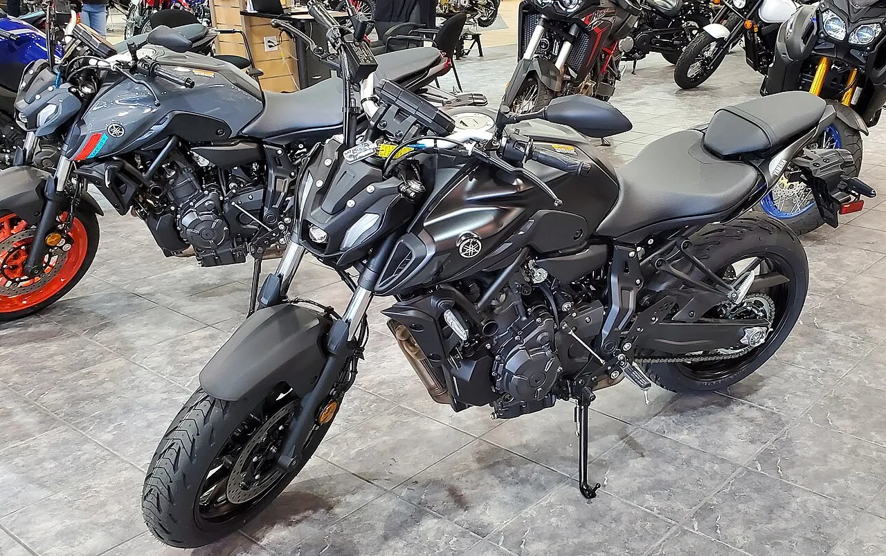
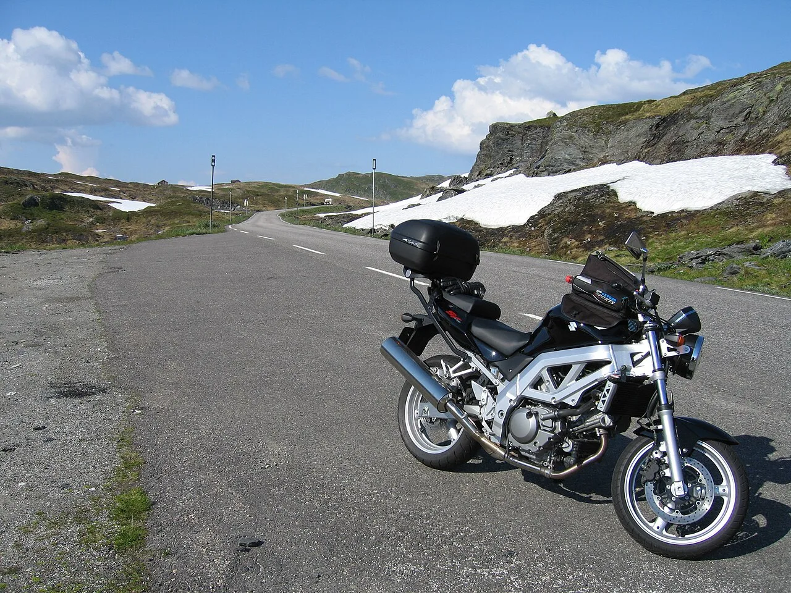
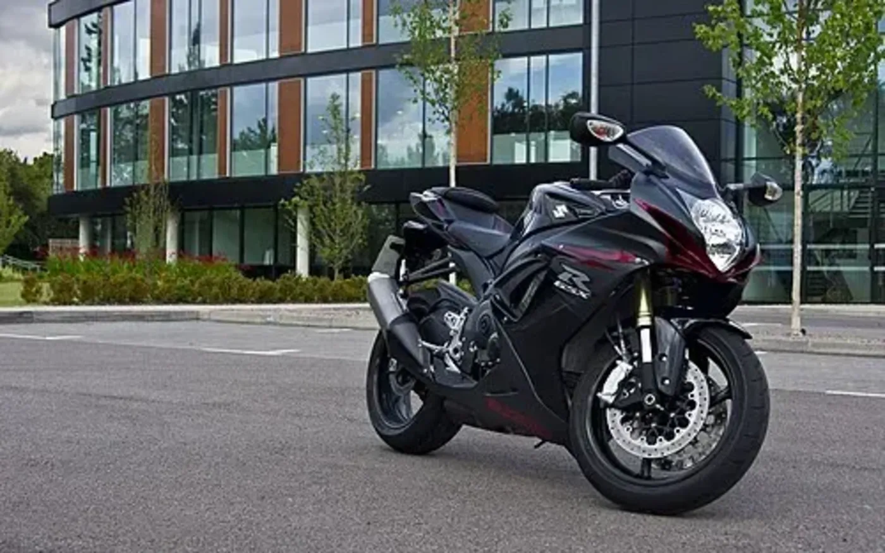
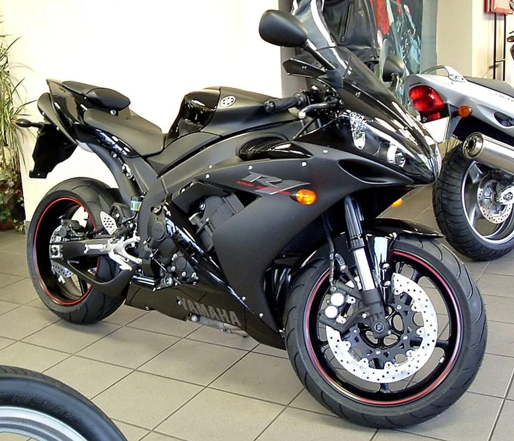
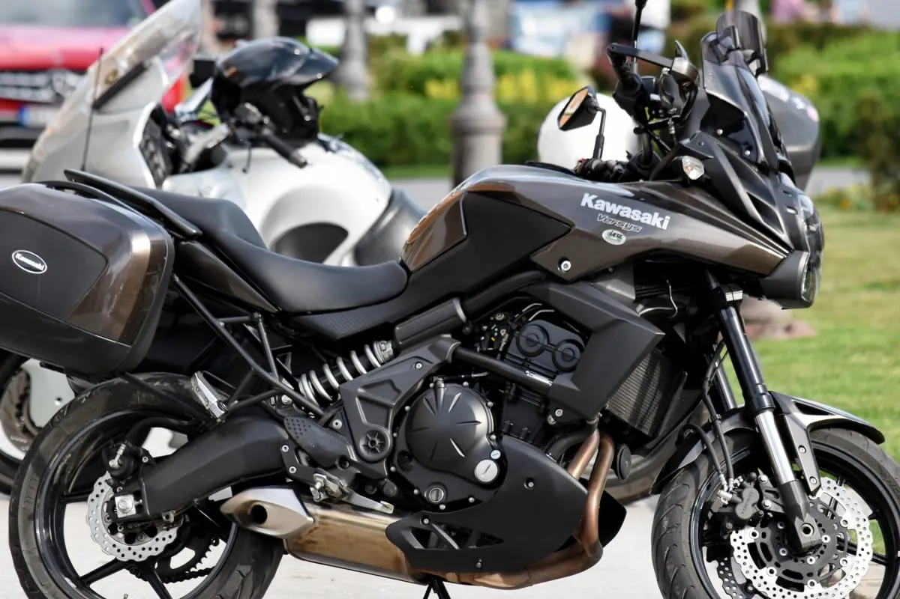
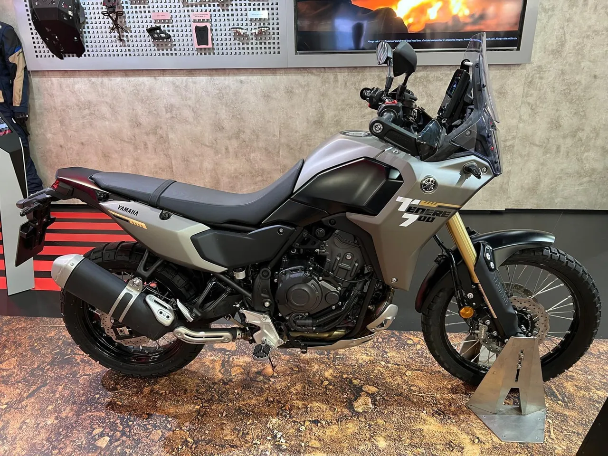
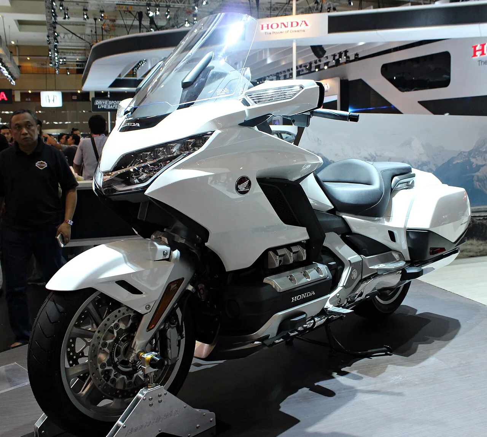
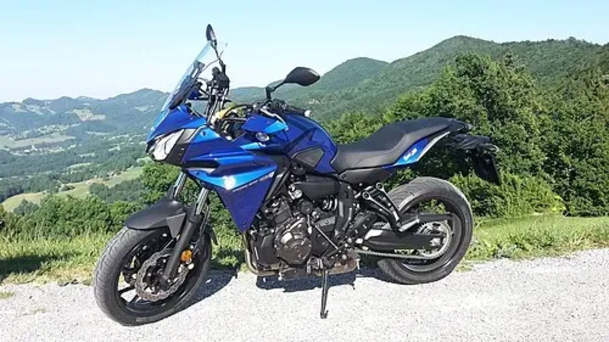

The best motorcycle is not necessarily the one that wins a launch test. If you intend
to keep it, commute through winter or disappear across Europe, the more interesting
questions are what breaks, how expensive it is to put right, and how much attention
it needs between rides.

My starting shortlist is the **Yamaha MT-07 for a naked, Honda CBR600RR for a used
supersport, and Suzuki V-Strom 650 for road-biased adventure touring**. For genuine
trail use, the **Yamaha Ténéré 700** takes the adventure slot instead.

Those are editorial recommendations, **not statistically proven reliability
champions**. There is no accessible, current, like-for-like failure-rate dataset
covering every model and generation below.

For touring, there are different answers again: the **BMW GS Adventure is the
long-range pick in this comparison**, the **Honda Gold Wing Tour is the luxury
two-up comfort pick**, and a **manual Honda NC750X is where I would start when
minimising ownership costs**. A used **Yamaha FJR1300A** is the shaft-drive
alternative when luggage, a passenger and sustained motorway work matter more.

## In this guide

- [What the research can actually tell us](#what-the-research-can-actually-tell-us)
- [The shortlist at a glance](#the-shortlist-at-a-glance)
- [Naked motorcycles](#naked-motorcycles)
- [Supersport motorcycles](#supersport-motorcycles)
- [Adventure motorcycles](#adventure-motorcycles)
- [Touring: which bike can cover the most miles?](#touring-which-bike-can-cover-the-most-miles)
- [Which needs the least maintenance?](#which-needs-the-least-maintenance)
- [Which costs the least to insure?](#which-costs-the-least-to-insure)
- [Putting the running costs together](#putting-the-running-costs-together)
- [The checks that matter more than the badge](#the-checks-that-matter-more-than-the-badge)
- [My final buying order](#my-final-buying-order)
- [Sources and photograph licences](#sources-and-photograph-licences)

## What the research can actually tell us

**Research checked on 16 October 2026. UK market; new and used bikes considered.**
I have not personally ridden, dismantled or inspected these motorcycles. This is a
desk-researched synthesis, not a first-hand road test. It is not possible to search
every review on the internet, and inaccessible pages have not been treated as evidence.

The useful distinction is between four kinds of information:

1. **Used-buying guides** identify recurring faults, expensive wear items and the
   generations worth targeting. These are the main basis for the reliability
   shortlist, particularly BikeSocial's model-specific guides.
2. **Road tests and comparisons** reveal comfort, fuel consumption and practical
   annoyances. They do not establish a lifetime failure rate. A brilliant launch
   review cannot tell us how a new gearbox will behave at 60,000 miles.
3. **Owner reports** help find questions to investigate, not percentages to repeat.
   MCN's owner-review sections are useful here, but self-selection, different
   mileages and inconsistent model-year reporting prevent a controlled comparison.
4. **Official recall information and the exact owner's manual** matter at purchase.
   A recall count is not a reliability league table; completion of the relevant
   work on the particular bike is what matters.

The sources are linked beside the claims and collected below. Most of the detailed
fault evidence comes from **one publisher, Bennetts BikeSocial**, which also sells
insurance. Rider provides an independent touring test, and MCN contributes
explicitly labelled owner anecdotes. This is not three independent reliability
studies, nor a claim of consensus across the entire motorcycle press. There are no
affiliate links in this article.

**Reliability, durability and low maintenance are different things.** A reliable
chain-driven twin still needs chain care. A durable shaft-drive tourer can have an
expensive electronic suspension fault. A bike that reaches a huge mileage with
regular repairs has demonstrated longevity, not necessarily trouble-free ownership.

## The shortlist at a glance

These are the generations supported by the evidence, not permission to transfer
their reputation automatically to every motorcycle wearing the same name.
Availability of new bikes and old dealer stock varies; verify UK availability
rather than assuming every model below remains in production.

| Job | My starting choice | Evidence scope | Main reason | Main reservation |
| --- | --- | --- | --- | --- |
| Everyday naked | Yamaha MT-07 | Established 689 cc CP2 generations; used guide from 2014 | Strong engine reputation, straightforward package | Corrosion and budget suspension |
| Value naked | Suzuki SV650 | 2016-on generation in the linked used guide | Proven V-twin, accessible mechanical layout | Front-cylinder weather exposure and finish |
| Faster naked | Yamaha MT-09 | 847 cc, 2013–2020 guide | Strong CP3 engine reputation | Early throttle response, suspension and abuse |
| Used supersport | Honda CBR600RR | 2007-on generation in the linked guide | Few reported engine horror stories | Crash history, valve-service bill and C-ABS costs |
| More flexible sports bike | Suzuki GSX-R750 | K6/K7 fault guide; later bike pictured separately | Road-friendly torque for a supersport | Brake recall, electrics and gearbox checks |
| Road adventure | Suzuki V-Strom 650 | Long-running 645 cc family; 2017 update reviewed | Established engine, useful tank and luggage provision | Finish and age-related condition |
| Road adventure alternative | Kawasaki Versys 650 | Established 649 cc family in the used guide | Durable engine, road wheels, sensible consumables | Exhaust corrosion and winter neglect |
| Trail-capable adventure | Yamaha Ténéré 700 | Original-generation used evidence, not all later revisions | Proven CP2 with a genuine off-road chassis | Wheels, drop damage and vulnerable exhaust mounting |
| Used full-size tourer | Yamaha FJR1300A | 2013–2021 guide | Established engine, shaft, cruise control | Weight, shaft care and recall completion |
| Low-cost touring all-rounder | Honda NC750X manual | 2016-on used guide and 2025 road test | Frugal engine and practical storage | Still chain-driven; not a luxury tourer |

There is deliberately no numerical reliability score. Turning a journalist's
phrase such as “very reliable” into a score of 97/100 would manufacture precision
the evidence does not contain.

## Naked motorcycles

### Yamaha MT-07: my everyday reliability-first pick

The case for the MT-07 is the engine, not an exotic specification.
[BikeSocial's used guide][mt07] describes very few serious CP2 engine stories and
an established reliability record. The same engine family appears in the XSR700,
Tracer 700 and Ténéré 700, which gives buyers several ways to use the basic recipe.

The important qualification is that **engine reliability is not the same as
weatherproof finish**. Check fasteners, exposed metal, exhaust, radiator and
suspension linkages. A neglected winter commuter can cost more to put right than a
cleaner bike with higher recorded mileage.

An [MCN owner report][mcn-mt07] describes reliable all-weather use, but also mentions
protective treatment. That is supporting anecdote, not evidence that every MT-07
survives salt without care.

**Buy it for:** daily riding, reasonable consumables and a familiar mechanical
platform. **Choose something else for:** wind protection and regular two-up touring.
The newer Y-AMT transmission needs its own evidence; the earlier manual bike's
reputation does not prove the newer system's long-term durability.

### Suzuki SV650: the value alternative

The [2016-on SV650 buying guide][sv650] makes a persuasive case for the V-twin's
dependability and home-maintenance friendliness. It also supplies the reasons not
to treat that reputation as immunity from faults.

Look at the front spark-plug area and its drainage, exhaust studs and pipe joints,
cam-chain-tensioner noise, and brake-caliper sliders. Weather exposure and corrosion
are the recurring theme. This is a bike to inspect from underneath, not just admire
in a dealer's photographs.

**My comparison:** choose the cleaner, better-documented example over an automatic
preference for either the SV or MT-07. The SV can make particular sense if the
purchase price leaves money for servicing and security. It is not automatically
cheaper to insure simply because it is less fashionable.

### Yamaha MT-09: the faster option, with a bigger condition warning

[BikeSocial's 2013–2020 guide][mt09] reports few major CP3 engine issues. That earns
the **847 cc generation** a place here; it does not establish a failure rate for
the later 890 cc bikes.

Early throttle response and soft suspension are reasons for a careful test ride.
Inspect head bearings, fork seals, suspension linkages and crash marks. A strong
engine reputation cannot undo repeated hard landings or poor servicing.

**My comparison:** MT-07 for the simpler everyday proposition; MT-09 when you
genuinely want more performance and accept a potentially larger tyre and insurance
budget. Ask for quotes before deciding that the bigger bike is a bargain.

## Supersport motorcycles

### Honda CBR600RR: my first used supersport inspection

The [2007-generation used guide][cbr600] reports few engine horror stories and
highlights the **16,000-mile valve-clearance service**. That combination makes the
CBR600RR a sensible place to start if you want a genuine supersport rather than a
relaxed road bike with fairings.

Condition is the deciding factor: look for crash repairs, mismatched bodywork,
damaged steering stops, tired suspension and an unclear track history. Check gear
selection under appropriate test-ride conditions, especially if an aftermarket
quickshifter has been fitted.

Later C-ABS-equipped examples need particular attention to brake-fluid servicing
and system condition. The guide flags extra maintenance work and expensive
replacement components. Do not choose a non-ABS bike merely to avoid a possible
repair bill without considering the safety trade-off.

An [MCN owner account][mcn-cbr600] describes dependable commuting, but it remains
one owner's experience. Neither that account nor the used guide proves the CBR has
the lowest failure rate of every 600.

**Verdict:** my reliability-led used supersport starting point, not my cheap
commuting or touring recommendation. The current-generation CBR600RR must be
assessed separately; an old model's record cannot certify newer electronics.

### Suzuki GSX-R750: more road flexibility, more checks

The attraction is the balance: less need to chase revs than on a 600, without
choosing a litre superbike just to gain overtaking flexibility.

But [BikeSocial's K6/K7 guide][gsxr750] is not a clean bill of health. It flags
front-brake recall work, throttle-position-sensor and exhaust-valve issues,
corrosion, and gearbox concerns, especially on bikes with quickshifters.

**Verdict:** a credible alternative if you want the engine character, but not a
reason to overlook a better-kept CBR. Verify the exact generation and recall
applicability by VIN; the 2011 photograph does not make the K6/K7 findings a
2011-model reliability study.

### Why a Yamaha R1 is not my default reliability recommendation

The [2004–2006 R1 guide][r1] illustrates why brand-wide recommendations are weak.
It describes a generally strong engine but warns that generator-rotor magnets
can detach as their adhesive ages, with potentially severe engine damage.

That is a specific inspection and repair-history question for this generation.
It is **not** a claim that every R1 has the problem. For a buyer whose first
priority is avoiding unexpected mechanical trouble, however, it is enough to
put the CBR600RR ahead on my initial shopping list.

### And a litre-class Honda Fireblade?

The [2008–2011 Fireblade buying guide][fireblade] is broadly positive about engine
reliability, while flagging C-ABS complications, exhaust corrosion and chassis
wear. It belongs on a shortlist if you specifically want a litre sports bike.

I would not buy one to save money over a 600. Tyres, brakes, fairing damage and the
actual insurance quotation can outweigh a tempting used purchase price. Nor
should findings about this generation be transferred to the later CBR1000RR-R.

## Adventure motorcycles

### Suzuki V-Strom 650: my road-touring reliability pick

The V-Strom combines the established 645 cc V-twin family with a more useful
touring format than the naked SV650: weather protection, luggage provision and
an upright riding position.

[BikeSocial's 2017 review][vstrom] documents the evolutionary engine update,
traction control and a **20-litre tank**. The shared engine lineage supports the
shortlist, but that launch test alone does not establish the updated model's
long-term reliability.

For a used example, I would inspect corrosion, brakes, bearings, rear suspension,
charging behaviour and service records before worrying about the odometer.
[MCN's owner-review section][mcn-vstrom] also demonstrates the limits of owner
ratings: one contributor explicitly says their bike is too new for their
reliability rating to be useful.

**Verdict:** my first road-biased adventure viewing, especially used. Do not
confuse the V-Strom 650's long record with evidence for the quite different
V-Strom 800 engine and electronics.

### Kawasaki Versys 650: the road-focused alternative

The [Versys buying guide][versys] describes a very durable ER-6-derived engine,
while identifying exhaust corrosion, neglected examples that consume oil, and
electrical connections as things to investigate.

Its 17-inch cast wheels and road-biased chassis suit a rider whose “adventure”
is a wet week in Wales rather than a remote trail. The 2015 update brought a
**21-litre tank**, compared with 19 litres on the earlier bike pictured.

**My comparison:** V-Strom for its particular touring package; Versys if you
prefer its road handling and find the better example. Neither needs to be
replaced by a more powerful machine to do ordinary touring.

### Yamaha Ténéré 700: when the route genuinely leaves the road

[The original-generation used guide][t7] supports the CP2 engine's reputation but
also identifies spoke corrosion, wheel and radiator condition, brittle plastics,
clutch wear and damage from off-road use.

The [2022 World Raid review][worldraid] adds a particularly important warning:
the exhaust mounting can allow a fall to damage surrounding parts. That is a
real ownership concern even if the engine never misses a beat.

**Verdict:** my trail-capable pick, not the universal touring winner. Seat
comfort, seat height, tyre choice and repairing a puncture matter as much as the
engine when travelling. The early bike's simpler specification must not be
confused with later electronics and chassis revisions.

For mainly tarmac riding, I would still inspect a V-Strom or Versys first.

## Touring: which bike can cover the most miles?

“Most miles on a ride” can mean **between fuel stops**, **comfortably during a
day**, or **over the motorcycle's life**. Those are three different comparisons.
No bike makes riding while tired safe, and no review establishes a maximum
comfortable daily mileage for every rider.

### Between fuel stops: the GS Adventure leads this shortlist

The **BMW R 1250 GS Adventure and R 1300 GS Adventure** are the long-range starting
points here, with their **30-litre tanks**. These are the Adventure versions, not
the standard GS.

The [R 1300 GSA test][gsa1300] is unusually useful because it separates the
laboratory figure from road riding. It quotes **57.6 imperial mpg** under WMTC
for the manual bike, a more ordinary riding figure around **47 mpg**, and
**37.5 mpg** during the review's more demanding riding.

That produces dramatically different arithmetic:

| R 1300 GS Adventure scenario | Input | Calculated full-to-empty range |
| --- | --- | ---: |
| Published WMTC figure, manual bike | 30 litres, 57.6 imperial mpg | 380 miles |
| Reviewer's more ordinary-riding estimate | 30 litres, 47 imperial mpg | 310 miles |
| Review's demanding-use consumption | 30 litres, 37.5 imperial mpg | 247 miles |

**These are calculations, not promised distances or safe fuel-stop targets.**
They use the nominal tank volume and leave no reserve. The formula is
`litres ÷ 4.54609 × imperial mpg`; actual usable fuel and conditions vary.
Plan an earlier stop and establish your own loaded-bike consumption.

The [R 1250 GSA review][gsa1250] confirms the same nominal tank size. It is a
used alternative with a longer history than the 1300, not automatically the
cheaper bike to maintain. Neither wins this article's reliability category just
by having a big tank.

### Real-world touring range: compare like with like

| Motorcycle and source | What the source actually reports | How I would use it |
| --- | --- | --- |
| R 1300 GS Adventure, 30 litres | Roughly 247–310 miles to empty using the road-consumption figures above | Strong long-range candidate, but refuel sooner |
| Ténéré 700 World Raid, 23 litres, 2022 test | Around 200 miles to reserve in that test; approximately 237 miles to empty at 47 mpg | Useful extra capacity, not a guaranteed 300-mile leg |
| FJR1300, 2013–2021 UK used guide | Suggests looking for fuel around 250 miles; economy varies with generation | A touring estimate, not a controlled comparison |
| FJR1300ES, 2016 US Rider test | 42.9 US mpg average and 283-mile estimated full-tank range | Different market and mpg unit; do not compare 42.9 directly with UK mpg |
| NC750X, 2025 road test, 14.1 litres | 66 imperial mpg and roughly 200 miles of range | Good economy does not create a huge tank |
| Earlier NC750X DCT versus Tracer 700 test | NC hit reserve at 140 miles; Tracer's projected full-to-empty range was about 210 miles | Shows how much a specific ride can change expectations |

Sources: [GSA test][gsa1300], [World Raid test][worldraid],
[UK FJR guide][fjr], [Rider FJR test][rider-fjr],
[2025 NC test][nc2025] and [NC/Tracer comparison][nc-tracer].
The entries mix measured consumption, projected range and advice about when to
refuel, **explicitly labelled rather than ranked as one controlled test**.

This is why I would not simply multiply the NC750X's most optimistic economy
claim by its tank size and declare it a distance champion. Nor does this
shortlist establish the longest-range production motorcycle in the world.

### Comfortable distance: Gold Wing Tour, RT or FJR?

**For a passenger and luxury-road-touring brief, my first test ride would be a
Honda Gold Wing Tour.** [BikeSocial's 2022 review][goldwing] describes the comfort
of the platform but makes an important distinction: the standard Gold Wing is
not the Tour, and loses the latter's passenger backrest/top-box arrangement and
some touring comfort equipment.

That is a comfort recommendation, not a claim that it has the biggest fuel range,
the lowest servicing bill or a universally comfortable seat. Weight and
low-speed manoeuvring must suit the rider.

**For a used, weather-protected road tourer, test a BMW RT as well.** The
[2006–2013 R 1200 RT guide][rt] supports its mile-covering ability but flags
rear-drive condition, clutch costs, ESA suspension and ABS repairs. This is not
evidence that an old RT is a low-maintenance bargain, or a review of a current RT.

**For used value and an established engine, my practical first viewing would be
a 2013-on Yamaha FJR1300A.** [BikeSocial's guide][fjr] highlights its strong engine
record, shaft drive and cruise control, but also shaft corrosion, suspension
linkages and recalls. The A's conventional suspension avoids one electronic
suspension repair exposure; it does not eliminate suspension maintenance.

[Rider's independent 2016 FJR1300ES test][rider-fjr] covered a 2,600-mile California
loop in a little over three days. That demonstrates touring capability, **not a
daily target**: the author also describes fatigue and soreness. The American ES
test bike is not the same specification as the UK A I would initially shop for.

For planning, work backwards from the route, weather, breaks and your own fitness.
A hypothetical 300-mile day at a realistic 45 mph moving average already means
**6 hours 40 minutes riding**, before meals, fuel or delays. It is not a universal
recommendation. [Highway Code Rule 91][fatigue] advises a break of at least
15 minutes after every two hours of driving; stop earlier whenever needed.

### Lifetime miles: no defensible champion

There is no verified, comparable lifetime-mileage dataset in these sources.
An individual FJR, Gold Wing or GS with an enormous odometer reading is a useful
case study, not proof that all examples will reach it or do so without expensive
repairs. For a high-mileage purchase, documented work matters more than a
headline record.

## Which needs the least maintenance?

### My low-cost all-rounder: Honda NC750X manual

For a commuter that can tour, the **manual NC750X is my first ownership-cost
candidate**, supported by the [used guide][nc-used] and [2025 road test][nc2025].
It combines a frugal engine, useful built-in storage and a practical road brief.

Why specify manual? It removes the DCT system from the maintenance and purchase
decision. That is an argument for simplicity, **not evidence that DCT is
unreliable**. DCT can be worth its cost for the rider who prefers it, but include
its model-specific servicing requirements in dealer estimates.

The NC still needs chain care, tyres, brake work, fluids and scheduled servicing.
Its low-revving character does not prove a lower failure rate or excuse missed
maintenance.

### Least chain attention: a shaft-drive FJR, not “no maintenance”

An FJR removes routine exposed-chain cleaning, adjustment and lubrication from
the trip. It substitutes shaft/final-drive inspection and lubrication work.
The [used guide][fjr] explicitly warns about water ingress and corrosion and
recommends attention to the shaft and hub.

It can therefore require **less day-to-day drivetrain attention** while still
costing more overall than a middleweight twin. Heavy-bike tyres, brake work,
labour access and age-related repairs do not disappear.

### Service intervals worth checking before buying

These are **the linked UK buying guides' summaries**, not newly verified factory
maintenance schedules. Confirm the exact model year, market, elapsed-time
requirements and operating conditions in its manual before booking work.

| Bike and evidence scope | Routine mileage interval reported | Valve-clearance check reported | Cost implication |
| --- | ---: | ---: | --- |
| Tracer 700, 2016–2019 | 6,000 miles | 24,000 miles | Long valve interval, but still chain-driven |
| FJR1300, 2013–2021 UK guide | 6,000 miles | 24,000 miles | Four-cylinder access and shaft work must be priced |
| CBR600RR, 2007-generation guide | Check the exact manual | 16,000 miles | A cheap used price can hide an approaching major service |
| R 1200 RT, 2006–2013 guide | 6,000 miles | Generation-dependent; use the exact manual, not one interval across all these years | Do not budget from the routine oil change alone |

Sources: [Tracer][tracer700], [FJR][fjr], [CBR][cbr600] and [RT][rt].
The US FJR test lists a **26,600-mile** valve interval; that difference is exactly
why an American specification should not silently replace a UK schedule.
[Honda's official manual portal][honda-manuals] is one starting point for
model-specific documentation.

Ask local workshops for the same scope: routine annual service, the next
valve-clearance service, brake-fluid work, tyres fitted, chain/sprockets or
final-drive work, and any electronic-suspension servicing. **A long interval is
not a low invoice.**

## Which costs the least to insure?

**There is no verified cheapest-to-insure motorcycle in this research.** I have
not obtained matched quotations for a real rider, and would not publish invented
annual premiums or present a journalist's insurance “group” as a price.

Among these touring-capable bikes, I would **quote a standard manual NC750X,
V-Strom 650 and Versys 650 first**. For a naked, add an SV650 and MT-07. That is a
shortlist to test, not a ranking backed by insurance quotations.

The [Bennetts explanation of pricing][insurance] describes premiums in terms of
the likelihood and cost of a claim. It is an older explanation of the mechanism;
its historical premium-increase figures are **not 2026 market data**.

Your age, postcode, licence history, claims, no-claims discount, storage, security,
use and annual mileage can change the result completely. A reliable engine says
little about theft exposure or the repair cost of a dropped fairing.

### How to find your actual cheapest bike

Obtain quotations on the same day using **accurate, identical rider details**:

| Keep fixed | Record for each bike |
| --- | --- |
| Rider, address and licence/claims history | Exact registration or model, year and value |
| Annual mileage and commuting/business use | Annual premium and total payable if paying monthly |
| Cover type, start date and named riders | Compulsory plus voluntary excess |
| Overnight storage and declared security | Theft conditions, security requirements and exclusions |
| Pillion and European cover requirements | Accessories, modifications and breakdown cover |

Get comprehensive and other suitable cover options rather than assuming
third-party cover must be cheapest. Compare like-for-like protection, not just
the smallest headline number. A higher excess is money you may actually have to
pay, not a free discount.

[Bennetts' practical guidance][cheaper-insurance] discusses storage, approved
security, accurate mileage and voluntary excess. Declare arrangements honestly,
including modifications. Check security conditions against what you can use
both at home and while touring.

**Bottom line:** NC750X manual is my first combined-cost quote, not a promise
of the lowest premium. Only matched quotes can name the insurance winner for you.

## Putting the running costs together

The Tracer 700 is the useful counterargument to buying purely on economy.
[Its used guide][tracer700] supports the CP2 engine record, while the
[head-to-head with the NC750X DCT][nc-tracer] preferred the Yamaha's riding
experience and found the conventional filler easier to access with camping
luggage. Those findings concern the older bikes tested, not a controlled verdict
on the 2025 NC750X.

To see how much economy alone is worth, use a transparent scenario rather than
inventing complete ownership totals.

**Illustration only:** 10,000 miles a year and petrol at **£1.50 per litre**.
That price is an assumption, not a surveyed October 2026 pump price. All figures
use **imperial mpg** and are rounded to the nearest pound.

| Assumed fuel economy | Annual fuel cost | Difference from 60 mpg |
| --- | ---: | ---: |
| 80 mpg | £852 | £284 less |
| 66 mpg | £1,033 | £103 less |
| 60 mpg | £1,137 | Baseline |
| 50 mpg | £1,364 | £227 more |
| 45 mpg | £1,515 | £379 more |

Calculation: `annual miles ÷ imperial mpg × 4.54609 × price per litre`.
Costs and differences are rounded independently from unrounded calculations.
These are scenarios, **not promises that a particular bike will achieve each
row**. An unexpected repair, a tyre replacement or an insurance difference can
easily outweigh the fuel saving.

For each actual candidate, add:

**fuel + insurance + scheduled servicing + tyres + chain/final-drive allowance +
repairs + tax/MOT + depreciation**, plus finance, security and breakdown cover
where applicable.

My provisional combined-cost preference is the **NC750X manual**, followed by
inspecting and quoting the **V-Strom 650, Versys 650 and Tracer 700**. There is no
priced, matched dataset here that proves which has the smallest total. For
mostly solo touring, buy the best documented one that fits you and your quotes.
For heavy two-up use, an FJR can justify higher running costs through suitability.

## The checks that matter more than the badge

1. **Identify the generation and exact specification.** An R 1300 GSA is not an
   R 1250 GSA; a new R7 is not automatically covered by an old MT-07's evidence;
   a V-Strom 800 is not a V-Strom 650.
2. **Read invoices, not just stamps.** Establish when valve checks, brake fluid,
   coolant, suspension and drivetrain work were actually done.
3. **Check MOT history and mileage progression.** Use the
   [official MOT history service][mot]; investigate advisories and long gaps.
4. **Check recalls and ask a dealer to confirm VIN-specific completion.** The
   [government recall service][recalls] includes motorcycles. A model's
   reputation is not proof that this example has had the work.
5. **Arrange a cold start and a competent inspection.** Check leaks, corrosion,
   brakes, tyres, bearings, charging and crash or trail damage. Pay a specialist
   if you cannot assess them.
6. **Price the next major service before negotiating.** A bike just below a
   valve-check milestone may be less of a bargain than it looks.
7. **Test comfort and practicalities.** Low-speed handling, screen turbulence,
   luggage access, passenger accommodation and the loaded weight matter.
8. **Get the insurance quote before the deposit.** Do not assume the insurer
   agrees with your idea of a sensible motorcycle.

## My final buying order

- **Naked:** MT-07 first, SV650 if the example and price are better, MT-09 if I
  actually want the extra performance.
- **Supersport:** inspect a standard, well-documented CBR600RR first; a GSX-R750
  if I prefer its delivery and the generation-specific checks are satisfied.
- **Adventure, mostly road:** V-Strom 650 or Versys 650, chosen on condition and
  fit rather than badge loyalty.
- **Adventure, real trails:** original-generation Ténéré 700, with wheels,
  corrosion and drop-damage inspection treated seriously.
- **Touring, fewer fuel stops:** GS Adventure leads this shortlist, but use
  real consumption and reserve margins rather than the laboratory headline.
- **Touring, passenger comfort:** test a Gold Wing Tour and an RT; neither is
  automatically the cheapest option.
- **Touring, established used value:** FJR1300A, after shaft, suspension and
  recall checks.
- **Touring, lowest-cost starting point:** NC750X manual, then matched workshop
  estimates and insurance quotes against the middleweight alternatives.

The most dependable purchase is usually not the most dramatic photograph.
It is the right generation, in good condition, with evidence that its owner has
done the expensive work on time.

## Sources and photograph licences

### Research sources

All pages below were accessed for this article on **16 October 2026**.
Historical tests retain their original model-year and market context. Opinions
are paraphrased; photographs from review sites have not been copied.

1. [Yamaha MT-07, 2014-on used guide][mt07], Bennetts BikeSocial.
2. [Suzuki SV650, 2016-on used guide][sv650], Bennetts BikeSocial.
3. [Yamaha MT-09, 2013–2020 used guide][mt09], Bennetts BikeSocial.
4. [Honda CBR600RR, 2007-generation used guide][cbr600], Bennetts BikeSocial.
5. [Suzuki GSX-R750 K6/K7 buying guide][gsxr750], Bennetts BikeSocial.
6. [Yamaha YZF-R1, 2004–2006 used guide][r1], Bennetts BikeSocial.
7. [Honda CBR1000RR Fireblade, 2008–2011 used guide][fireblade], Bennetts BikeSocial.
8. [Suzuki V-Strom 650, 2017 launch review][vstrom], Bennetts BikeSocial.
9. [Kawasaki Versys 650 used guide][versys], Bennetts BikeSocial.
10. [Yamaha Ténéré 700 original-generation used guide][t7], Bennetts BikeSocial.
11. [Yamaha Ténéré 700 World Raid, 2022 review][worldraid], Bennetts BikeSocial.
12. [BMW R 1300 GS Adventure, 2025 review][gsa1300], Bennetts BikeSocial.
13. [BMW R 1250 GS Adventure, 2019 review][gsa1250], Bennetts BikeSocial.
14. [Yamaha FJR1300, 2013–2021 used guide][fjr], Bennetts BikeSocial.
15. [2016 Yamaha FJR1300ES road test][rider-fjr], Rider; US specification and US mpg.
16. [Honda Gold Wing, 2022 review][goldwing], Bennetts BikeSocial; standard/Tour distinction.
17. [BMW R 1200 RT, 2006–2013 used guide][rt], Bennetts BikeSocial.
18. [Honda NC750X, 2016-on used guide][nc-used], Bennetts BikeSocial.
19. [Honda NC750X, 2025 review][nc2025], Bennetts BikeSocial.
20. [Yamaha Tracer 700, 2016–2019 used guide][tracer700], Bennetts BikeSocial.
21. [Honda NC750X DCT versus Yamaha Tracer 700 UK comparison][nc-tracer], Bennetts BikeSocial.
22. [MT-07 owner-review section][mcn-mt07], MCN; anecdotal, not a failure-rate survey.
23. [CBR600RR owner-review section][mcn-cbr600], MCN; anecdotal.
24. [V-Strom owner-review section][mcn-vstrom], MCN; anecdotal.
25. [Motorcycle insurance pricing explained][insurance], Bennetts BikeSocial; historical context.
26. [How to get cheaper insurance][cheaper-insurance], Bennetts.
27. [Check vehicle recalls][recalls], GOV.UK.
28. [Check MOT history][mot], GOV.UK.
29. [Highway Code rules for drivers and motorcyclists][fatigue], GOV.UK; Rule 91.
30. [Owner's manual portal][honda-manuals], Honda UK.

### Photograph register

All fifteen photographs are hosted locally. Licences and authors were checked
against Wikimedia Commons file metadata. They remain separate from this site's
code licence; no photographer or manufacturer endorsement is implied.

**Edits for every image:** resized to no more than 1,400 pixels wide, metadata
stripped and converted to WebP. The R1, SV650 and two CC0 images retain their
public-domain status; Creative Commons adaptations remain under their respective
licences. Older or different-generation illustrations are identified in captions.

| Local image | Photographer | Original file | Reuse terms |
| --- | --- | --- | --- |
| Yamaha MT-07 | PackMecEng | [2021 Black Yamaha MT-07.jpg](https://commons.wikimedia.org/wiki/File:2021_Black_Yamaha_MT-07.jpg) | [CC BY-SA 4.0][cc4] |
| Suzuki SV650 | Trondos | [SuzukiSV650.jpg](https://commons.wikimedia.org/wiki/File:SuzukiSV650.jpg) | Public-domain dedication recorded on source page |
| Yamaha MT-09 | TheMalsa | [Yamaha MT-09 2014.jpg](https://commons.wikimedia.org/wiki/File:Yamaha_MT-09_2014.jpg) | [CC BY-SA 3.0][cc3] |
| Honda CBR600RR | PekePON | [HONDA CBR600RR 2007TMCS.jpg](https://commons.wikimedia.org/wiki/File:HONDA_CBR600RR_2007TMCS.jpg) | [CC BY-SA 3.0][cc3] |
| Suzuki GSX-R750 | Muaddib.1402 | [2011 Suzuki GSX-R750.jpg](https://commons.wikimedia.org/wiki/File:2011_Suzuki_GSX-R750.jpg) | [CC BY-SA 3.0][cc3] |
| Yamaha YZF-R1 | StealthFX | [Yamaha YZF-R1 2006.jpg](https://commons.wikimedia.org/wiki/File:Yamaha_YZF-R1_2006.jpg) | Public-domain dedication recorded on source page |
| Honda Fireblade | Darth NormaN | [CBR1000R Fireblade 08.jpg](https://commons.wikimedia.org/wiki/File:CBR1000R_Fireblade_08.jpg) | [CC BY 3.0][ccby3] |
| Suzuki V-Strom 650XT | Nevilleg | [2015 Suzuki V-Strom 650XT ABS.JPG](https://commons.wikimedia.org/wiki/File:2015_Suzuki_V-Strom_650XT_ABS.JPG) | [CC BY-SA 4.0][cc4] |
| Kawasaki Versys 650 | Bicanski | [Versys 650 2010.jpg](https://commons.wikimedia.org/wiki/File:Versys_650_2010.jpg) | [CC0][cc0] |
| Yamaha Ténéré 700 | AVMOTO | [Yamaha Ténéré 700 2025.jpg](https://commons.wikimedia.org/wiki/File:Yamaha_T%C3%A9n%C3%A9r%C3%A9_700_2025.jpg) | [CC BY-SA 4.0][cc4] |
| Honda Gold Wing | Wilzz99 | [Honda Gold Wing GL1800, IIMS 2018](https://commons.wikimedia.org/wiki/File:Honda_Gold_Wing_GL1800_-_Indonesia_International_Motor_Show_2018_-_April_26_2018.jpg) | [CC BY-SA 4.0][cc4] |
| BMW R 1200 RT | Hans45 | [BMW 2010 R1200RT Special.jpg](https://commons.wikimedia.org/wiki/File:BMW_2010_R1200RT_Special.jpg) | [CC BY-SA 3.0][cc3] |
| Yamaha FJR1300 | Tokumeigakarinoaoshima | [YAMAHA FJR1300.JPG](https://commons.wikimedia.org/wiki/File:YAMAHA_FJR1300.JPG) | [CC0][cc0] |
| Honda NC750X | Carsamar | [2017 Honda NC750X.jpg](https://commons.wikimedia.org/wiki/File:2017_Honda_NC750X.jpg) | [CC BY-SA 4.0][cc4] |
| Yamaha Tracer 700 | GT1976 | [2017 Yamaha 700 Tracer](https://commons.wikimedia.org/wiki/File:2017-06-19_Yamaha_700_Tracer,_Baujahr_2017,_blau_(01).jpg) | [CC BY-SA 4.0][cc4] |

[mt07]: https://www.bennetts.co.uk/bikesocial/reviews/bikes/yamaha/mt-07-2014-used-review
[sv650]: https://www.bennetts.co.uk/bikesocial/reviews/bikes/suzuki/sv650-2016-review-used-price-spec
[mt09]: https://www.bennetts.co.uk/bikesocial/reviews/bikes/yamaha/mt-09-review-2013-used-price-spec
[cbr600]: https://www.bennetts.co.uk/bikesocial/reviews/bikes/honda/cbr600rr-2007-review-used
[gsxr750]: https://www.bennetts.co.uk/bikesocial/reviews/bikes/suzuki/suzuki-gsx-r750-k6-k7-2006-2007-buyers-guide
[r1]: https://www.bennetts.co.uk/bikesocial/reviews/bikes/yamaha/yzf-r1-2004-review
[fireblade]: https://www.bennetts.co.uk/bikesocial/reviews/bikes/honda/cbr1000rr-fireblade-2008-used-review
[vstrom]: https://www.bennetts.co.uk/bikesocial/reviews/bikes/suzuki/reviewed-2017-suzuki-v-strom-650
[versys]: https://www.bennetts.co.uk/bikesocial/reviews/bikes/kawasaki/kawasaki-versys-650-2007-review-used-price-spec
[t7]: https://www.bennetts.co.uk/bikesocial/reviews/bikes/yamaha/tenere-700-2019-used
[worldraid]: https://www.bennetts.co.uk/bikesocial/reviews/bikes/yamaha/tenere-700-world-raid-review
[gsa1300]: https://www.bennetts.co.uk/bikesocial/reviews/bikes/bmw/r1300gs-adventure-2025-review
[gsa1250]: https://www.bennetts.co.uk/bikesocial/reviews/bikes/bmw/bmw-r1250gs-adventure-2019-review
[fjr]: https://www.bennetts.co.uk/bikesocial/reviews/bikes/yamaha/fjr1300-2013-used-review
[rider-fjr]: https://ridermagazine.com/2016-yamaha-fjr1300es-road-test-review/
[goldwing]: https://www.bennetts.co.uk/bikesocial/reviews/bikes/honda/gl1800-gold-wing-2022-review
[rt]: https://www.bennetts.co.uk/bikesocial/reviews/bikes/bmw/r1200rt-2006-used-review
[nc-used]: https://www.bennetts.co.uk/bikesocial/reviews/bikes/honda/honda-nc750x-2016-review-used-price-spec
[nc2025]: https://www.bennetts.co.uk/bikesocial/reviews/bikes/honda/nc750x-2025-review
[tracer700]: https://www.bennetts.co.uk/bikesocial/reviews/bikes/yamaha/tracer-700-2016-review-used-price-spec
[nc-tracer]: https://www.bennetts.co.uk/bikesocial/reviews/bikes/group-tests/honda-nc750x-dct-vs-yamaha-tracer-700-uk-review
[mcn-mt07]: https://www.motorcyclenews.com/bike-reviews/yamaha/mt-07/2014/
[mcn-cbr600]: https://www.motorcyclenews.com/bike-reviews/honda/cbr600rr/2007/
[mcn-vstrom]: https://www.motorcyclenews.com/bike-reviews/suzuki/dl650-v-strom/2011/
[insurance]: https://www.bennetts.co.uk/bikesocial/news-and-views/advice/biking-tips/motorcycle-insurance-your-questions-answered-price-premiums-claims
[cheaper-insurance]: https://www.bennetts.co.uk/help-centre/help/how-to-get-cheaper-insurance
[recalls]: https://www.gov.uk/check-vehicle-recall
[mot]: https://www.gov.uk/check-mot-history
[fatigue]: https://www.gov.uk/guidance/the-highway-code/rules-for-drivers-and-motorcyclists-89-to-102
[honda-manuals]: https://www.honda.co.uk/motorcycles/owners/owners-manual.html
[cc4]: https://creativecommons.org/licenses/by-sa/4.0/
[cc3]: https://creativecommons.org/licenses/by-sa/3.0/
[ccby3]: https://creativecommons.org/licenses/by/3.0/
[cc0]: https://creativecommons.org/publicdomain/zero/1.0/
