The used Pan America is an unusually tempting motorcycle. For the price of a much
less powerful adventure bike, you can have Harley-Davidson's 150 hp-class V-twin,
cruise control, cornering electronics and, on the right Special, semi-active
suspension and a bike that lowers itself as you stop.

The catch is that **a cheap Pan America and a good-value Pan America are not
necessarily the same thing**. The first bikes arrived in 2021, and the most
important distinction for a used buyer is not a new paint scheme. It is the
electrical and charging-system revision reported for **model year 2024**.

**My starting recommendation is a genuine MY2024 Pan America 1250 Special, ideally
with Adaptive Ride Height, a documented service/update history and meaningful
dealer warranty cover.** A MY2025 Special is equally worth considering when its
price and equipment justify the difference. This is an evidence-led buying
preference, not proof that 2024 has the lowest failure rate.

For a tighter budget, I would consider an inspected, well-documented 2022 or 2023
bike, and even a properly sorted 2021. But I would not buy any of them because a
seller says, without invoices, that "all the early problems were fixed".

<figure style="min-width:0;margin:0">
<a href="./panamerica-event.webp">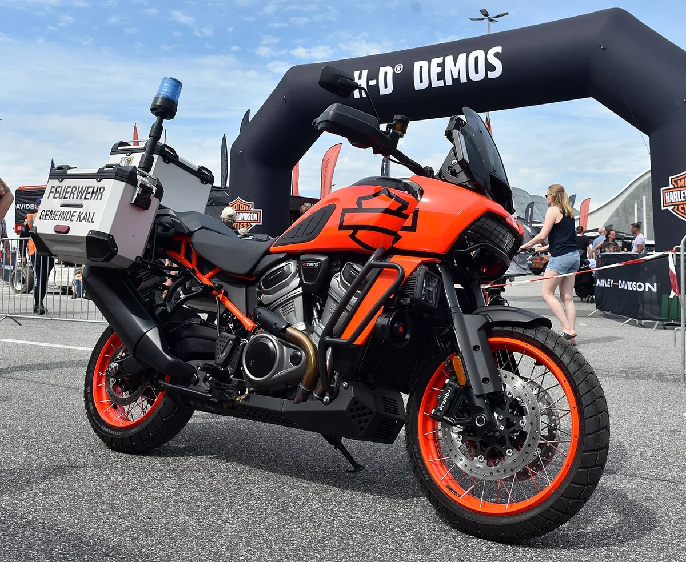</a>
<figcaption>A modified Special photographed at Hamburg Harley Days in 2022, not a standard factory specification. Frank Schwichtenberg, CC BY-SA 4.0; source and edits below.</figcaption>
</figure>
<figure style="min-width:0;margin:0">
<a href="./panamerica-2023.webp">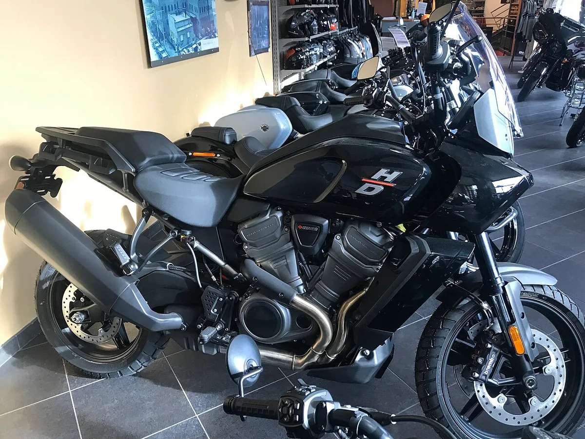</a>
<figcaption>Pan America photographed in 2023; the photograph's date does not establish its model year. Olinone, CC BY-SA 4.0; source and edits below.</figcaption>
</figure>

## In this guide

- [The recommendation, before the detail](#the-recommendation-before-the-detail)
- [What this research can and cannot establish](#what-this-research-can-and-cannot-establish)
- [Which Pan America is which?](#which-pan-america-is-which)
- [Every model year: 2021 to 2026](#every-model-year-2021-to-2026)
- [The good things that survive the used-bike discount](#the-good-things-that-survive-the-used-bike-discount)
- [What the wider road-test record actually says](#what-the-wider-road-test-record-actually-says)
- [The bad things: faults, compromises and inspection priorities](#the-bad-things-faults-compromises-and-inspection-priorities)
- [Recalls: check the motorcycle, not just the year](#recalls-check-the-motorcycle-not-just-the-year)
- [UK used prices: what sellers are asking](#uk-used-prices-what-sellers-are-asking)
- [Running costs: the purchase price is only the beginning](#running-costs-the-purchase-price-is-only-the-beginning)
- [The viewing and test-ride checklist](#the-viewing-and-test-ride-checklist)
- [My final buying order](#my-final-buying-order)
- [Sources, market data and photograph licences](#sources-market-data-and-photograph-licences)

## The recommendation, before the detail

| Your use and budget | Where I would start | What would change my mind |
| --- | --- | --- |
| Best all-round used Pan America | **MY2024 Special**, with verified specification and history | An equally well-documented MY2025 at a small premium |
| Cheapest defensible route in | A sorted 2022/2023 Special, or an exceptional 2021 | Unresolved starting faults, missing update records or a small saving over a later bike |
| Entirely road-based riding | **2025-on ST** | Regular rough tracks, a need for more suspension travel or wanting the Special's protection |
| Factory-equipped touring | CVO or **2026 Limited**, priced against an equipped Special | Paying a large premium for accessories or paint you do not need |
| Remote travel with minimal technical dependence | Consider whether this is the right platform at all | Strong local dealer support and acceptance of its electronics/parts complexity |

The number plate is not enough. One real advert in the research describes a
**2023-registered bike as "22MY"**, while another listed as 2025 is described as
**2022 model year**. A 24-plate bike is not automatically the revised MY2024
machine. Have a Harley dealer confirm the VIN, model year and fitted hardware.

## What this research can and cannot establish

**Checked on 27 October 2026. Primary buying market: UK, prices in pounds.**
Coverage runs from the 2021 production launch through the verified 2026 range:
base 1250, Special, CVO, ST and Limited. I have not verified an officially
announced 2027 Pan America, so there is no invented 2027 specification here.

This is desk research, **not my own road test or ownership diary**. The evidence
comes from Harley-Davidson's UK catalogue, official recall material, independent
launch and later road tests, and a dated sample of UK advertisements.

Those sources answer different questions:

- **Manufacturer specifications** establish equipment and announced changes, not
  long-term dependability.
- **Journalist observations** can establish that a test bike had an abrupt
  throttle or an inconsistent quickshifter. They cannot establish how often that
  happens across the fleet.
- **Recall documents** describe defined safety defects and remedies, not every
  possible fault or every country's campaign.
- **Owner reports** can identify worthwhile inspection questions. Self-selected
  complaints and praise are not a controlled reliability survey.
- **Advertisements** establish what a seller is asking and claiming, not what a
  motorcycle sold for or whether its condition has been independently verified.

I have not found a credible, exposure-adjusted failure-rate dataset comparing all
Pan America model years. There are deliberately **no reliability percentages,
star-based year rankings or predictions of resale prices** in this guide.
Nor can any researched article catalogue every possible failure. The aim is to
identify the meaningful year/variant differences and the purchase risks the
available evidence actually supports.

**How to read the visuals:** there are ten photographic views, including four
explicitly labelled detail crops, and thirty original graphics. Eighteen graphics
show numerical data or calculations; twelve are explanatory buying diagrams,
**not statistical evidence**. Open a graphic for its full-size labels. Repeated
views of one bike are not additional reliability observations.

<figure style="min-width:0;margin:0"><a href="./evidence-map.svg">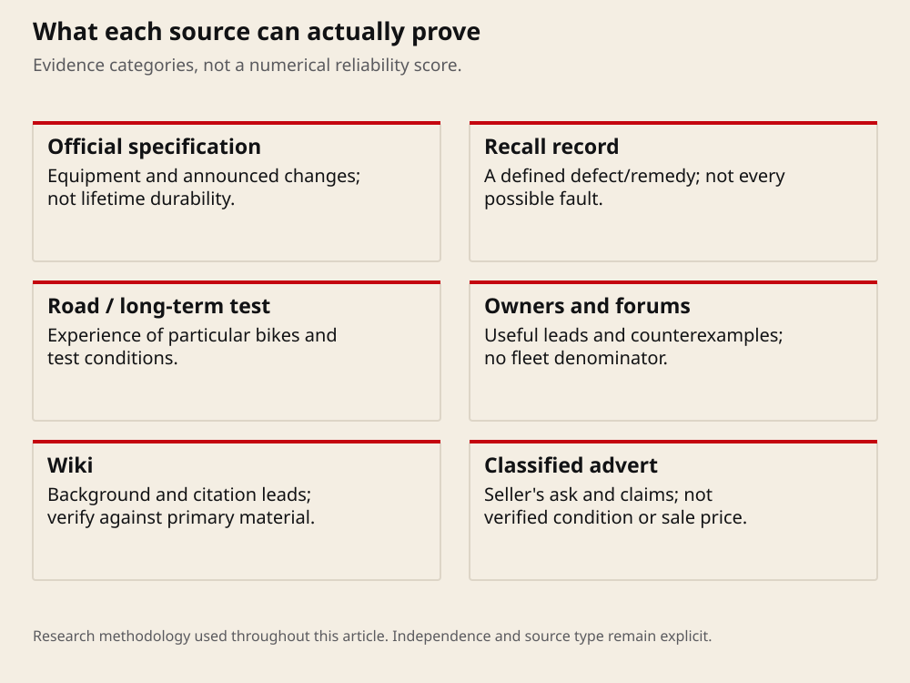</a><figcaption>Research map: a forum post, wiki entry, recall record and classified advert cannot answer the same question. Original explainer, not a reliability ranking.</figcaption></figure>
<figure style="min-width:0;margin:0"><a href="./buying-verification.svg">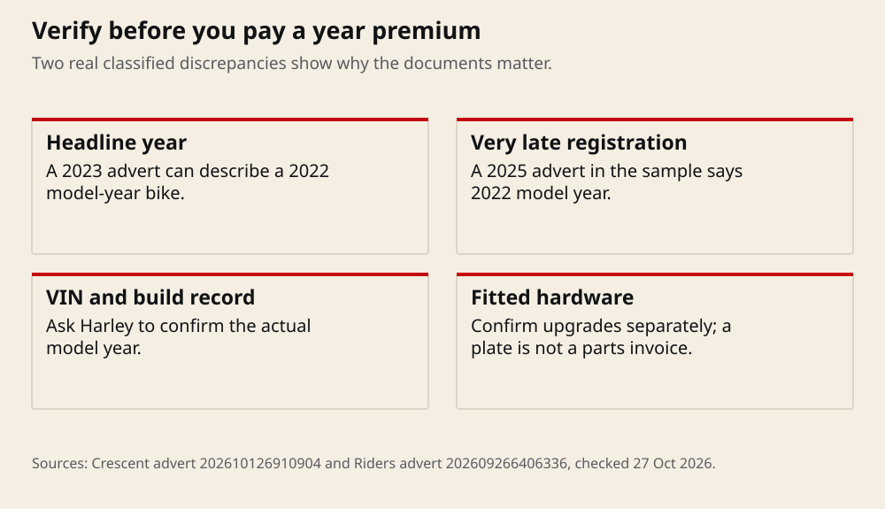</a><figcaption>Model-year trap: check the VIN/build record and hardware, not just the plate. The two examples come from the dated advert register.</figcaption></figure>

## Which Pan America is which?

<figure style="min-width:0;margin:0"><a href="./model-family.svg">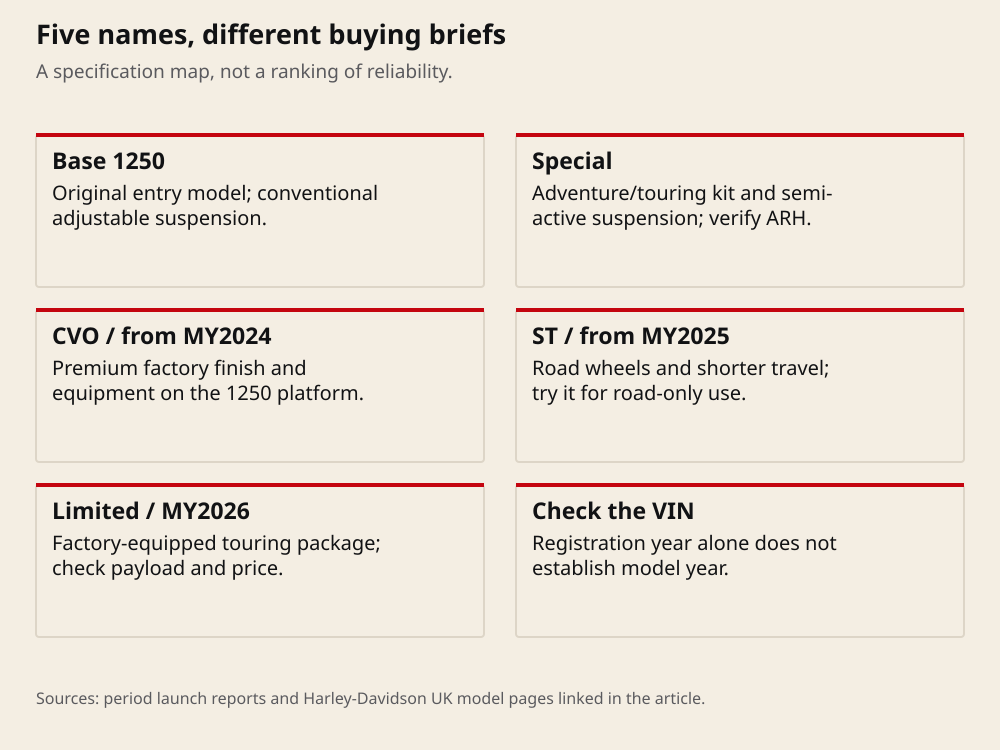</a><figcaption>The production family at a glance. Names indicate different equipment and intended use, not proven reliability levels.</figcaption></figure>
<figure style="min-width:0;margin:0"><a href="./choose-your-variant.svg">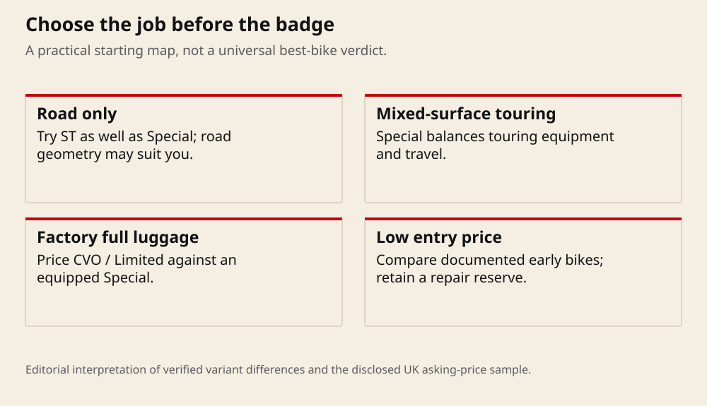</a><figcaption>Choose the job before the badge. This is editorial advice based on the verified specification differences.</figcaption></figure>

### Pan America 1250: the original base bike

The original **RA1250** gives you the liquid-cooled 1,252 cc Revolution Max V-twin,
six-speed gearbox, chain final drive and the fundamental Pan America chassis.
It is not a traditional air-cooled Harley cruiser with adventure bodywork.

The base bike uses conventional adjustable suspension rather than the Special's
semi-active system. That can appeal to someone who values a simpler suspension
specification. It does **not** make the rest of the motorcycle mechanically or
electronically simple. Check its actual equipment rather than using a photograph
of a Special as a shopping list. [BikeSocial's launch review][launch] is a useful
starting comparison.

I could not establish the exact UK model-year withdrawal date of the standalone
base bike from an authoritative archive. Older stock registered much later is
plainly still relevant to the used market.

### Pan America 1250 Special: the used-market sweet spot

The **RA1250S** is the version I would normally search for. The launch equipment
included semi-active suspension, heated grips, centre stand, tyre-pressure
monitoring, steering damper and additional adventure/touring equipment.
**Adaptive Ride Height and tubeless laced wheels were options at launch**, not
proof that every used Special has them. [Launch specification][launch].

ARH is not just automatic preload adjustment. Its particular attraction is
lowering the motorcycle at a stop, then restoring its riding height as you move.
That is useful when a loaded adventure bike's seat height is the limiting factor.
It is still a heavy machine when you push it backwards out of a parking space.

<figure style="min-width:0;margin:0"><a href="./arh-versus-preload.svg">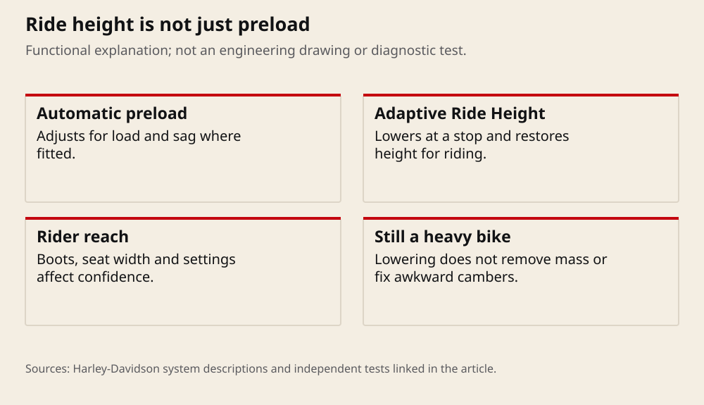</a><figcaption>ARH and automatic preload are related but different functions. Original functional explainer, not an engineering schematic.</figcaption></figure>
<figure style="min-width:0;margin:0"><a href="./seat-luggage-detail.webp">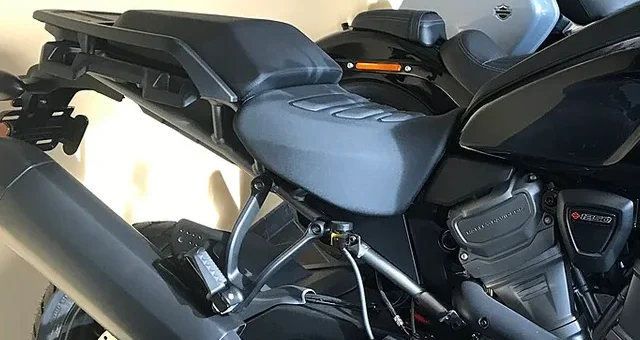</a><figcaption>Seat and rear-rack detail, cropped from Olinone's 2023 photograph, CC BY-SA 4.0. Not a measurement of seat height or payload.</figcaption></figure>

### CVO Pan America: premium equipment, not a bigger engine

The CVO is a factory premium derivative, not simply a Special with a dealer's
sticker. It joined the range for **MY2024**, documented in [ADV Pulse's
26 January 2024 launch report][cvo-launch]. The verified [2025 UK CVO page][cvo] lists luggage, quickshifter,
factory protection and premium finishes. It uses the Revolution Max 1250 engine;
do not assume "CVO" means the large-displacement engine upgrade associated with
some other Harley families.

Its buying argument is an equipment bundle you actually want. Its drawback is
paying extra for finish and accessories that do not, on their own, establish
better reliability. Inspect luggage mounts, locks, keys and crash protection
carefully: a full accessory list can conceal expensive missing or damaged pieces.

### Pan America 1250 ST: the road bike, from 2025

The ST changes the brief. **17-inch road wheels, street tyres, a lower stance and
shorter-travel suspension** make it the model to try if "adventure" means
interesting roads rather than deliberately seeking rough tracks.

Do not confuse its adjustable road suspension with the Special's semi-active
setup, or assume a quickshifter means an automatic gearbox. It remains a manual
motorcycle with clutchless shifting assistance.

The [2025 Motorcycle.com ST test][st-test] describes ARH and a quickshifter in its
specification, but also criticises inconsistent shifting. BikeSocial's [UK ST
review][st-uk] lists a £16,995 price, 150 bhp and 246 kg. Region-specific equipment
and weight conventions matter, so check the exact UK bike rather than transplanting
every US test specification.

For scale, the two 2025 US-market Motorcycle.com specification tables give the
following **manufacturer-claimed** figures. These are comparison context, not
VIN-specific UK homologation data:

| 2025 model | Suspension travel, front/rear | Claimed kerb weight | Seat figure quoted in the test |
| --- | --- | --- | --- |
| Special | 7.5 / 7.5 inches, about 191 / 191 mm | 569 lb, about 258 kg | 32.7 inches, about 831 mm, low position with ARH |
| ST | 6.7 / 6.7 inches, about 170 / 170 mm | 542 lb, about 246 kg | 29.4 inches, about 747 mm, low position with ARH |

Both seat figures are explicitly associated with ARH in those tables. They are
**not a promise of fixed, unlowered riding seat height**. The ST test's prose
rounds travel slightly differently; the table values above follow its specification
table. Try the actual bike rather than choosing from a single seat-height number.

<figure style="min-width:0;margin:0"><a href="./claimed-weights.svg">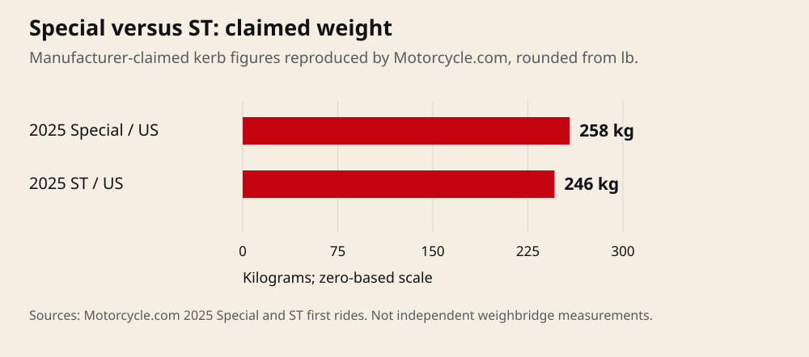</a><figcaption>Manufacturer-claimed figures in the two Motorcycle.com tests, not independent weighings or UK VIN-specific weights.</figcaption></figure>
<figure style="min-width:0;margin:0"><a href="./suspension-travel.svg">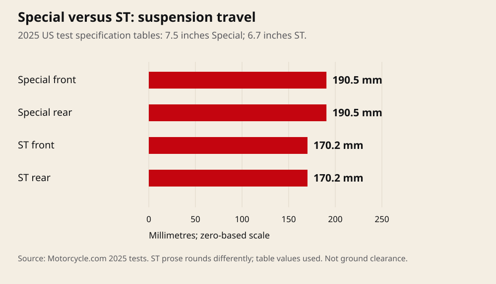</a><figcaption>Travel from the same tests' specification tables: 7.5 inches versus 6.7 inches. This is not a ground-clearance comparison.</figcaption></figure>

### Pan America 1250 Limited: a real 2026 model

The **Limited is a genuine factory model**, not merely dealer shorthand for
"Special with panniers". Harley's [2026 UK page][limited] lists it at **£22,995**,
with touring equipment including aluminium luggage, ARH, semi-active suspension,
laced wheels, lighting and protection.

Its advantage is buying a more complete touring package at once. Its disadvantages
are the extra money, equipment to damage in a fall, and the need to check available
payload once rider, passenger, accessories and luggage are included. A large
pannier is not permission to exceed its load limit.

### Factory weight is not a fixed platform number

Harley's US technical pages label the following figures **"Weight, In Running
Order"**. Keep that label: these are manufacturer figures, not independent
weighings, a universal UK specification or a promise about your accessory-laden
bike.

| Model year | Special | ST | Premium touring version |
| --- | --- | --- | --- |
| 2025 | 569 lb / about 258 kg | 542 lb / about 246 kg | CVO: 659 lb / about 299 kg |
| 2026 | 578 lb / about 262 kg | 546 lb / about 248 kg | Limited: 661 lb / about 300 kg |

Sources: [2025 Special][us-2025-special], [2025 ST][us-2025-st],
[2025 CVO][us-2025-cvo], [2026 Special][special-us],
[2026 ST][us-st] and [2026 Limited][us-limited]. Pounds are the printed source
values; kilograms are rounded conversions. These pages all list a
5.6-US-gallon tank, approximately **21.2 litres**. That does not turn a theoretical
full-tank range calculation into a safe distance between fuel stops.

Do not carry the 2025 weights forward to MY2026 merely because a model name is
unchanged. Nor is an equipped CVO/Limited a like-for-like weighing against an
unequipped Special: equipment changes the motorcycle you actually have to
manoeuvre. Do not infer either worse handling or better reliability from this
table alone.

Seat-height comparisons need similar discipline. Harley's 2025 US Special page
prints **laden** low/high positions of 31.1 / 32.0 inches, while the period
Motorcycle.com table above quotes a different figure and convention. They are
not interchangeable measurements. I could not verify a consistent official
stopped-versus-moving ARH dataset across all six years, so there is no invented
"seat height by year" graph.

<figure style="min-width:0;margin:0"><a href="./panamerica-hamburg-rear.webp">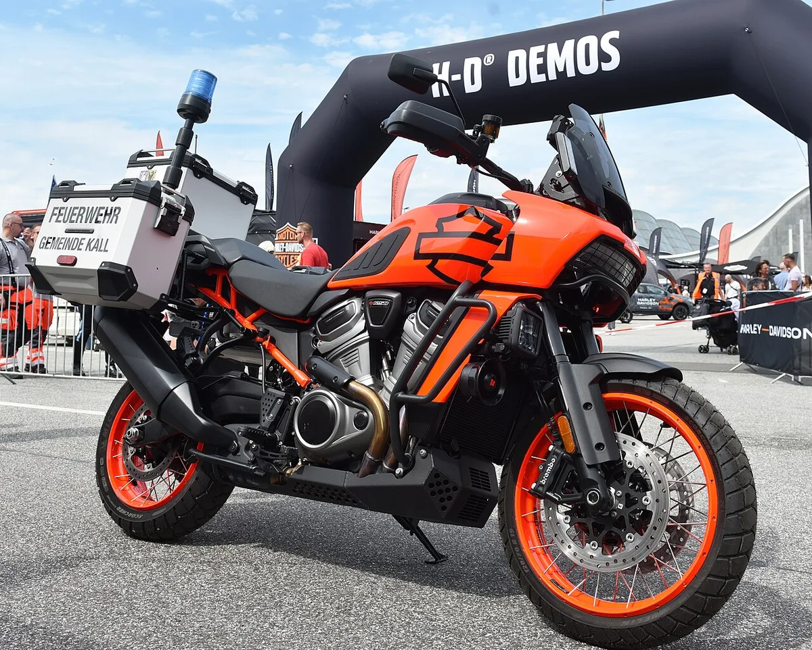</a><figcaption>Another view of the same modified event bike, not a factory Limited or CVO. Frank Schwichtenberg, Hamburg 2022, CC BY-SA 4.0.</figcaption></figure>
<figure style="min-width:0;margin:0"><a href="./payload-check.svg">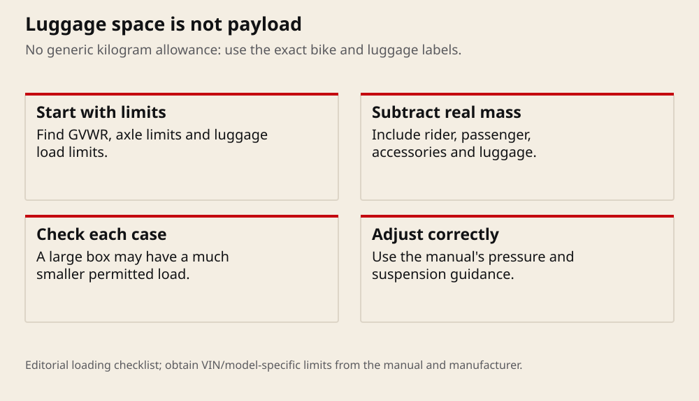</a><figcaption>No invented universal payload allowance: use the exact motorcycle manual and luggage labels.</figcaption></figure>

## Every model year: 2021 to 2026

The table refers to **model year**, not registration year. Equipment can vary by
market, optional packages and modifications.

<figure style="max-width:60rem"><a href="./year-timeline.svg">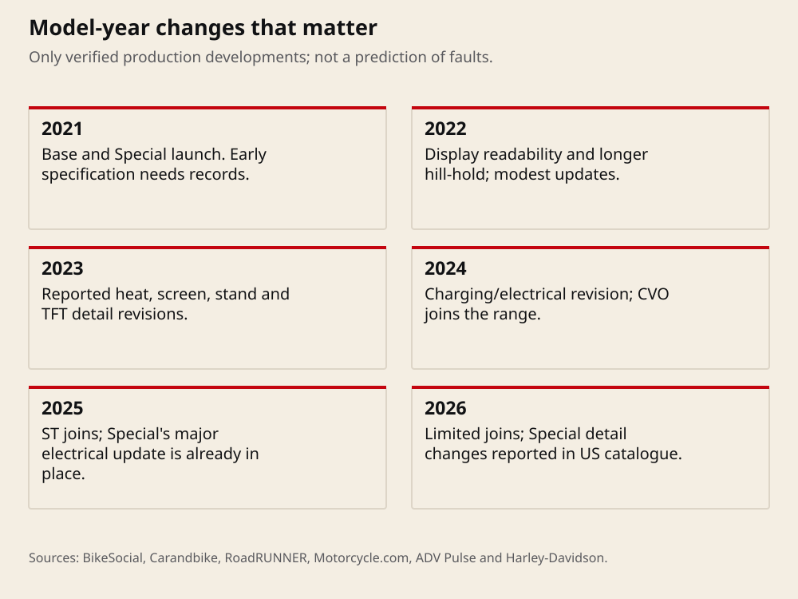</a><figcaption>Source-linked milestones, including RoadRUNNER's reported 2023 heat, screen, stand and TFT revisions. Detail improvements are not the later electrical-system redesign.</figcaption></figure>

| Model year | What the evidence supports | The good | The caution | My used-buying stance |
| --- | --- | --- | --- | --- |
| **2021** | Production launch of base 1250 and Special | Full-strength engine and much of the appeal for the lowest entry prices | Earliest specification; verify recalls, software, charging health and actual options | Buy selectively, not just cheaply |
| **2022** | TFT readability update, longer hill-hold operation and colour changes; no major mechanical revision in the period report | Small usability improvements, often heavily discounted used | Not the later electrical-system redesign | Good budget candidate with evidence |
| **2023** | RoadRUNNER reports heat-management, screen-support, sidestand and TFT revisions; still pre-2024 electrical specification unless upgraded | Targeted usability improvements, plus potentially useful history/cover | Verify actual UK fitment; these changes do not prove the later charging hardware | Compare condition and price against MY2024 |
| **2024** | Significant reported wiring/charging/battery revision; CVO added | A concrete technical reason to prefer a later bike; factory premium touring option | Revised does not mean fault-free; establish genuine model year | **My starting year for a used Special** |
| **2025** | Special carries the revised platform; ST joins; CVO documented in UK catalogue | Choice between road-focused ST and adventure Special, plus premium CVO | Paint alone does not justify a large Special premium; quickshifter concerns remain | Strong alternative, especially with useful cover |
| **2026** | UK Special, ST and factory Limited verified; Special detail updates | Latest verified range and turnkey Limited option | Limited used-age evidence and higher asking prices | Buy for specification/warranty, not assumed perfection |

### 2021: an impressive first attempt, with first-year buying questions

The launch bike was not a tentative, underpowered entry into adventure touring.
The [2021 BikeSocial test][launch] liked the engine and the idea behind the
ride-height system. The [MCN review][mcn] also found a credible first attempt in a
very competitive class.

The appeal used is straightforward: much of the performance and touring equipment
has not disappeared just because the bike has depreciated. The problem is that the
oldest bikes need the most careful investigation of maintenance, electronics and
remedial work. The below-freezing instrument-display recall described later is a
documented example of why an update history matters.

<figure style="min-width:0;margin:0"><a href="./panamerica-pair.webp">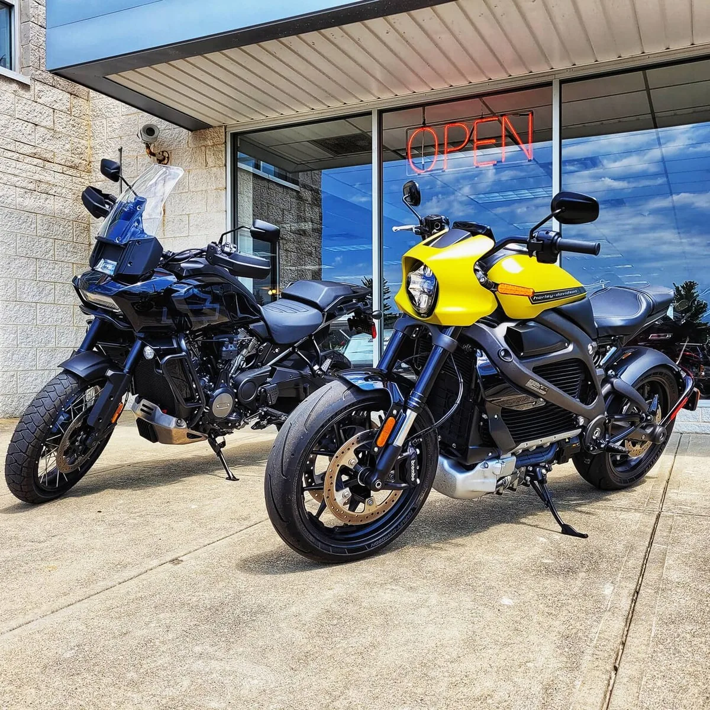</a><figcaption>Pan America on the left; the yellow motorcycle is a different model, the LiveWire. Mike Mekinda, July 2021, CC BY 2.0. Illustrative image, not a performance comparison.</figcaption></figure>
<figure style="min-width:0;margin:0"><a href="./panamerica-museum.webp">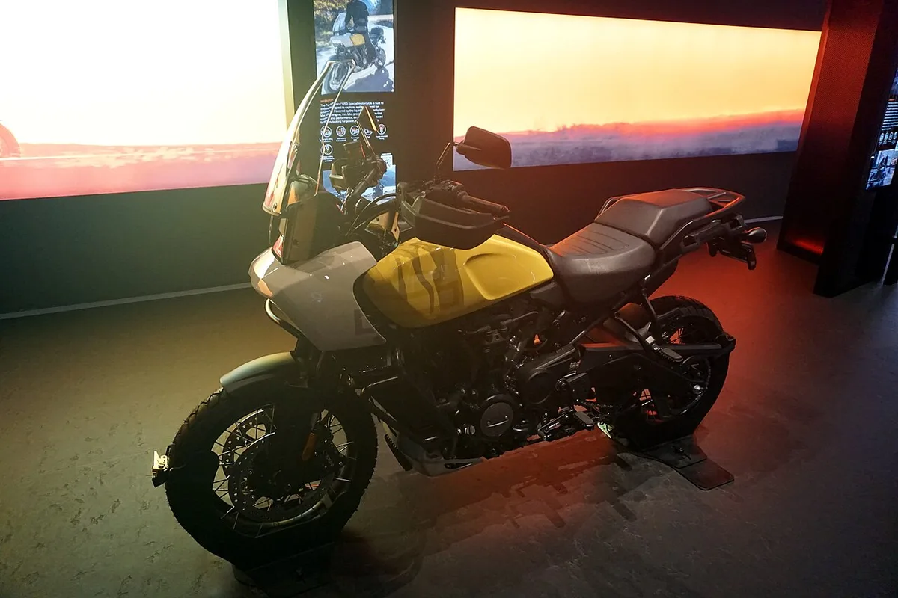</a><figcaption>Uploader-identified 2023 Special, photographed at the museum in May 2024. Michael Barera, CC BY-SA 4.0. Display lighting and uploader identification, not VIN verification.</figcaption></figure>

**My rule:** a MY2021 needs a stronger case on records, condition and price than a
later bike. It is not automatically a bad motorcycle, but it is not my
lowest-hassle default recommendation.

### 2022: useful polish, not a second-generation motorcycle

The [period update report][update-2022] identifies improved TFT readability,
hill-hold extended from the earlier ten-second period to roughly three to five
minutes, and a new Special colour. It explicitly describes no other major
mechanical change.

Those are worthwhile improvements. They are not evidence of a redesigned engine,
new gearbox or the 2024 charging hardware. The article has an India-market
introduction context, so it is used here for the announced technical changes,
not UK pricing or exact UK delivery dates.

**My rule:** do not pay a large premium over an otherwise equivalent 2021 merely
because "second year must be reliable". Pay for the particular bike's history.

### 2023: worthwhile detail revisions, not a magic fix

[RoadRUNNER's review of a 2022 Special][roadrunner] lists changes for 2023:
a radiator-air deflector, revised windscreen support, catalytic-converter heat
shield, reinforced sidestand and TFT software/UI updates. These are relevant to
the heat, screen and usability complaints in early tests; it would be wrong to
say that only paint changed.

This is a journal's account, not a VIN-specific UK parts bulletin. Verify the
actual fitment before paying extra. It also does **not** establish the MY2024
wiring, stator/rotor and battery revision on an ordinary MY2023.

For charging-system buying questions I would still put an unmodified MY2023
in the pre-2024 group. A well-maintained example can be preferable to a neglected
2024, but "2023" by itself is not a charging-system repair receipt.

### 2024: the meaningful breakpoint

The strongest year-specific technical evidence is in the [2025 Special
test][special-test], which describes MY2024 as the platform's most significant
technical update. It reports:

- A more robust wiring harness.
- Revised stator and rotor.
- **14% more charging output at low rpm**, according to the test's account of
  Harley's information.
- A larger battery with a higher cold-cranking rating.

That **14% refers to low-rpm charging performance, not engine power**.
The distinction matters on a touring bike using heated clothing, lights,
navigation and repeated low-speed running.

The same publication says Harley staff described upgrades as backwards-compatible
with 2021-2023 bikes. I have not verified a VIN-specific retrofit bulletin or a UK
installed price. Do not read that as "buy any early bike and cheaply turn it into
a 2024". Get the parts list, compatibility, labour quote and completed-work invoice
from the dealer.

The other notable 2024 arrival is the **CVO Pan America**. The [period launch
report][cvo-launch] lists the Special's basic platform with ARH, aluminium side
and top cases, quickshifter, laced wheels, auxiliary lighting, skid plate and
distinctive Legendary Orange finish. Its quoted price is American, not a UK
valuation. This is an equipment-rich variant, not a larger-engine successor.

**This is why I recommend starting with MY2024.** There is an identifiable
engineering revision, rather than a belief that newer paint cures everything.
It still needs a battery/charging assessment and a proper test ride.

### 2025: ST broadens the choice; Special does not start again

The [2025 Special review][special-test] describes its year's change as paint
options, with the electrical changes having arrived for 2024. A 2025 can still be
worth more because of condition, mileage, useful equipment and warranty, but
there is no basis here for calling it an all-new, universally corrected Special.

The ST is the more interesting model change. Try it alongside a Special before
buying for road-only use. A lower, road-focused bike can suit the real riding
better than a long-travel adventure specification bought on principle.

The CVO's premium equipment is also documented for 2025. Price the accessories
against what you would genuinely buy, not their original retail total.

### 2026: Special, ST and Limited, not a fictional reliability guarantee

At the research date Harley's UK pages show a [Special from £17,745][special],
[ST from £16,995][st] and [Limited from £22,995][limited]. These are advertised
starting prices, not negotiated on-the-road quotations including every option
and charge.

Harley's [US 2026 Special page][special-us] also identifies a revised exhaust
without the previous mid-exhaust section, a claimed **1.2 kg weight saving**,
finned engine covers and new tank graphics. Those are real announced detail
changes, not a completely new engine. The evidence is explicitly US-market;
confirm the exhaust and equipment of a UK example before assuming identical
fitment.

The CVO link resolves to a **2025** archive at **£23,995**. That is not evidence
of a 2026 CVO. A used 2026 registration also does not establish which earlier model
year a motorcycle was built to.

The Limited's equipment is real, but there is less elapsed ownership time to judge
it. Buying the newest one buys a newer example and potentially more warranty;
it does not buy a statistically demonstrated absence of faults.

## The good things that survive the used-bike discount

### The engine is a reason to buy it, not an apology for the badge

The Revolution Max is a modern, liquid-cooled, rev-friendly V-twin, with a claimed
150 hp-class output in the sources. The launch figures include **127 Nm** of
torque. It is not intended to feel like an air-cooled cruiser motor.
Both the [launch review][launch] and [later Special test][special-test] find
genuine performance here.

That makes it a compelling road and touring proposition: overtaking performance,
cruise control and useful chassis electronics without buying a different engine
because the odometer has passed a particular birthday.

<figure style="min-width:0;margin:0"><a href="./panamerica-bangkok.webp">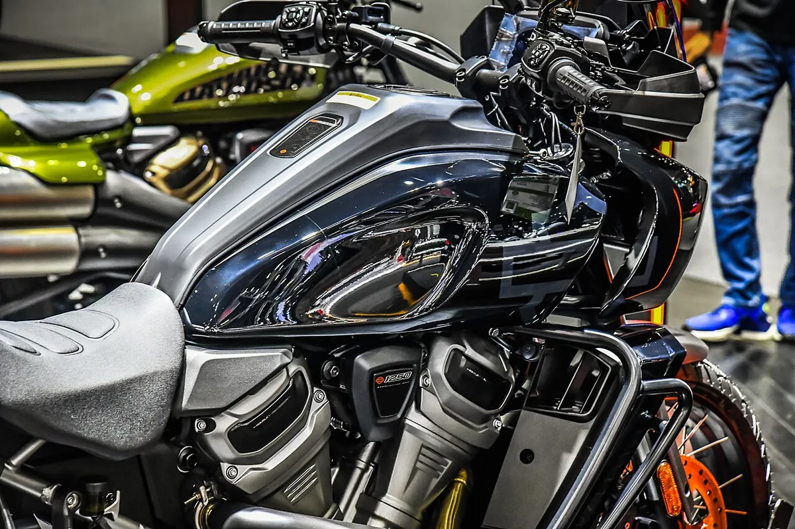</a><figcaption>Pan America detail at the 2022 Bangkok show, visually identified from the machine; model year not established. Tris T7, CC BY-SA 4.0.</figcaption></figure>
<figure style="min-width:0;margin:0"><a href="./engine-protection-detail.webp">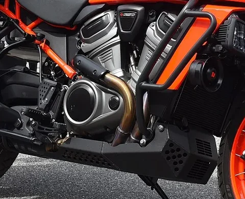</a><figcaption>Engine/protection detail crop from Frank Schwichtenberg's Hamburg 07 photograph, CC BY-SA 4.0. Accessories on this modified bike are not a standard-equipment claim.</figcaption></figure>

### ARH is an unusually useful piece of adventure-bike technology

If you find tall bikes intimidating when stopping, ARH can be more valuable than
an extra riding mode. It addresses a real problem without permanently converting
the motorcycle to a short-travel lowered setup.

But **try it wearing your own boots**. Seat width, sag, passenger/luggage load and
the chosen seat position all affect reach. It cannot remove the mass of a loaded
motorcycle if you stop on an awkward camber.

### The Special has proper touring equipment

Heated grips, cruise, a centre stand, tyre-pressure information and semi-active
suspension are not decorative features on a wet UK commute or a European trip.
The later [Special test][special-test] still praises the suspension's performance
on varied surfaces.

Used accessories can improve the deal further. Complete luggage with functioning
locks can be worth having; a random pile of aftermarket wiring deserves a much
less enthusiastic response.

### There is one significant maintenance advantage

BikeSocial's [technical explanation][launch] describes hydraulic valve-lash
adjustment, eliminating the usual scheduled shim-type valve-clearance inspection.
That is a real distinction from some rival engines.

It does **not** eliminate oil changes, fluid changes, diagnostics, coolant checks,
wheel bearings, suspension servicing or chain maintenance. The final drive is
**chain, not shaft or Harley-style belt**.

## What the wider road-test record actually says

The useful question is not how many reviews call the engine exciting. It is
**what each reviewer rode, for how long, and what went wrong or worked well**.
These additional first-hand reports broaden the picture beyond a launch-day
verdict:

| Publication and test | Exposure actually described | Good points | Criticisms and limits |
| --- | --- | --- | --- |
| [Cycle World, 2021 big-bore comparison][cw-2021] | Three-day comparison; 2021 Special | Predictable dirt handling and suspension | Right-footpeg heat and small dash text; no Pan America-specific mileage given |
| [Cycle World, 2022 open-class comparison][cw-2022] | 2022 Special G.I.; about 1,000 miles for the three-bike test overall | Comfort and dirt performance | Heat, weight and dash legibility; do not relabel the overall mileage as Harley-only distance |
| [RoadRUNNER, 2022 Special][roadrunner] | Accessorized bike, 2,000 miles over ten days | Touring comfort, engine and handling | This bike had complaints involving heat, dash/app, cruise, ride-height setting, screen, handguards and sidestand |
| [Visordown, living with the Special][visordown-living] | About 500 miles over two weeks on a 2021 Special | Comfort, weather protection, engine and ARH | Heavy to manoeuvre; awkward screen adjustment; still a short loan, not years of ownership |
| [Adventure Bike Rider, Special review][abr] | Launch-period 2021 bike, including about five hours in heavy Welsh rain and an off-road school | Rain-mode confidence and comfort | Screen and front plastics; its listed 258 kg is not an independent weighing |
| [Gear Patrol, first ride][gear-patrol] | Three-day media event, including a 150-mile road ride and 15-mile off-road section | Shows the platform's appeal to an adventure newcomer | Novice off-road reviewer struggled with ground reach and broke lever tips after drops; not a controlled durability test |
| [Autoevolution, 2022 road ride][autoevolution] | Road-only ride; exact variant and mileage unspecified | Engine and road-riding appeal | Dashboard economy and estimated range, not measured tank-to-tank results; no off-road finding to borrow |

Two instrumented Cycle World comparisons add useful numbers. The 2021 test
reports **128.2 hp, 604 lb wet and an 11.73-second quarter-mile at 120.76 mph**.
The 2022 test reports **127.63 hp, 577 lb wet, 0–60 mph in 3.35 seconds and an
11.43-second quarter-mile at 119.90 mph**. These are particular test bikes and
conditions, not a controlled experiment proving one model year is faster or
lighter. Do not equate reported test output with the manufacturer's 150 hp
engine-rating convention.

<figure style="min-width:0;margin:0"><a href="./instrumented-output.svg">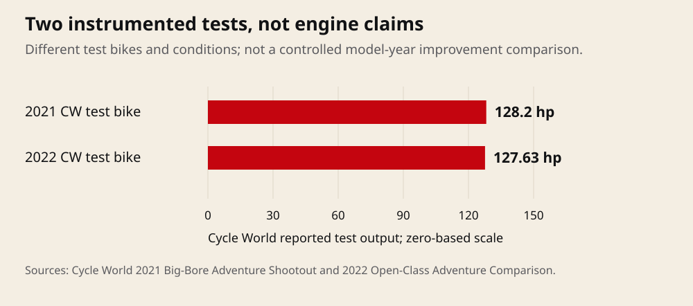</a><figcaption>Two attributed instrumented tests, not engine claims or proof of a model-year performance change.</figcaption></figure>
<figure style="min-width:0;margin:0"><a href="./test-weight-context.svg">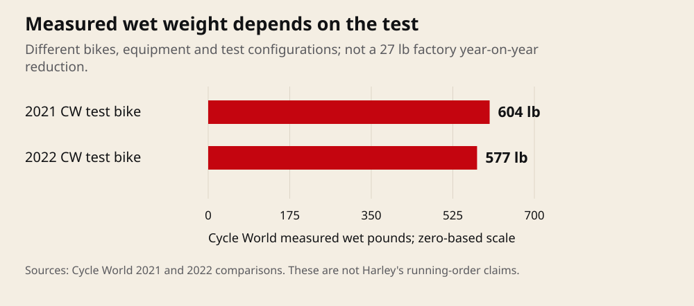</a><figcaption>Equipment and test configuration differ. This is not a claimed 27 lb factory weight reduction for MY2022, nor the same dataset as Harley's running-order specifications.</figcaption></figure>

Range reporting needs equal care. RoadRUNNER reports about **40 mpg** and roughly
**185 miles before the low-fuel warning**. Cycle World's 2022 table reports
**39.0 mpg**. These are the US publications' reported figures, kept separate from
the explicitly **imperial-mpg** fuel-budget scenarios below, not silently pooled
into an average. Visordown describes a roughly **230-mile trip** ending with
about **35 miles still shown on the dash**: a trip and an estimate, not a
standardised run-to-empty test. Load, speed, weather, tank fill and reserve all
matter.

The recurring criticisms across these accounts are heat, screen/display
usability and low-speed mass. The recurring positives are the engine, touring
comfort and genuine mixed-surface ability. Repetition across short tests gives
those inspection questions more weight; it still does not create a fleet
reliability rate.

## The bad things: faults, compromises and inspection priorities

The categories below are deliberate. A documented test criticism is not
automatically a safety recall; a precautionary inspection is not evidence of an
epidemic.

| Area | Evidence level | Why it matters | What I would require before purchase |
| --- | --- | --- | --- |
| Starting, battery and charging | A documented MY2024 redesign aimed at earlier electrical weaknesses; no fleet failure rate | A non-starting touring bike is not a bargain | Cold start, hot restart and dealer battery/charging assessment; invoices for claimed upgrades |
| TFT at freezing temperatures | Official MY2021 US recall | Missing speed/neutral display is a safety issue | VIN check and proof of applicable remedial work |
| Quickshifter/gear selection | Inconsistency and false neutrals observed in a 2025 test | An accessory can reduce rather than improve confidence if poorly behaved | Safe test of normal clutch shifts and fitted quickshifter; investigate recurring faults |
| Throttle and low-speed response | Abrupt response criticised in the later Special test | Matters in traffic and on loose surfaces | Try available road settings; do not assume one mode represents the whole bike |
| ARH and semi-active suspension | Complex equipment whose operation needs verification; not a measured failure-rate claim | An unexplained warning or non-functioning option can be expensive | Demonstration, fault-code report and a repair quote for any defect |
| Screen, comfort and heat | Rider/route dependent; launch screen movement noted | A wonderful engine cannot fix a tiring motorway ride | A sufficiently long ride in your own helmet and kit |
| Corrosion, bearings, wheels and crash damage | Used-bike inspection priorities, not a proven year-specific defect here | UK winter use and off-road drops can dominate condition | Physical inspection, service records and an independent inspection when needed |

### A fresh battery is not the whole electrical diagnosis

The MY2024 changes are the reason to ask detailed electrical questions, not a
reason to diagnose every symptom over the internet. A weak battery, parasitic
draw, charging fault, wiring modification and software issue are different things.

Ask whether a seller's "electrical upgrade" means a new battery, software alone,
or documented replacement charging-system parts. Those are not interchangeable.
Ask a dealer to test the system using the correct service procedure, including
the installed accessories. Do not adopt a random internet voltage threshold as
the only acceptance test.

A motorcycle taken straight off a charger and already warm when you arrive tells
you less than an agreed cold start followed by a proper ride and hot restart.
Repeated non-starts, resets or warnings need diagnosis, not a discount and a shrug.

<figure style="min-width:0;margin:0"><a href="./electrical-questions.svg">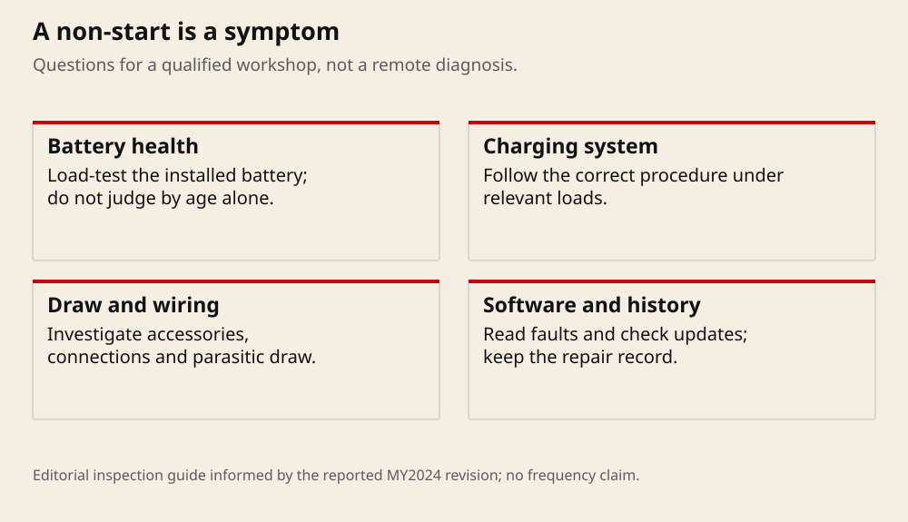</a><figcaption>A non-start is a symptom, not a diagnosis. These are questions for the workshop, not a claim about how frequently each cause occurs.</figcaption></figure>
<figure style="min-width:0;margin:0"><a href="./update-versus-upgrade.svg">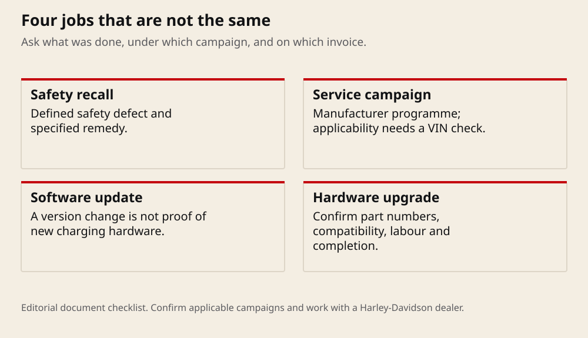</a><figcaption>Ask what work was done and retain the evidence. A software receipt does not prove a new stator, rotor or battery was installed.</figcaption></figure>

### What owners report, and why I will not turn it into a failure rate

The [MCN owner's-review section][mcn] contains contrasting experiences. An April
2022 review of a 2021 Special describes electronic teething problems reportedly
improved by software. A March 2025 review of a 2021 bike describes repeated fault
codes and winter corrosion. An October 2025 owner of a 2022 Special reports
spoke corrosion at around 2,000 miles but no other problems in their ownership.
Another report describes limp-mode/ABS concerns.

These are **individual, self-selected accounts**, not independently diagnosed
cases or evidence that a known fraction of bikes suffers those faults. Model year,
review date, servicing and riding conditions must not be conflated. The accounts
support asking about faults and inspecting finish; they do not justify calling
every early Pan America unreliable.

### Even a later bike can have a disappointing quickshifter

In the [2025 Special test][special-test], Motorcycle.com reported inconsistent
quickshifter action and some false neutrals on downshifts from third to second.
It said Harley staff were working on software, but did not confirm availability.
That last point matters: **an update promised in a review is not an update proved
to be fitted to the bike you are buying**.

The [ST test][st-test] also raises shifting criticisms. This supports checking
the system carefully, not claiming every gearbox is defective. Ordinary
clutch-operated shifts should also work correctly. Do not assume a quickshifter
is present, enabled or well calibrated just because an advert mentions it.

### Clever suspension is still something you must test

Check for leaks, damaged connectors, suspension messages, abnormal behaviour and
the actual operation of ARH. Have the dealer explain the selected lowering mode
and demonstrate normal operation; do not infer a failure simply because an
unfamiliar setting behaves differently from your expectation.

Conversely, do not accept "they all do that" as an explanation for a persistent
warning. A base bike avoids the Special's semi-active suspension, but gives up
some of the equipment that makes the Special attractive.

### Weight, ergonomics and weather protection are real trade-offs

This is a full-size adventure platform, not a light trail bike. The ST's lower
road-biased configuration can make more sense than buying the Special for
off-road capability you will never use.

The [launch test][launch] notes movement in the raised screen; other practical
questions depend on your height and helmet. Test motorway wind protection,
low-speed clutch/throttle response, seat comfort and heat in traffic. Heat
reaching a rider and an overheating warning are not the same diagnosis.

Inspect the radiator and cooling system for damage or leaks; check that
temperature behaviour is normal on the ride. That is prudent inspection, not a
claim that every model year has a cooling defect.

### Low maintenance is not low ownership risk

Electronic suspension, diagnostics, replacement luggage, lighting and model-specific
parts can all cost money. A dealer nearby who understands the Revolution Max
platform is more useful than a generic reassurance about Harley's dealer network.
Ask about appointment availability, diagnostic charges, warranty exclusions and
parts lead times before a major trip.

For wheels, check rim damage, spoke condition/tension where applicable, tyre
condition and pressure loss. Cast wheels are not automatically wrong for touring;
laced wheels are not automatically undamaged because the bike has adventure
tyres. Check the centre stand, sump protection, engine cases, bars, exhaust and
luggage brackets for evidence of harder falls.

<figure style="min-width:0;margin:0"><a href="./front-wheel-detail.webp">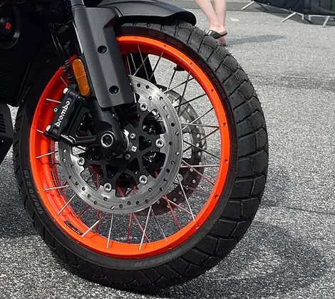</a><figcaption>Wheel/brake detail crop from Frank Schwichtenberg's Hamburg 06 image, CC BY-SA 4.0. Illustrates what to inspect; it does not demonstrate damage or a defect.</figcaption></figure>
<figure style="min-width:0;margin:0"><a href="./controls-detail.webp">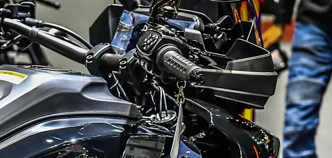</a><figcaption>Controls detail crop from Tris T7's Bangkok image, CC BY-SA 4.0. Older illustrative equipment, not a MY2026 cockpit photograph.</figcaption></figure>

## Recalls: check the motorcycle, not just the year

The official US record I verified is **NHTSA 22V030000 / Harley campaign 0631**,
reported on **25 January 2022**. It covers certain **MY2021** Pan America 1250
and 1250 Special motorcycles, alongside the Sportster S.

Below freezing, the instrument cluster may fail to show the speedometer and
neutral indicator at start-up. The remedy is a dealer software update.
[Official NHTSA record][cluster-recall].

**That is US evidence of a defined defect, not a complete UK recall register.**
Do not assume the US identifier is the UK campaign number or that every MY2021
VIN is included.

For a UK purchase:

1. Use the [official GOV.UK motorcycle recall route][uk-recalls] and the relevant
   make, model and manufacturing year.
2. Ask a Harley dealer to check the **actual VIN** for outstanding safety recalls
   and applicable service/product campaigns.
3. Ask for the repair/update history, not just "no outstanding recalls".
4. Check again immediately before collection, because campaigns and vehicle
   records can change.

A recall repair, a service bulletin, an ordinary software update and an optional
paid hardware upgrade are different things. Do not count them as the same repair,
and do not rank years simply by the number of recall headlines.

If a safety recall applies and the official instruction is not to ride, follow
that instruction rather than taking the test ride described elsewhere here.
The research could not establish an exhaustive VIN-by-VIN UK campaign history;
**absence from this section does not mean absence of a recall**.

## UK used prices: what sellers are asking

I inspected the **first twenty visible adverts on one Autotrader UK Pan America
model page on 27 October 2026**. The page reported 78 available bikes.
This is a convenience sample in the page's displayed order, not a random sample,
a completed-sales database or an exhaustive scan of all 78.

<figure style="min-width:0;margin:0"><a href="./sample-variants.svg">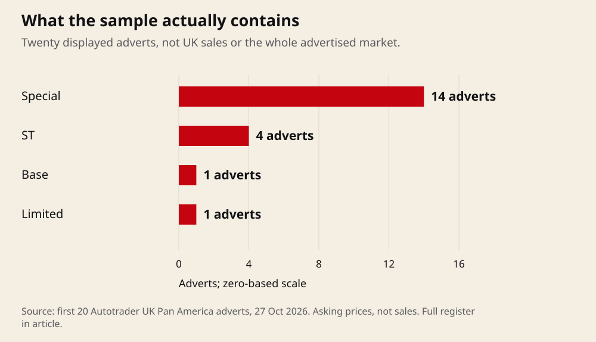</a><figcaption>Sample composition, not market share. This is why pooling every Pan America into one year-price comparison would mislead.</figcaption></figure>
<figure style="min-width:0;margin:0"><a href="./special-count-by-year.svg">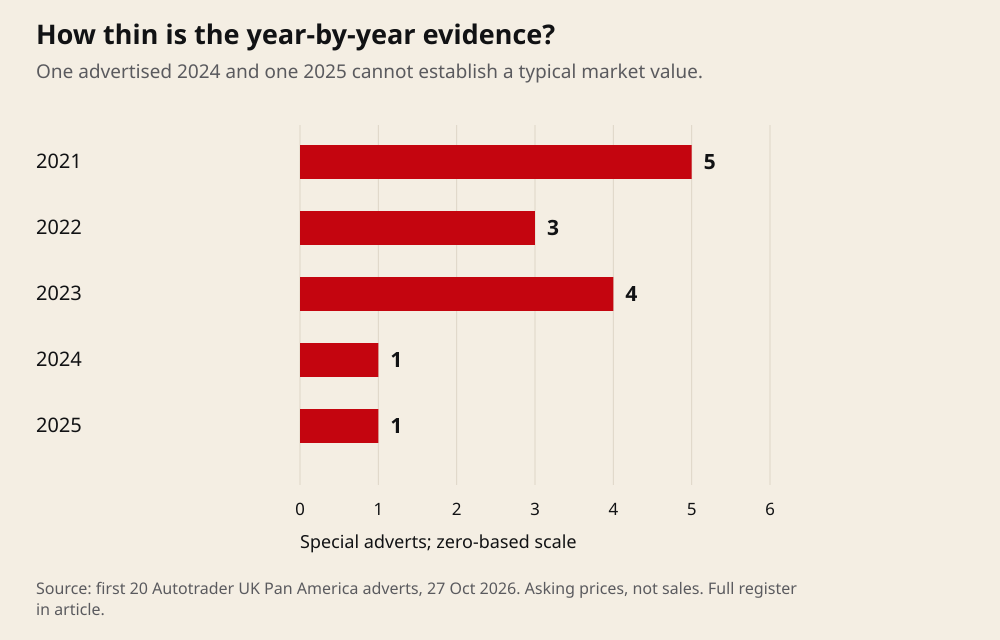</a><figcaption>The sample-size chart is as important as the price chart. The two newest Special groups each contain just one advert.</figcaption></figure>

The twenty adverts mix Specials, STs, a base bike and a Limited. For a less
misleading comparison, the chart below uses **only the fourteen described as
Specials** and groups them by the advert's displayed year. That is generally a
registration-year field, **not independently verified model year**.

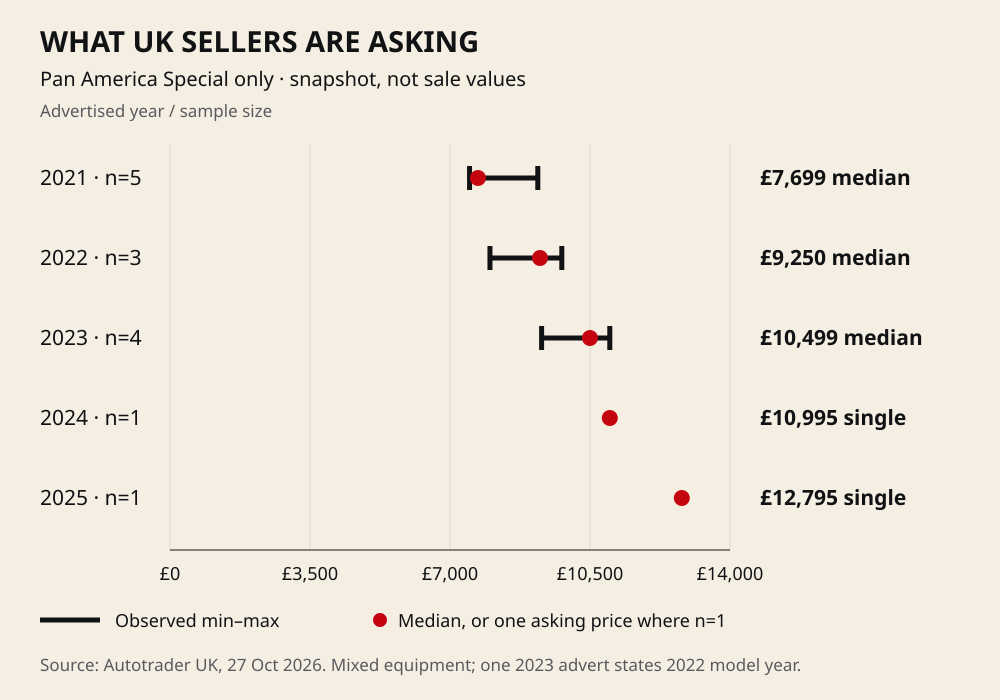

| Advertised year | Special adverts | Lowest ask | Median ask | Highest ask |
| --- | --- | --- | --- | --- |
| 2021 | 5 | £7,489 | £7,699 | £9,195 |
| 2022 | 3 | £7,999 | £9,250 | £9,795 |
| 2023 | 4 | £9,290 | £10,499 | £10,995 |
| 2024 | 1 | £10,995 | £10,995 | £10,995 |
| 2025 | 1 | £12,795 | £12,795 | £12,795 |

There are obvious limits. One bike is not a market median in any meaningful
population sense. The 2023 group includes an advert explicitly describing its
bike as **22MY**. Accessories, history, dealer preparation and warranty differ.
Some classified engine capacities are clearly inconsistent with the 1,252 cc
platform, so those fields must not be used to invent extra engine variants.

### Look at the individual asks, not only the medians

The small-multiple charts below keep each observed ask visible. They use the
**same zero-based £14,000 scale** for the three early Special groups. The seller
labels are shortened to fit; the complete identities and links are in the register.
They do not adjust for mileage, warranty, condition or accessories.

<figure style="min-width:0;margin:0"><a href="./asks-2021.svg">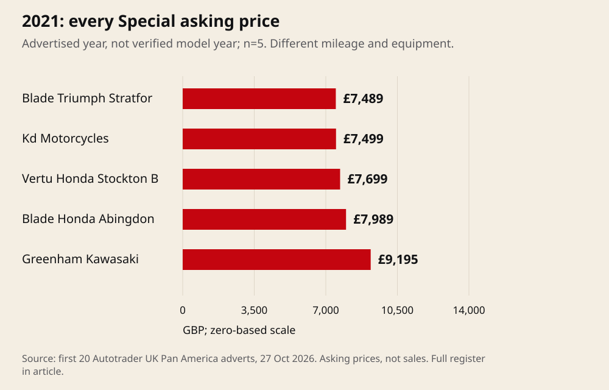</a><figcaption>2021 group, n=5: the highest ask is £1,706 above the lowest before any assessment of condition or equipment.</figcaption></figure>
<figure style="min-width:0;margin:0"><a href="./asks-2022.svg">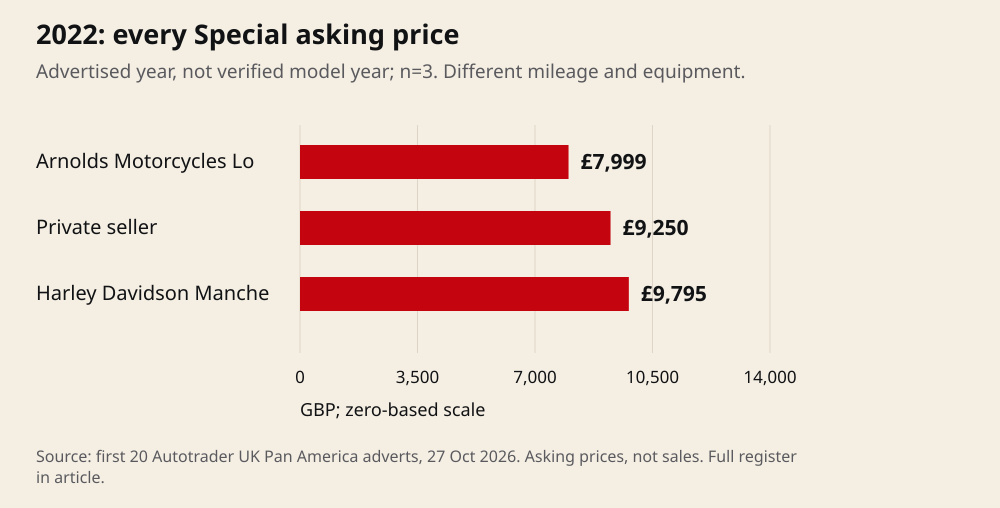</a><figcaption>2022 group, n=3: one private advert and two trade adverts; those are not identical sale propositions.</figcaption></figure>
<figure style="min-width:0;margin:0"><a href="./asks-2023.svg">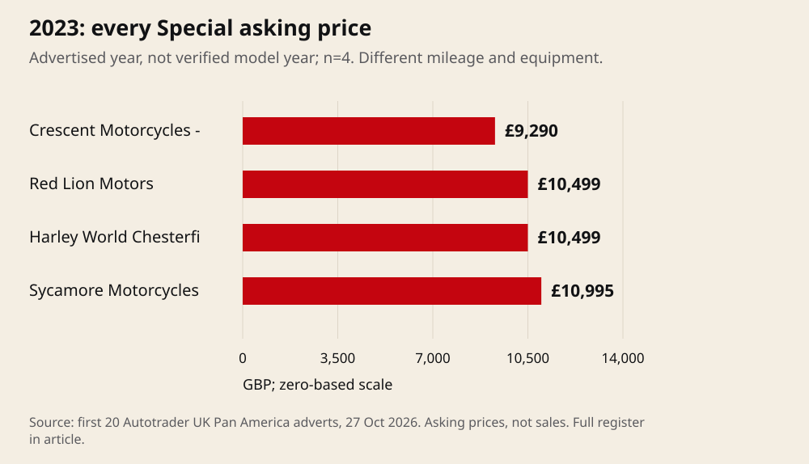</a><figcaption>2023 group, n=4: the cheapest explicitly says 22MY. The chart preserves the advert-year grouping instead of inventing a model-year correction.</figcaption></figure>
<figure style="min-width:0;margin:0"><a href="./st-asking-prices.svg">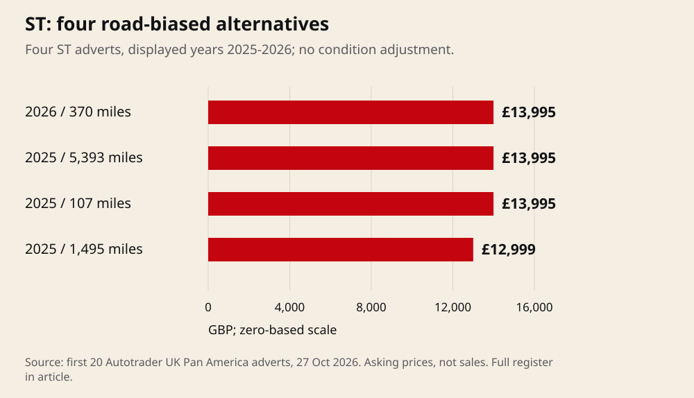</a><figcaption>ST sample, n=4, using a separate £16,000 scale. One advertised-2026 ST costs the same as two advertised-2025 STs.</figcaption></figure>

### Mileage explains less than an advert headline suggests

The scatter plot leaves all fourteen Special observations visible, with no fitted
line. It would take a larger, cleaned dataset to estimate a year-adjusted mileage
effect, and completed sales to estimate transaction values. A low-mileage machine
can also have little recent use, old consumables or overdue annual maintenance.

<figure style="min-width:0;margin:0"><a href="./mileage-price-scatter.svg">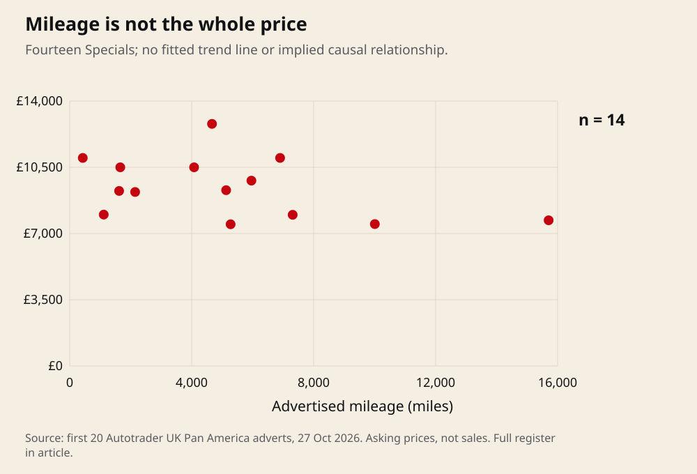</a><figcaption>Descriptive scatter only. It does not show that mileage causes a particular discount.</figcaption></figure>
<figure style="min-width:0;margin:0"><a href="./sample-mileage.svg">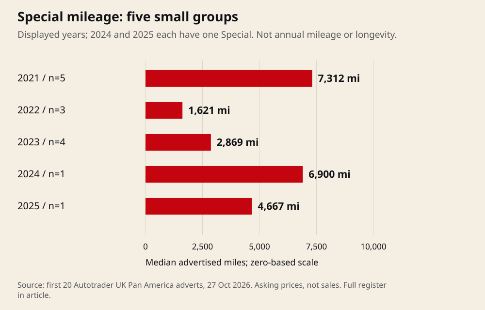</a><figcaption>Different mileage profiles help explain why a simple year-price comparison is incomplete. These are not annual mileage averages.</figcaption></figure>

### What I would take from these numbers

**The early bikes are genuinely cheaper in this sample.** The £7,699 MY2021
example and the £10,995 advertised-2024 Special are **£3,296 apart** before
condition, mileage, warranty and remedial work are considered. That can fund a
meaningful maintenance reserve. It does not prove that the older bike needs
£3,296 of repairs, or that it will need none.

**The 2023/2024 boundary deserves careful shopping.** The sample's 2023 median
asking price is only **£496 below** the single advertised-2024 bike. If those were
the actual alternatives and the latter is verified MY2024, I would investigate
the later bike first. It would be wrong to turn that one comparison into a
universal rule that all 2024s cost only £496 more.

<figure style="min-width:0;margin:0"><a href="./special-comparison.svg">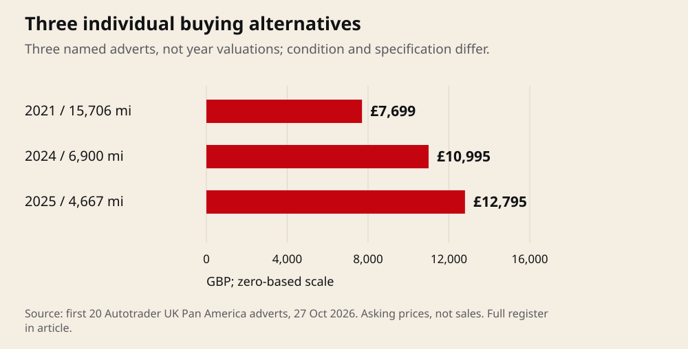</a><figcaption>Three actual alternatives, not three model-year valuations. The 2024 candidate needs VIN confirmation before its revision is assumed.</figcaption></figure>
<figure style="min-width:0;margin:0"><a href="./asking-price-brackets.svg">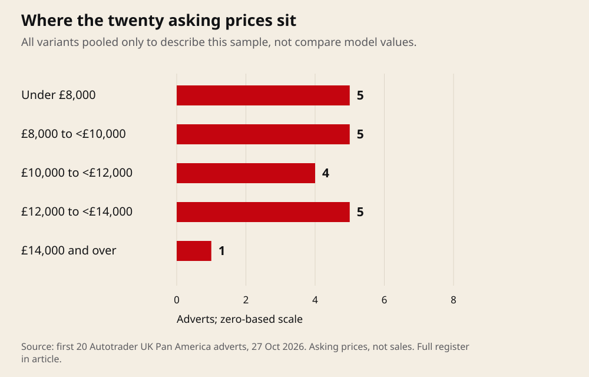</a><figcaption>Budget brackets for this page sample, mixing labelled variants only to describe availability—not to establish equal value.</figcaption></figure>

**A 2025 Special needs a reason for its premium.** The £12,795 example is
**£1,800 above** that advertised-2024 bike, with different mileage and equipment.
It is described as MY2025 with luggage, ARH and accessories. The extra money can
make sense, but it is not buying a documented whole new generation.

**Do not pay nearly-new money without checking new offers.** The current UK
starting prices are £17,745 for a Special and £16,995 for an ST. Compare actual
written cash quotations, equipment, finance cost and warranty. A larger finance
contribution or lower monthly payment is not automatically a cheaper purchase.

<figure style="max-width:60rem"><a href="./uk-starting-prices.svg">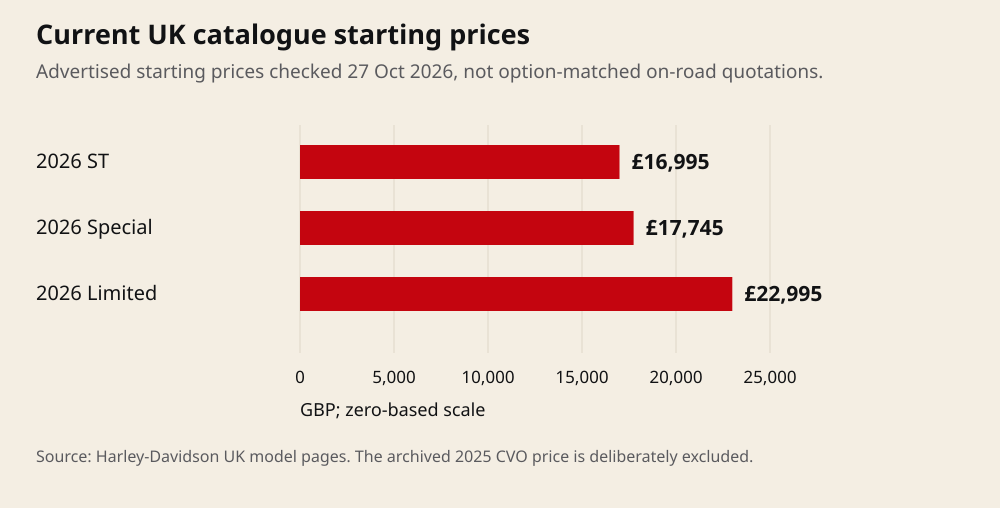</a><figcaption>Current 2026 UK catalogue starting prices, not option-matched delivered quotations. The archived MY2025 CVO price is deliberately not mixed into this current-range chart.</figcaption></figure>

### The twenty-advert register

These are **seller claims observed on the research date**, not recommendations of
individual motorcycles or endorsements of dealers. Prices exclude any additional
fees, delivery and finance costs unless the seller's final quotation says otherwise.
Listings can change or disappear. The model-year notes deliberately preserve
contradictions rather than quietly correcting the data.

| Advert / seller | Displayed year | Described version | Mileage shown | Asking price | Important qualification |
| --- | --- | --- | --- | --- | --- |
| [Maidstone Harley-Davidson][ad-01] | 2026 | Limited | 1,646 | £18,900 | Excluded from Special-only chart |
| [Sycamore Motorcycles][ad-02] | 2026 | ST | 370 | £13,995 | Excluded from chart |
| [Private seller, Wolverhampton][ad-03] | 2022 | Special | 1,621 | £9,250 | Only private advert in this twenty |
| [West Coast Harley-Davidson][ad-04] | 2025 | ST | 5,393 | £13,995 | Excluded from chart |
| [Cobb & Jagger][ad-05] | 2025 | Special | 4,667 | £12,795 | Description explicitly says MY2025 |
| [Crescent, Verwood][ad-06] | 2023 | Special | 5,130 | £9,290 | Description explicitly says **22MY** |
| [Harley-Davidson Manchester][ad-07] | 2022 | Special | 5,959 | £9,795 | Registration plate and year field need checking |
| [Arnolds, Loughborough][ad-08] | 2022 | Special | 1,116 | £7,999 | Classified engine-capacity field inconsistent |
| [KD Motorcycles][ad-09] | 2021 | Special / SP | 10,007 | £7,499 | Verify full specification |
| [Red Lion Motors][ad-10] | 2023 | Special | 1,659 | £10,499 | Model year unverified |
| [Vertu Honda Stockton][ad-11] | 2021 | Special | 15,706 | £7,699 | Title says 21MY; description claims ARH/laced wheels |
| [Newmarket Harley-Davidson][ad-12] | 2024 | Special | 6,900 | £10,995 | Dealer claims history, ARH and quickshifter; verify MY |
| [Blade Triumph Stratford][ad-13] | 2021 | Special | 5,277 | £7,489 | Classified engine-capacity field inconsistent |
| [Blade Honda Abingdon][ad-14] | 2021 | Special | 7,312 | £7,989 | Model year unverified |
| [Harley World Chesterfield][ad-15] | 2023 | Special | 4,079 | £10,499 | Model year unverified |
| [Sycamore Motorcycles][ad-16] | 2025 | ST | 107 | £13,995 | Excluded from chart |
| [Sycamore Motorcycles][ad-17] | 2023 | Special | 429 | £10,995 | Low mileage is not proof of completed annual maintenance |
| [KD Motorcycles][ad-18] | 2025 | ST | 1,495 | £12,999 | Excluded from chart |
| [Greenham Kawasaki][ad-19] | 2021 | Special | 2,146 | £9,195 | Above the other 2021 asks in this small sample |
| [Riders Motorcycles][ad-20] | 2025 | Base 1250 | 1,419 | £9,499 | Description says **2022 model year** and 1,314 miles; excluded |

That final advert is a useful warning about buying by the headline. It is not
evidence of a new MY2025 base bike, and its two mileage claims need reconciliation.

<figure style="max-width:60rem"><a href="./all-asking-prices.svg">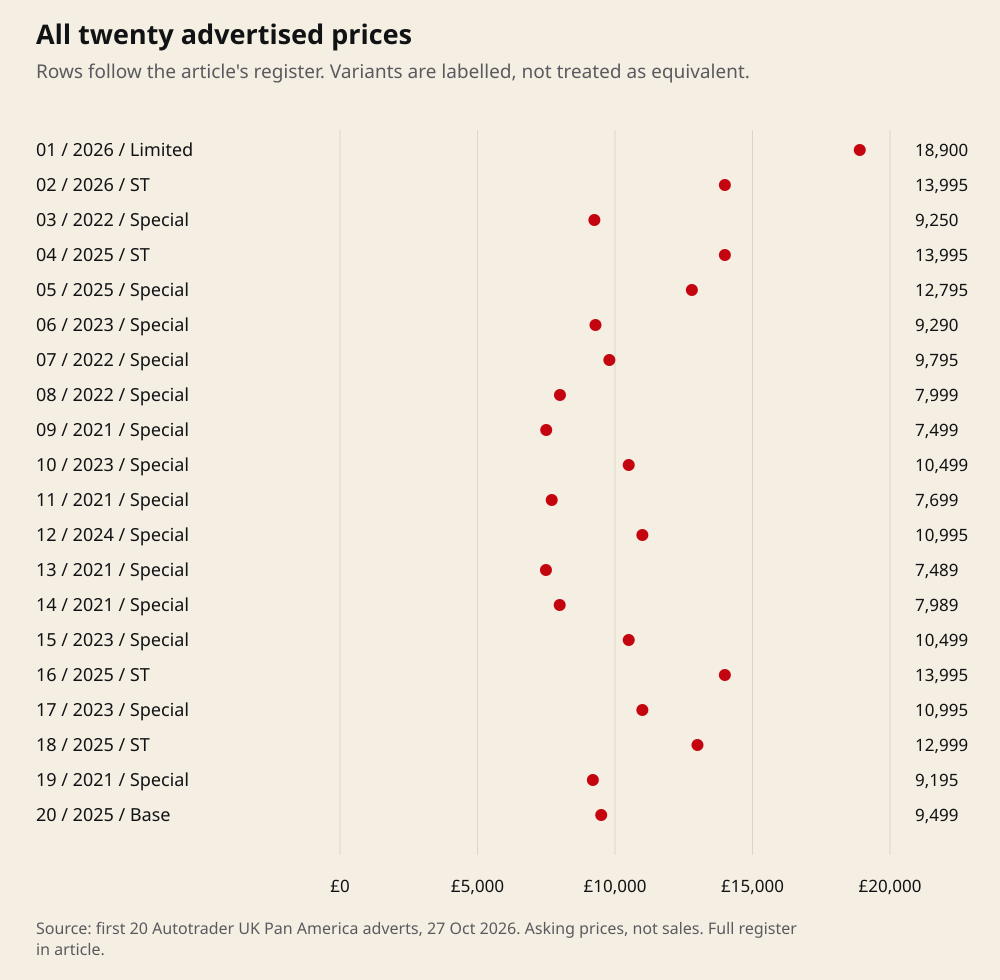</a><figcaption>The entire disclosed snapshot in register order. Numbered rows map directly to the twenty linked adverts, including the base and Limited.</figcaption></figure>

## Running costs: the purchase price is only the beginning

### Servicing and wear

Ask for the exact **VIN/model-year service schedule** and evidence of time-based
as well as mileage-based work. A very low-mileage example can still be overdue on
age. The advert claiming a "full service history" needs invoices showing what was
actually done.

The valve-lash system is an advantage, but budget for oil/filter work, fluids,
brakes, tyres, chain/sprockets, bearings, battery condition and suspension attention.
Ask a local workshop for written prices rather than borrowing a US labour bill
or assuming every Harley dealer charges the same amount.

Tyre choice matters as much as wheel appearance. A road ST, road-biased Special
and knobbly-tyred trail machine will not have identical tyre life, noise, wet-road
behaviour or replacement cost.

### Fuel: a transparent sensitivity calculation

The following is **an illustration**, not a measured Pan America economy result
and not a claim about today's pump price. At **6,000 miles a year**, an assumed
**£1.50 per litre**, and **imperial UK mpg**:

| Assumed economy | Litres per year, approximately | Fuel cost per year, rounded |
| --- | --- | --- |
| 40 mpg | 682 | £1,023 |
| 45 mpg | 606 | £909 |
| 50 mpg | 546 | £818 |

Formula: `annual miles / imperial mpg × 4.54609 × pounds per litre`.
Substitute your own mileage, observed consumption and local price.

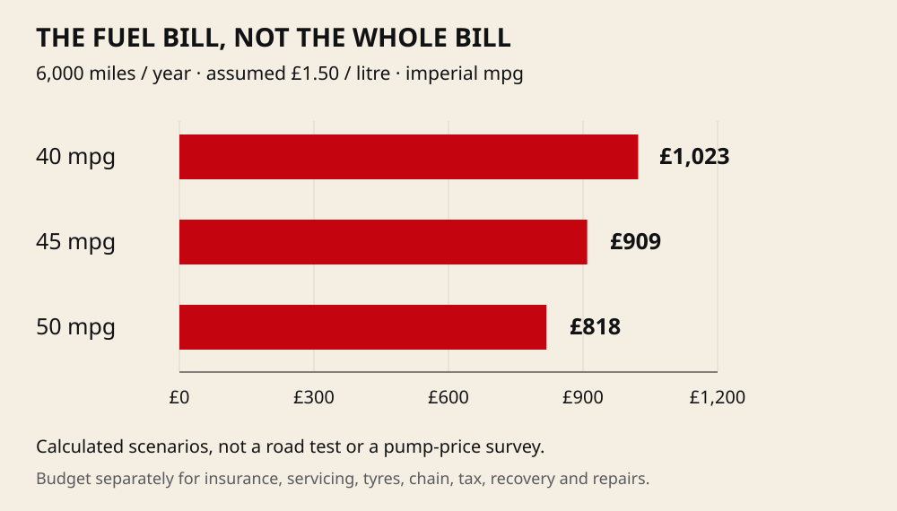

The difference between the 40 and 50 mpg scenarios is about **£205 a year**.
That helps put a supposed bargain into perspective: one omitted accessory key,
set of tyres or unresolved fault can matter more than a modest fuel saving.
This is not a prediction of which year uses less petrol.

The two sensitivity charts isolate **one assumption at a time**. The first holds
45 imperial mpg and £1.50/litre constant while changing annual mileage. The second
holds 6,000 miles and 45 mpg constant while changing the assumed pump price.
Neither establishes measured economy for a specific model year.

<figure style="min-width:0;margin:0"><a href="./fuel-mileage.svg">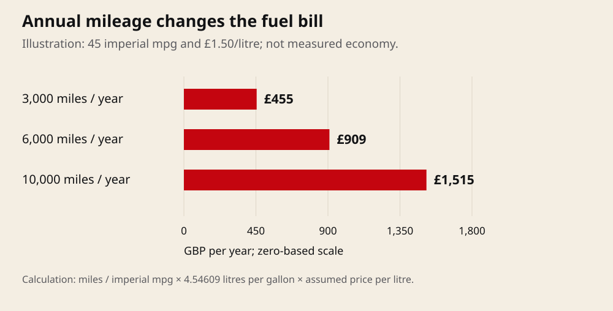</a><figcaption>How your use changes the budget: roughly £455, £909 and £1,515. Calculated examples, not real-world consumption tests.</figcaption></figure>
<figure style="min-width:0;margin:0"><a href="./fuel-pump-price.svg">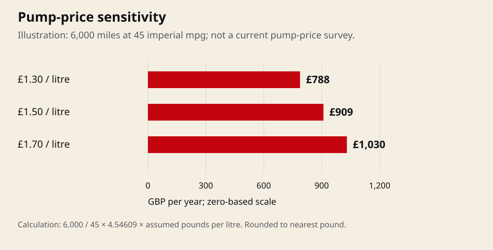</a><figcaption>Pump-price sensitivity: about £788, £909 and £1,030 per year under the stated assumptions. Not a forecourt-price survey.</figcaption></figure>

### Insurance, warranty and a repair reserve

Get an insurance quotation on the actual registration before paying a deposit.
Postcode, rider, storage, use, modifications and security can matter more than a
generic estimate for "a Harley". Tell the insurer about accessories and changes.

Read the warranty wording: duration, claim limit, labour contribution, diagnostics,
exclusions and whether ARH/electronic suspension are covered. A twelve-month
warranty with an exclusion for the very system worrying you is less useful than
the headline suggests.

<figure style="max-width:60rem"><a href="./warranty-checklist.svg">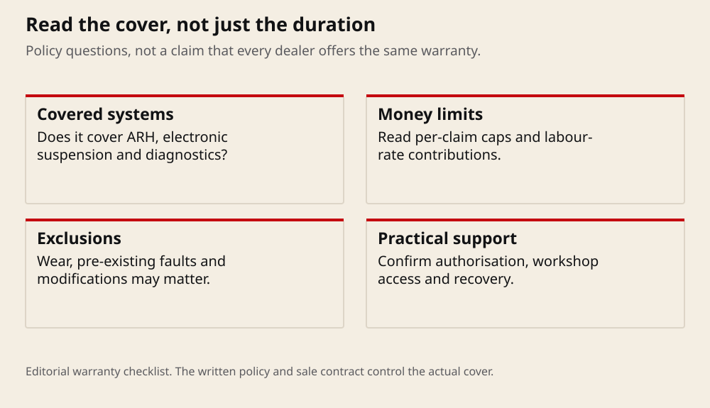</a><figcaption>Check what the written policy covers before assigning value to the warranty headline.</figcaption></figure>

I would retain a **four-figure contingency** rather than spend every available
pound on the motorcycle. That is my budgeting preference, not a quoted expected
repair bill. Separate ordinary servicing and wear from the money held for
unexpected repairs, and add tax, recovery and any luggage you still need.

## The viewing and test-ride checklist

Arrange these checks with the seller and, where appropriate, a qualified mechanic.
Ride only with permission, suitable insurance and a roadworthy motorcycle.
Do not attempt unsafe braking, traction-control or off-road "tests" on public roads.

### Before travelling

1. **Ask for model-year confirmation**, not just registration date. Request a
   dealer VIN check without publishing the full VIN in public.
2. Request service invoices, recall/update records, number of keys and details of
   financed ownership or an outstanding agreement.
3. Ask which options are fitted: ARH, cast or laced wheels, quickshifter, luggage,
   lighting and any electrical accessories.
4. Ask directly about previous non-starts, warning messages, recovery visits,
   accident repairs and any replaced charging/suspension components.
5. Agree to see the bike cold if possible. Obtain insurance and an independent
   vehicle-history check through a reputable service.

### At the motorcycle

1. Match the documents and identifiers; investigate discrepancies rather than
   assuming the advert is accurate.
2. Check tyres, rims/spokes, brakes, bearings, fork/shock leaks, chain and sprockets.
   Look underneath and behind protective bars for hidden impact damage.
3. Inspect wiring around accessories, the battery area and exposed connectors.
   Neat routing is not proof of a correct circuit, but obvious improvised work is
   a reason for professional inspection.
4. Check fluid condition/levels according to the manual and look for leaks.
   Do not remove a hot cooling-system cap.
5. Check TFT, switchgear, indicators, lights, heated grips and tyre-pressure display
   where fitted. Ask for stored diagnostic faults to be read and explained.
6. Confirm luggage locks, mounts, keys and the complete mounting kit. Test seat,
   screen and riding-position adjustments.

### On an appropriate ride

1. Assess cold-start behaviour and stable running; persistent warnings need
   diagnosis before continuing.
2. Try normal clutch-operated changes, then a fitted quickshifter within the
   manufacturer's instructions. Investigate repeated false neutrals.
3. Assess low-speed throttle/clutch behaviour, road modes and ordinary braking.
   Do not deliberately trigger emergency systems.
4. Have ARH demonstrated and confirm suspension settings make sense for your
   load. Check comfort, reach and wind protection in your own equipment.
5. After a normal ride, check the hot restart and for fresh leaks or warning
   messages. Have charging and battery condition professionally assessed.

### Reasons I would pause the purchase

- An unidentified model year sold at a "later revision" premium.
- Repeated starting faults excused by "it only needs charging".
- Persistent suspension, engine or charging warnings without a written diagnosis.
- Unexplained crash damage, questionable accessory wiring or mismatched paperwork.
- Claimed upgrades with no evidence of what parts were fitted.
- A seller refusing reasonable inspection or asking for payment before identity,
  ownership and condition can be checked.

Walking away is often cheaper than buying someone else's unresolved diagnostic
project.

<figure style="min-width:0;margin:0"><a href="./cold-hot-check.svg">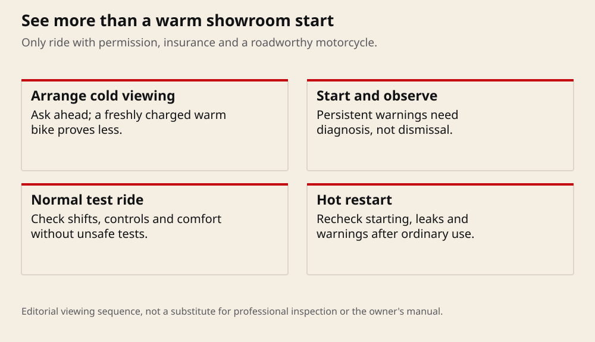</a><figcaption>A viewing sequence rather than a diagnostic guarantee. No test ride overrides a no-ride recall or an unresolved safety problem.</figcaption></figure>
<figure style="min-width:0;margin:0"><a href="./inspection-red-flags.svg">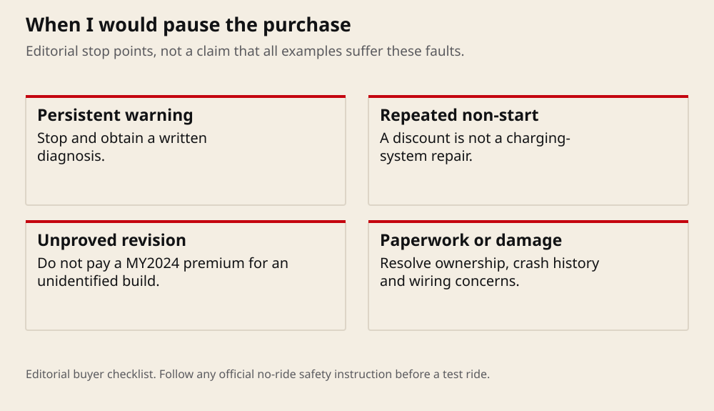</a><figcaption>Editorial stop points: diagnose or verify before paying, rather than assuming a discount cures the issue.</figcaption></figure>

## My final buying order

**First: a verified MY2024 Special.** It is the point where the evidence identifies
a meaningful electrical revision, and the dated UK sample shows why it is worth
comparing carefully with ambitious asking prices for earlier bikes. ARH would be
high on my list if seat height matters.

**Second: an equally good MY2025 Special.** Pay the extra for condition, useful
equipment and meaningful cover, not because you assume another major redesign.

**For road-only use: try the 2025-on ST before deciding.** Its chassis brief may be
a better answer than the taller Special, even though it is not my pick for
rougher-track capability.

**For value at the lower end: buy the best documented early bike, not simply the
youngest plate.** A sorted MY2022 can be a better buy than an unknown MY2023.
An exceptionally well-documented MY2021 can make financial sense, but it has to
earn its place with evidence and a genuine saving.

**CVO and Limited are equipment decisions.** They can be good buys when you want
the whole package at a sensible used price. Neither badge is proof of better
reliability.

The short version is not "never buy an early Pan America". It is:

> Start at model year 2024, then let condition, documented work, actual equipment
> and the price of the individual bike overrule the shortcut.

## Sources, market data and photograph licences

### Technical and model-year sources

- [BikeSocial: Pan America 1250 launch review][launch] — original engineering,
  equipment and road-test context; not long-term reliability evidence.
- [MCN: Pan America review][mcn] — independent launch-era assessment; owner
  submissions, where present, are anecdotal rather than fleet statistics.
- [Carandbike: 2022 update, 11 January 2022][update-2022] — TFT/hill-hold/colour
  changes; regional introduction dates are not treated as UK dates.
- [Ultimate Motorcycling: 2023 Special review, 9 March 2023][special-2023] —
  period evidence for the Special and optional/accessory equipment, not proof that
  each option was introduced that year.
- [ADV Pulse: CVO launch, 26 January 2024][cvo-launch] — first CVO model year and
  equipment; US pricing is not substituted for UK pricing.
- [Motorcycle.com: 2025 Special first ride][special-test] — retrospective account
  of MY2024 charging changes, plus actual later test criticisms; US equipment and
  pricing are not assumed to be UK specification.
- [Motorcycle.com: 2025 ST first ride][st-test] and [BikeSocial: UK ST
  review][st-uk] — road-biased variant and observed trade-offs.
- [Harley-Davidson UK: 2026 Special][special], [2026 ST][st] and [2026
  Limited][limited] — current model descriptions and starting prices, accessed
  27 October 2026.
- [Harley-Davidson UK: archived 2025 CVO][cvo] — archive, not evidence of a
  current-year CVO.
- [Harley-Davidson US: 2026 Special][special-us] — announced exhaust, engine-cover
  and graphic changes; regional fitment caveat applies.
- Harley-Davidson's US technical specifications: [2025 Special][us-2025-special],
  [2025 ST][us-2025-st], [2025 CVO][us-2025-cvo], [2026 ST][us-st] and
  [2026 Limited][us-limited] — manufacturer running-order weights, tank capacity
  and measurement labels; not independently measured UK bikes.
- [NHTSA: campaign 22V030000][cluster-recall] — official US safety-recall record.
- [GOV.UK: checking vehicle recalls][uk-recalls] — official route for checking UK
  motorcycles; confirm outstanding work on the actual VIN with Harley.

### Additional first-hand journal evidence

- [Cycle World: 2021 Big-Bore Adventure Shootout][cw-2021], Justin Dawes,
  21 December 2021 — instrumented three-day comparison; one 2021 Special.
- [Cycle World: 2022 Open-Class Adventure Comparison Test][cw-2022], Blake
  Conner, 2 September 2022 — measured results for a 2022 Special G.I.; overall
  test mileage is not Harley-only mileage.
- [RoadRUNNER: 2022 Pan America Special][roadrunner], Klaus Nennewitz,
  published 30 November 2023, page updated 7 May 2026 — 2,000-mile trip and
  reported 2023 detail changes. The page-update date does not make it a 2026-bike
  review.
- [Visordown: Living with the Pan America Special][visordown-living], Simon
  Hancocks, 8 October 2021 — two-week loan. His [25 June 2021 launch
  review][visordown-launch] is a separate, one-day ride, not another long-term
  ownership sample.
- [Adventure Bike Rider: Special review][abr], published 11 March 2022 —
  launch-period riding, rain and off-road-school experience; publication year
  does not turn its launch bike into verified MY2022 hardware.
- [Gear Patrol: first-person Pan America review][gear-patrol], Steve Mazzucchi,
  published 18 June 2021, updated 8 February 2023 — novice off-road experience on
  the launch bike, not a 2023-model test.
- [Autoevolution: 2022 Pan America road test][autoevolution], Sebastian Toma,
  30 December 2022 — road-only impressions; displayed/estimated economy and
  range are not treated as measurements.
- [Rider Magazine: video-review page][rider-excerpt], Kevin Duke,
  18 June 2021 — only the short accessible excerpt was readable; its
  subscriber-directed full review is not claimed as inspected evidence.

### Market-data method

Source: [Autotrader UK Pan America model page][market], accessed 27 October 2026.
The twenty linked adverts above are the first twenty results exposed on that
page, representing nineteen trade listings and one private listing. Only the
fourteen advertised Specials enter the price-range chart. Base, ST and Limited
examples are retained in the register but excluded from that calculation.

Groups use the displayed advert year; they are not corrected into guessed model
years. Medians use the middle value, or the mean of the two middle values, of each
group's asking prices. Mileage is miles and is reproduced from the listing field;
the Riders description's conflicting figure is disclosed. No bike was inspected.
No sale completion, stock availability, warranty promise or dealer description
was independently verified. There are no affiliate links.

The 32 graphics are original artwork for this article: **20 numerical charts or
calculations and 12 editorial explainers**. More graphics do not mean more
independent evidence. Price charts visualise the disclosed snapshot; fuel charts
visualise explicit assumptions; specification comparisons identify their sources.
None is an historical depreciation curve or a manufacturer reliability chart.

### What the wider research could and could not establish

The search also covered [Wikipedia's Pan America entry][wiki], owner-community
pages and additional motorcycle publications. Wikipedia is useful for discovering
references, but its mixture of announcement history and planned launch dates is
not a reason to relabel the **2021 production launch** as an earlier model year.
The year recommendations here follow dated production reviews and official
model pages instead.

Some ADVrider, PanAmericaForums and HDForums pages, and some magazine pages, were
blocked, gated or unavailable during this research. I did not bypass those
restrictions or treat search snippets as if I had read complete threads. The
accessible owner accounts inform the inspection questions, not a claimed forum
consensus, a failure percentage or an assertion that every reported problem is
fixed on a certain year. This is a broad, source-linked desk guide, **not an
exhaustive reading of every journal or forum, a six-year ownership test or a
complete UK recall register**.

### Photograph register

The photographs are illustrative older images, not current-model publicity
photographs or evidence of the specification of an advertised bike. The ten
photographic views comprise **six source photographs and four labelled detail
crops**, not ten independent motorcycles or ten additional pieces of evidence.

| Local image | Photographer and original | Reuse licence | Changes |
| --- | --- | --- | --- |
| `panamerica-event.webp` | Frank Schwichtenberg, [Hamburg Harley Days 2022 06][photo-event], photographed 26 June 2022 | [CC BY-SA 4.0][cc] | Resized to 1,200 px wide, converted to WebP; no crop |
| `panamerica-2023.webp` | Olinone, [Harley-Davidson Pan America (2023)][photo-showroom], photographed 19 September 2023 | [CC BY-SA 4.0][cc] | Resized to 1,200 px wide, converted to WebP; no crop |
| `panamerica-hamburg-rear.webp` | Frank Schwichtenberg, [Hamburg Harley Days 2022 07][photo-hamburg-07], photographed 26 June 2022 | [CC BY-SA 4.0][cc] | Resized to 1,200 px wide, converted to WebP; no crop; another view of the same modified bike |
| `panamerica-bangkok.webp` | Tris T7, [Bangkok Motor Show photograph 28][photo-bangkok], photographed 23 March 2022 | [CC BY-SA 4.0][cc] | Resized to 1,200 px wide, converted to WebP; no crop; visually identified Pan America, model year not verified |
| `panamerica-pair.webp` | Ride Local Dream Global – Mike Mekinda, [Panamerica and Livewire][photo-pair], photographed 3 July 2021 | [CC BY 2.0][cc-by] | Resized to 1,200 px wide, converted to WebP; no crop; Pan America left, LiveWire right |
| `panamerica-museum.webp` | Michael Barera, [Harley-Davidson Museum May 2024 29][photo-museum], photographed 6 May 2024 | [CC BY-SA 4.0][cc] | Resized to 1,200 px wide, converted to WebP; no crop; uploader identifies a 2023 Special |
| `front-wheel-detail.webp` | Frank Schwichtenberg, [Hamburg 06 original][photo-event] | [CC BY-SA 4.0][cc] | A 470 × 420 px wheel/brake detail crop from the resized image, converted to WebP |
| `engine-protection-detail.webp` | Frank Schwichtenberg, [Hamburg 07 original][photo-hamburg-07] | [CC BY-SA 4.0][cc] | A 480 × 390 px engine/protection crop from the resized image, converted to WebP |
| `controls-detail.webp` | Tris T7, [Bangkok original][photo-bangkok] | [CC BY-SA 4.0][cc] | A 650 × 310 px handlebar/control crop from the resized image, converted to WebP |
| `seat-luggage-detail.webp` | Olinone, [showroom original][photo-showroom] | [CC BY-SA 4.0][cc] | A 640 × 340 px seat/rear-rack crop from the resized image, converted to WebP |

The adapted BY-SA photographs remain under **CC BY-SA 4.0**; Mike Mekinda's
photograph remains under **CC BY 2.0**, separately from the site's code licence.
Credit and licence links apply to the photographs, not an endorsement
by their photographers or Harley-Davidson.

[launch]: https://www.bennetts.co.uk/bikesocial/reviews/bikes/harley-davidson/pan-america-1250-2021
[mcn]: https://www.motorcyclenews.com/bike-reviews/harley-davidson/pan-america/2021/
[update-2022]: https://www.carandbike.com/news/2022-harley-davidson-pan-america-1250-unveiled-with-updates-2702277
[special-2023]: https://ultimatemotorcycling.com/2023/03/09/2023-harley-davidson-pan-america-special-review/
[cvo-launch]: https://www.advpulse.com/adv-news/harley-davidson-launches-cvo-pan-america-for-2024/
[special-test]: https://www.motorcycle.com/bikes/manufacturer/harley-davidson/2025-harley-davidson-pan-america-1250-special-review-first-ride-44650108
[st-test]: https://www.motorcycle.com/bikes/manufacturer/harley-davidson/2025-harley-davidson-pan-america-1250-st-review-first-ride-44649622
[st-uk]: https://www.bennetts.co.uk/bikesocial/reviews/bikes/harley-davidson/pan-america-1250-st-2025-review
[special]: https://www.harley-davidson.com/gb/en/motorcycles/pan-america-1250-special.html
[special-us]: https://www.harley-davidson.com/us/en/motorcycles/pan-america-1250-special.html
[us-2025-special]: https://www.harley-davidson.com/us/en/motorcycles/2025/pan-america-1250-special.html
[us-2025-st]: https://www.harley-davidson.com/us/en/motorcycles/2025/pan-america-1250-st.html
[us-2025-cvo]: https://www.harley-davidson.com/us/en/motorcycles/2025/cvo-pan-america.html
[us-st]: https://www.harley-davidson.com/us/en/motorcycles/pan-america-1250-st.html
[us-limited]: https://www.harley-davidson.com/us/en/motorcycles/pan-america-1250-limited.html
[wiki]: https://en.wikipedia.org/wiki/Harley-Davidson_Pan_America
[cw-2021]: https://www.cycleworld.com/story/motorcycle-reviews/big-bore-adventure-shootout-comparison/
[cw-2022]: https://www.cycleworld.com/story/motorcycle-reviews/open-class-adventure-bikes-comparison-test-2022/
[roadrunner]: https://www.roadrunner.travel/motorcycles/review-2022-harley-davidson-pan-america-1250-special/
[visordown-living]: https://www.visordown.com/features/general/living-harley-davidson-pan-america-1250-special
[visordown-launch]: https://www.visordown.com/news/general/harley-davidson-pan-america-1250-road-test-and-video-review
[abr]: https://www.adventurebikerider.com/article/harley-davidson-pan-america-1250-special-review/
[gear-patrol]: https://www.gearpatrol.com/cars/motorcycles/a36315027/2021-harley-davidson-pan-america-review/
[autoevolution]: https://www.autoevolution.com/news/ridden-harley-davidson-pan-america-1250-freedom-to-roam-and-torque-for-all-207422.html
[rider-excerpt]: https://ridermagazine.com/video-harley-davidson-pan-america-review/
[st]: https://www.harley-davidson.com/gb/en/motorcycles/pan-america-1250-st.html
[limited]: https://www.harley-davidson.com/gb/en/motorcycles/pan-america-1250-limited.html
[cvo]: https://www.harley-davidson.com/gb/en/motorcycles/2025/cvo-pan-america.html
[cluster-recall]: https://api.nhtsa.gov/recalls/campaignNumber?campaignNumber=22V030
[uk-recalls]: https://www.gov.uk/check-vehicle-recall
[market]: https://www.autotrader.co.uk/bikes/motorcycles/harley-davidson/pan-america
[ad-01]: https://www.autotrader.co.uk/bike-details/202610247295038
[ad-02]: https://www.autotrader.co.uk/bike-details/202610207158389
[ad-03]: https://www.autotrader.co.uk/bike-details/202610187106341
[ad-04]: https://www.autotrader.co.uk/bike-details/202610187101733
[ad-05]: https://www.autotrader.co.uk/bike-details/202610167061929
[ad-06]: https://www.autotrader.co.uk/bike-details/202610126910904
[ad-07]: https://www.autotrader.co.uk/bike-details/202610096839206
[ad-08]: https://www.autotrader.co.uk/bike-details/202610096828900
[ad-09]: https://www.autotrader.co.uk/bike-details/202610086817259
[ad-10]: https://www.autotrader.co.uk/bike-details/202610066738096
[ad-11]: https://www.autotrader.co.uk/bike-details/202610066734461
[ad-12]: https://www.autotrader.co.uk/bike-details/202610066729710
[ad-13]: https://www.autotrader.co.uk/bike-details/202610066706894
[ad-14]: https://www.autotrader.co.uk/bike-details/202610026620841
[ad-15]: https://www.autotrader.co.uk/bike-details/202609306523190
[ad-16]: https://www.autotrader.co.uk/bike-details/202609296485405
[ad-17]: https://www.autotrader.co.uk/bike-details/202609296484993
[ad-18]: https://www.autotrader.co.uk/bike-details/202609286473709
[ad-19]: https://www.autotrader.co.uk/bike-details/202609286445974
[ad-20]: https://www.autotrader.co.uk/bike-details/202609266406336
[photo-event]: https://commons.wikimedia.org/wiki/File:Hamburg_Harley_Days_2022_06.jpg
[photo-showroom]: https://commons.wikimedia.org/wiki/File:Harley-Davidson_Pan_America_(2023).jpg
[photo-hamburg-07]: https://commons.wikimedia.org/wiki/File:Hamburg_Harley_Days_2022_07.jpg
[photo-bangkok]: https://commons.wikimedia.org/wiki/File:Harley-Davidson_in_The_43rd_Bangkok_International_Motor_Show_by_TrisT_28.jpg
[photo-pair]: https://commons.wikimedia.org/wiki/File:Harley-Davidson_Panamerica_and_Livewire.jpg
[photo-museum]: https://commons.wikimedia.org/wiki/File:Harley-Davidson_Museum_May_2024_29_(2023_Pan_America_1250_Special).jpg
[cc]: https://creativecommons.org/licenses/by-sa/4.0/
[cc-by]: https://creativecommons.org/licenses/by/2.0/
