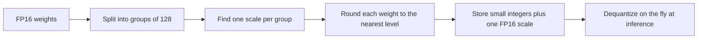
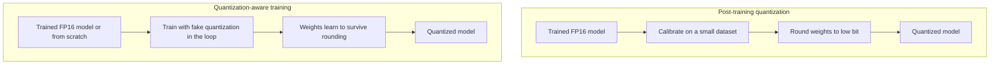
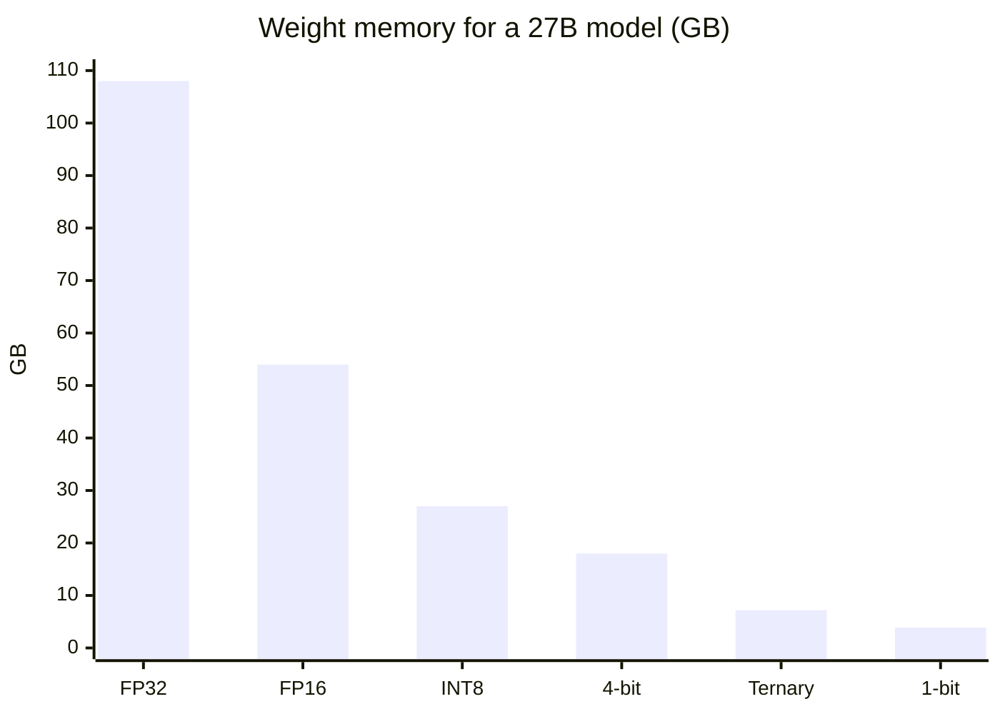

A 27 billion parameter model normally needs about 54 GB of memory. Bonsai 27B, a 1-bit build of Qwen3.6-27B
from PrismML, ships in about 3.9 GB. That is small enough for a recent phone. The obvious question is what
was thrown away, and whether the thing that comes out is still the same model.

This post is my attempt to answer that from the ground up: what a weight is, what quantization does to it,
where the bytes go, where the quality goes, and what Bonsai changes.

## The headline number: 65,536 to 2

A model weight is a number. In a normal full-precision release it is stored in 16 bits (FP16 or BF16).
Sixteen bits can form 2^16 = **65,536** distinct patterns. So each weight can take one of about 65 thousand
values.

A 1-bit weight has 2^1 = **2** patterns. That is the "65,000 to 1" idea, more precisely 65,536 down to 2.

| Bits per weight | Distinct values | Example format |
|---|---|---|
| 32 | about 4.29 billion | FP32 (training) |
| 16 | 65,536 | FP16 / BF16 (normal release) |
| 8 | 256 | INT8 / Q8 |
| 4 | 16 | INT4 / Q4 |
| 3 | 8 | Q3 |
| 2 | 4 | Q2 |
| about 1.58 | 3 | Ternary: {-1, 0, +1} |
| 1 | 2 | Binary: {-1, +1} |

Two caveats before the excitement. First, floating point formats do not spread their values evenly, and a
few of the 65,536 patterns are NaN or infinity, so "65,536 values" is the right order of magnitude, not an
exact count of usable numbers. Second, a quantized weight is never stored alone. It comes with a scale
factor, which is why the real cost of "1-bit" is 1.125 bits, not 1. More on that below.

## What a weight looks like in memory

For reference, this is how the common 16-bit and 32-bit formats split their bits.

| Format | Sign | Exponent | Mantissa | Total | Range | Precision |
|---|---|---|---|---|---|---|
| FP32 | 1 | 8 | 23 | 32 | huge | high |
| FP16 | 1 | 5 | 10 | 16 | small (max about 65,504) | medium |
| BF16 | 1 | 8 | 7 | 16 | huge (same as FP32) | low |

BF16 keeps FP32's range and gives up precision, which is why it became the default for training and
release. The point for us: even at 16 bits, a weight is already an approximation. Quantization just pushes
that approximation much further.

## What quantization actually does

Quantization maps a large set of possible values onto a small set of levels, and stores the small index
instead of the original number. The basic recipe has four steps.



The simplest version is symmetric absmax quantization. Take a group of weights, find the largest absolute
value, and divide it so that value lands on the top level.

```
scale = max(|w|) / (largest integer level)
q     = round(w / scale)        # stored as a small integer
w_hat = q * scale               # what the model sees at inference
```

### A worked example

Four weights: `[0.12, -0.53, 0.98, -0.09]`. The largest magnitude is 0.98.

**8-bit** (levels from -127 to 127): scale = 0.98 / 127 = 0.00772.

| Original | q (stored) | Reconstructed | Error |
|---|---|---|---|
| 0.12 | 16 | 0.1235 | 0.0035 |
| -0.53 | -69 | -0.5325 | 0.0025 |
| 0.98 | 127 | 0.9800 | 0.0000 |
| -0.09 | -12 | -0.0926 | 0.0026 |

Errors are in the third decimal place. You will not see this in the output.

**4-bit** (levels from -7 to 7): scale = 0.98 / 7 = 0.14.

| Original | q (stored) | Reconstructed | Error |
|---|---|---|---|
| 0.12 | 1 | 0.14 | 0.02 |
| -0.53 | -4 | -0.56 | 0.03 |
| 0.98 | 7 | 0.98 | 0.00 |
| -0.09 | -1 | -0.14 | 0.05 |

Errors are now in the second decimal place, and the small weight -0.09 got 55% larger in magnitude.

**1-bit** (sign only, with one shared scale). For binary weights the scale that minimises squared error is
the mean absolute value: (0.12 + 0.53 + 0.98 + 0.09) / 4 = 0.43.

| Original | q (stored) | Reconstructed | Error |
|---|---|---|---|
| 0.12 | +1 | +0.43 | 0.31 |
| -0.53 | -1 | -0.43 | 0.10 |
| 0.98 | +1 | +0.43 | 0.55 |
| -0.09 | -1 | -0.43 | 0.34 |

Now every weight is wrong, some by a lot. The big weight 0.98 collapsed to 0.43. This is the raw cost of
1-bit: you keep the sign and roughly the average size, and lose almost everything else. A single weight like
this is hopeless. The reason it can work at all is that a model has billions of weights and the errors are
spread across them, with the sign pattern carrying most of the structure. Making that survive is the hard
part, and it is why Bonsai is interesting.

### The level picture

```
FP16:   ... 65,536 patterns, dense ...............................................
INT8:   |  |  |  |  |  |  |  |  |  |  |  |  |  |  |  |  |   (256 levels)
INT4:   |     |     |     |     |     |     |     |     |     (16 levels)
Ternary:      |                 |                 |           (-s, 0, +s)
Binary:             |                       |                 (-s, +s)
```

Each time you drop a bit, the gap between levels doubles. That is the whole story of quantization error in
one sentence.

### How fast the error grows

For rounding to evenly spaced levels with step size Δ, the error variance is roughly Δ² / 12. Remove one
bit and Δ doubles, so the error variance goes up 4x. That is the familiar rule of about 6 dB of
signal-to-noise per bit.

| Bits | Relative step size | Relative error variance |
|---|---|---|
| 8 | 1x | 1x |
| 6 | 4x | 16x |
| 4 | 16x | 256x |
| 3 | 32x | 1,024x |
| 2 | 64x | 4,096x |

This is a simplified picture (real weights are not uniformly distributed, and real quantizers do better than
plain rounding) but it explains the shape of the curve you see in practice: Q8 is essentially free, Q5 and
Q6 are close, and below 4 bits things get hard quickly.

## Scales, groups and the real cost of a bit

One scale for a whole weight matrix would be a disaster, because a single large weight would stretch the
scale for everything. So weights are quantized in small **groups**, typically 32, 64 or 128 weights, and
each group gets its own scale (and sometimes a zero-point).

```
Group of 128 weights:  [ q q q q q q q q ... q q q q ]  +  1 FP16 scale (16 bits)
                         128 x b bits                       16 bits
```

The scale is overhead, spread across the group:

> effective bits per weight = b + 16 / group_size

| Bits | Group size | Overhead | Effective bits/weight |
|---|---|---|---|
| 4 | 128 | 0.125 | 4.125 |
| 4 | 64 | 0.25 | 4.25 |
| 4 | 32 | 0.5 | 4.5 |
| 2 | 128 | 0.125 | 2.125 |
| 1 | 128 | 0.125 | **1.125** |
| 1.585 (ternary) | 128 | 0.125 | **1.71** |

That is exactly where Bonsai's numbers come from. The 1-bit build is quoted at 1.125 bits per weight: one
bit plus 16/128 for the group scale. The ternary build is quoted at 1.71: log2(3) = 1.585 bits of
information per ternary weight, plus the same 0.125 of scale overhead.

Smaller groups track the weights more closely and give better quality, but cost more bits. Choosing the
group size is one of the main quality-versus-size knobs.

## The outlier problem

The reason absmax quantization needs groups is outliers. Take four weights `[0.1, -0.2, 0.15, 10.0]` at
4-bit. The scale is 10 / 7 = 1.43, so:

| Original | q | Reconstructed |
|---|---|---|
| 0.1 | 0 | 0 |
| -0.2 | 0 | 0 |
| 0.15 | 0 | 0 |
| 10.0 | 7 | 10.0 |

One outlier erased every other weight in the group. Large language models are known for this. The LLM.int8()
work found that outlier features start appearing at around the 6.7B parameter scale, and activations are
usually worse than weights. A lot of quantization research is really outlier management: smaller groups,
keeping a few sensitive weights in higher precision, rescaling channels before rounding, or rotating the
weights so the outliers get spread out.

## Two ways to get a low-bit model



**Post-training quantization (PTQ)** takes a finished model and compresses it. It is cheap, takes minutes to
hours, and is what most people use. It works very well down to about 4 bits and gets progressively worse
below that.

**Quantization-aware training (QAT)** keeps the low-bit rounding inside the training loop, so the model
learns weights that survive being rounded. It is far more expensive but is how extremely low-bit models
(ternary, binary) get to useful quality. BitNet b1.58 from Microsoft Research is the best-known example of a
model designed around ternary weights from the start.

Some of the common PTQ names you will see:

| Method | Idea |
|---|---|
| RTN (round to nearest) | Plain rounding. The baseline. |
| GPTQ | Quantizes layer by layer and adjusts the remaining weights to compensate for the error already made. |
| AWQ | Protects the small fraction of weights that matter most, judged by activation size, by scaling them before rounding. |
| SmoothQuant | Moves outlier difficulty from activations into weights so both can be quantized. |
| GGUF k-quants (Q4_K_M etc.) | llama.cpp formats with block scales and a mix of bit widths across layers. |
| HQQ | Fast calibration-free quantization. Bonsai uses a 4-bit HQQ build for its vision tower. |

<!-- verify: I have not read PrismML's whitepaper, so I do not describe exactly how Bonsai was trained.
One third-party article claims it is a BitNet-style model trained from scratch, but PrismML describes it as
a compression of Qwen3.6-27B. Check the whitepaper before writing a "how Bonsai does it" section. -->

## The memory arithmetic for a 27B model

Size is just parameters times bits per weight, divided by 8 to get bytes.

> size in GB = parameters x bits per weight / 8 / 1,000,000,000

For 27 billion parameters:

| Format | Bits/weight | Size | vs FP16 |
|---|---|---|---|
| FP32 | 32 | 108 GB | 2x bigger |
| FP16 / BF16 | 16 | 54 GB | 1x |
| INT8 | 8 | 27 GB | 2x smaller |
| Conventional 4-bit build | about 4.5 to 5 | about 18 GB | about 3x smaller |
| Ternary Bonsai (theoretical) | 1.71 | 5.8 GB | 9.4x smaller |
| Ternary Bonsai (deployed) | 2.125 | 7.2 GB | 7.5x smaller |
| 1-bit Bonsai | 1.125 | about 3.8 to 3.9 GB | about 14x smaller |

The ternary row has two sizes because today's kernels store ternary values in 2-bit slots, so the shipped
file is 7.2 GB rather than the 5.8 GB the information content would suggest. A tighter packing would
shrink it, at some decoding cost.



And in bits, to make the 65,536 to 2 point concrete:

| | Bits for all weights |
|---|---|
| FP16 | 27B x 16 = 432 billion |
| 1-bit Bonsai | 27B x 1.125 = about 30 billion |

### Weights are not the whole bill

The headline sizes are for the language model weights. At runtime you also pay for:

- **KV cache.** Grows linearly with context. Roughly `2 x layers x KV heads x head dim x context length x bytes per element`. Bonsai advertises a 262K context, and at long contexts the cache can rival the weights. Quantizing weights does nothing to it.
- **Activations and runtime buffers.**
- **The vision tower.** Bonsai ships it separately in 4-bit.

This is why a phone with 12 GB of RAM, of which maybe 6 GB is usable for a model, is a tight fit even for a
3.9 GB file.

## Smaller is also faster (sometimes)

Generating a token means reading essentially every weight once. For a single user on a laptop or phone this
is limited by memory bandwidth, not compute. The ceiling on speed is roughly:

> tokens per second <= memory bandwidth / model size in bytes

On a hypothetical machine with 100 GB/s of memory bandwidth:

| Format | Size | Upper bound |
|---|---|---|
| FP16 | 54 GB | 1.9 tok/s |
| 4-bit | 18 GB | 5.6 tok/s |
| Ternary | 7.2 GB | 13.9 tok/s |
| 1-bit | 3.9 GB | 25.6 tok/s |

These are ceilings, not predictions. Reality is lower because low-bit weights have to be unpacked back into
something the hardware can multiply, and that unpacking costs cycles. PrismML's reported numbers use custom
kernels: up to 163 tok/s for 1-bit and 134 tok/s for ternary on an RTX 5090, and 87 and 58 tok/s on an M5
Max. Some people report no real gain over a plain Q4 build of the same base model on stock runtimes, so I
treat the speed claims as hardware and runtime dependent.

## What lower-bit models lose

This is the part that matters most, and it is more nuanced than "it gets dumber".

**It is not uniform.** Quantization noise does not hit every capability equally. Roughly in the order things
tend to break as you go lower:

1. **Perplexity** creeps up first. This is the cheap, standard metric and it is the first to show damage.
2. **Precise recall.** Exact facts, rare names, numbers and code syntax.
3. **Long multi-step reasoning.** A small error per token compounds over a long chain of thought. This is my intuition for why reasoning suffers more than short answers.
4. **Structured output and tool calling.** A wrong bracket or key name breaks a JSON call completely, so these tasks have zero tolerance for small errors.
5. **Multilingual and long-tail behaviour.** Less-represented languages and unusual domains tend to degrade before English chat does.

**Bigger models tolerate it better.** A 27B model has far more redundancy than a 4B one, so a 27B model at 2
bits can still beat a 4B model at 8 bits for a similar memory cost. This is the entire premise of going
extremely low-bit on a large model.

**Which layers are quantized matters.** Conventional low-bit builds usually keep the embeddings, the output
head and the normalization layers at higher precision because they are small and sensitive. PrismML says
Bonsai applies its low-bit format end to end across the language network, including embeddings, attention,
MLPs and the LM head.

### What Bonsai 27B reports

| | Qwen3.6-27B FP16 | Ternary Bonsai | 1-bit Bonsai |
|---|---|---|---|
| Weights | 16-bit | {-1, 0, +1} | {-1, +1} |
| Effective bits/weight | 16 | 1.71 | 1.125 |
| Deployed size | about 54 GB | about 7.2 GB | about 3.9 GB |
| Overall quality vs baseline | 100% | higher retention than 1-bit | about 90% (score 76.1) |
| Tool calling score | 80.0 | 74.0 | 66.0 |
| Tool calling retention | 100% | 92.5% | 82.5% |

<!-- verify: I did not find a single overall ternary retention figure in the sources I read. Fill from the whitepaper. -->

The pattern matches the list above. Overall, the 1-bit build keeps about 90% of the original, and the
vendor's wider claim is that Bonsai retains roughly 90 to 95% of the source model across the family. But
tool calling, the strictest task in the list, drops much further for 1-bit: 66.0 against 80.0.

These are vendor numbers. The relative claim is easy to test independently, and I intend to.

## Why "1-bit" needs an asterisk

- **Ternary is not 1 bit.** A weight in {-1, 0, +1} carries 1.585 bits of information. It is a trit.
- **1.125 is the honest 1-bit figure.** The extra 0.125 is the scale for each group of 128.
- **The headline size excludes runtime costs.** KV cache, activations and the vision tower come on top.
- **Speed is not automatic.** See the section above.
- **It is a compression of an existing model**, not a new model trained at 27B. The ceiling for Bonsai is the quality of Qwen3.6-27B. That is a good thing to know when reading the scores.

## Putting it back into quality per GB

In the last post I suggested dividing quality by size, and one published approach divides the negative log
of the error rate by size. Using just the tool calling scores above, with error rate as 1 minus score:

| Model | Score | Size (GB) | Score / GB | -ln(error) / GB |
|---|---|---|---|---|
| Qwen3.6-27B FP16 | 80.0 | 54 | 1.48 | 0.030 |
| Ternary Bonsai | 74.0 | 7.2 | 10.3 | 0.187 |
| 1-bit Bonsai | 66.0 | 3.9 | 16.9 | 0.277 |

By either measure the 1-bit build wins by a wide margin. The log version is gentler on the low-bit models
than the plain ratio, because it rewards the full-precision model for its much lower error, but it still
cannot make up a 14x size difference. Whether that is the fair way to count is the question the next post
is for. A model that is 82% as good at tool calling is not a model I would use for an agent, however many
GB it saves.

## What I will test

I want to check these claims on my own hardware rather than repeat a vendor table.

- Fix a task set, including at least one that needs strict structured output.
- Run the same base model at FP16, Q8, Q4 and the Bonsai builds.
- Record quality, memory in use at a realistic context length, and tokens per second on the same machine.
- Plot quality against GB and see where the curve bends.

> Memory is the budget. Bits are how you spend it.

## Sources

- PrismML, [Bonsai 27B announcement](https://prismml.com/news/bonsai-27b)
- [Bonsai 27B on LM Studio](https://lmstudio.ai/models/bonsai-27b)
- [PrismML Bonsai demo repo](https://github.com/PrismML-Eng/Bonsai-demo)
- [Bonsai 27B review, LocalClaw](https://localclaw.io/blog/bonsai-27b-local-ai)
- Dettmers et al., LLM.int8() (outlier features)
- Ma et al., The Era of 1-bit LLMs (BitNet b1.58)
